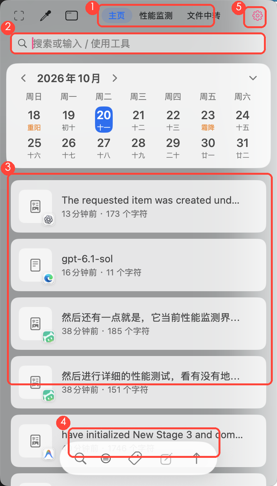
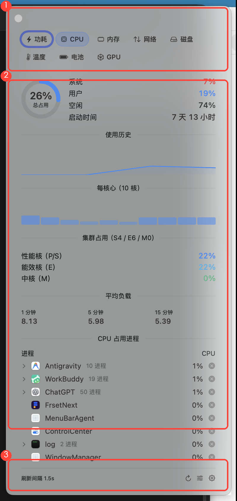
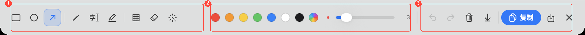
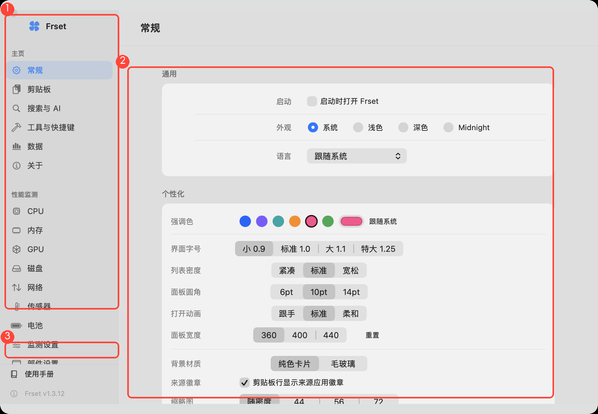
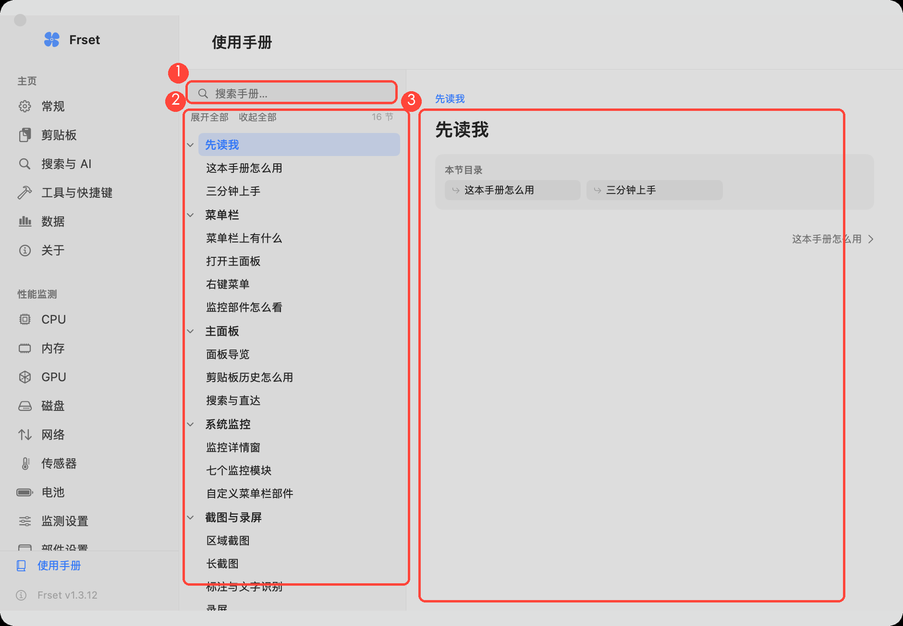

# Kitnest 使用手册

## 先读我

### 这本手册怎么用

这本手册写给**使用者**，不是写给开发者。每一节只讲三件事：

- 这个功能**能帮你做什么**；
- 在**哪里**能找到它；
- **怎么用**（几步就能完成）。

图中的**红色圆圈和编号**标出了你要看、要点的位置，图下面的文字按编号逐一解释。左侧目录可以像文件夹一样一层层展开，也可以直接在搜索框里搜关键词。

### 三分钟上手

1. **第一次启动**会弹出**欢迎窗**：一页看完所有功能、常用快捷键，最后一行是「权限引导」——建议顺手点开，把截图/快捷键要用的两项系统权限授了（约 30 秒）。
2. 启动后，它住在**屏幕右上角的菜单栏**里，不占 Dock。
3. 点菜单栏上的小猫图标 → 打开**主面板**（也可以按 ⌥A）。
4. 主面板里最常用的三件事：**找回刚复制的内容**、**截图**、**看电脑状态**。
5. 需要更多设置时，点面板右上角的齿轮。

就这些。剩下的内容可以当字典，用到哪查到哪。欢迎窗关掉了也不用找——菜单栏图标右键 →「欢迎与权限…」随时可以再看。

## 菜单栏

### 菜单栏上有什么

1. **监控部件**：实时显示电脑状态的小数据条（图中是电池功率 PPBR 和网络状态）。点一下就能看到对应模块的详情。
2. **主图标**（图中的小猫）：整个应用的入口。左键打开主面板，右键弹出功能菜单。

部件显示什么、显示几个，都可以在「设置 → 部件设置」里改；不想要部件也完全可以关掉，只留主图标。

### 打开主面板

- **左键**点主图标；
- 或者按快捷键 **⌥A**；
- 或者在浏览器/终端里打开 `frsetnext://panel`。

面板会从图标下方展开，再点一次图标（或按 Esc、点面板外面）就会收起。

### 右键菜单

右键点主图标，会看到一个简洁的菜单，常用入口都在这里：

- 打开主面板 / 打开设置；
- 性能监测、使用统计；
- **欢迎与权限…**：重新打开欢迎窗；里面的「权限引导」可以随时查看四项系统权限的状态并一键去授权；
- **检查更新…**：手动检查新版本（更新源在「设置 → 关于」里配置）；
- 显示哪些菜单栏图标；
- 退出 Kitnest。

### 监控部件怎么看

部件就是「不用打开任何窗口就能瞄一眼」的数据条，例如：

- **CPU**：当前占用百分比或小折线；
- **网络**：上行/下行速度；
- **电池/传感器**：电量、功率、温度等。

鼠标**悬停**在部件上会显示说明；**左键**点部件 → 打开该模块的详情窗；**右键**点部件 → 直接切换它的显示样式。

## 主面板

### 面板导览

1. **顶部页签**：在「主页 / 监测 / 中转 / 投屏」之间切换（左右切换的胶囊栏；鼠标悬停有全名提示：性能监测、文件中转）。旁边还有截图、标注、图钉等快捷按钮。
2. **搜索框**：输入关键词，直接在你的剪贴板历史里找内容；输入 `/` 还能当工具启动器用。
3. **剪贴板历史**：你最近复制过的文字、图片、文件都在这里，最新的在最上面。
4. **底部工具条**：搜索、筛选、标签、编辑、上传等批量操作。
5. **设置**：打开设置窗口。

### 剪贴板历史怎么用

主面板的主体就是剪贴板历史，每一行是一条复制记录：

- **单击**一条 → 预览内容；
- **双击**（或按回车）→ 直接粘贴回当前应用；
- 右侧的小图标告诉你这条内容来自哪个应用；
- 输入框里打字就是搜索，支持模糊匹配；
- 右键一条记录 → 置顶、加标签、删除、清空等。

历史默认保留 30 天，容量上限 2GB，都可以在「设置 → 剪贴板」里调整。

### 搜索与直达

搜索框不仅能搜剪贴板：

- 输入普通文字 → 搜剪贴板历史；
- 输入 `/` → 进入工具模式，敲工具名直接执行（例如 `/hash`、`/qr`）；
- 输入网址 → 直接打开。

## 系统监控

### 监控详情窗

1. **模块切换**：一排小标签，点哪个看哪个（功耗、CPU、内存、网络、磁盘、传感器、电池、GPU）。
2. **数据区**：当前模块的实时数值、历史曲线和明细。窗口高度会自动贴合内容，短页面不会留大片空白。
3. **页脚**：立即刷新、打开部件设置、打开监测设置。

窗口可以用鼠标拖动；点窗口外面就收起。

### 七个监控模块

| 模块 | 能看到什么 | 适合什么时候看 |
|---|---|---|
| 功耗 | 当前输入/输出功率（瓦） | 想知道插电时充得多快、拔电时耗得多凶 |
| CPU | 总占用、每核心、集群、负载、占用最高的进程 | 电脑发烫、风扇响、卡顿 |
| 内存 | 已用/压缩/联动/可用、交换区、内存压力 | 开太多网页或程序时 |
| 网络 | 上行下行速度、连接状态、延迟、高占用进程、端口占用 | 网慢、视频卡、想知道谁在偷跑流量 |
| 磁盘 | 读写速度、容量、健康度（SMART）、高占用进程 | 拷贝大文件、硬盘异响 |
| 传感器 | 温度、电压、电流、功率、风扇转速 | 检查散热是否正常 |
| 电池 | 电量、健康度、循环次数、适配器功率 | 关心电池寿命、充电速度 |

**端口占用**（网络页最底部）：列出这台电脑当前正在监听哪些端口、被哪个程序占用，以及是否对局域网开放。

- 数字是端口号，旁边是协议（TCP / UDP）和占用它的程序名；
- 标着「全部接口」和橙色圆点的，表示同一局域网里的其他设备可能连进来；
- 点「对外」可以只看这类端口，排查「谁在外面开了服务」；
- 点击任意一行，会复制 `127.0.0.1:端口`，方便直接贴到浏览器或终端。

### 自定义菜单栏部件

「设置 → 部件设置」里可以给每个模块挑一种展示样式：

- **迷你**：只显示一个数值，最省地方；
- **折线图 / 柱状图 / 饼图**：看趋势；
- **速度**：上下两行显示上传和下载；
- **电池 / 标签 / 图标 / 状态点**等。

还能调模块之间的间距、分隔线，以及每个模块的刷新间隔。改完立即生效，不用重启。

## 截图与录屏

### 区域截图

按 **⌥S**（默认）进入截图：

1. 屏幕变暗，拖动鼠标框选区域；
2. 松开后出现工具条：复制、保存、贴图、识字、翻译、编辑、美化、**空投**；
3. 回车执行默认动作（或按你的设置保存到剪贴板）。

### 窗口截图

按 **⇧⌥W**（或主面板截图菜单 →「窗口截图」）进入**窗口选择**：

1. 屏幕变暗，鼠标移到哪个窗口，哪个窗口就整框高亮并显示「App 名 · 窗口名」；
2. **单击**截取该窗口——只截窗口本身，被别的窗口挡住的部分也会完整还原（不是屏幕截图裁剪）；
3. 截完同样弹出动作工具条；Esc 随时取消。

### 长截图

按 **⇧⌥L**，框选一个可滚动的区域（网页、聊天记录、长文档），它会自动滚动并把每一屏拼成一张长图。过程中按 Esc 随时停止。

### 标注与文字识别

截图后（或对剪贴板里的图片）可以：

- **标注**：画笔、箭头、矩形、序号、文字；
- **OCR 取字**：框住图片里的文字，直接变成可复制的文本；
- **翻译**：把图里的外文翻成中文；
- **钉图**：把截图钉在屏幕上当参考，可缩放、可调透明度；
- **取色**：吸取屏幕上任意位置的颜色值；
- **空投**：截图落盘后直接调起系统隔空投送，发给 iPhone / iPad；
- **识码**：识别截图里的二维码/条码（原版同款能力），自动复制内容，是链接可直接打开。

#### 标注编辑器怎么用

底部工具条从左到右分三区，鼠标悬停在任意按钮上都有提示：

- **① 工具区**：矩形、椭圆、箭头、画笔、文字、荧光笔、马赛克、橡皮、抹除，中间用细线分组。
- **② 样式区**：一排常用颜色 + 最后的彩虹圆点（点开可以取屏幕上任意颜色）；下面是粗细滑杆，左边的圆点实时预览大小，右边显示数值。
- **③ 操作区**：撤销、重做、清空、长截图，以及蓝色的「复制」按钮和保存、关闭。

也可以直接按键盘快捷键切换工具：`R` 矩形、`O` 椭圆、`A` 箭头、`P` 画笔、`T` 文字、`H` 荧光、`M` 马赛克、`E` 橡皮、`D` 抹除。

使用小技巧：

- **马赛克是画笔**：按住鼠标在要遮的地方涂抹即可，圈会跟着光标走，松手停；单击则落一个点。遮人脸、遮地址、遮手机号都用它。
- **马赛克粗细可调**：滑杆改笔刷大小；选中马赛克时样式区还会多出「块」的三档（6 / 10 / 16）——块越小越细腻，块越大越糊、越不容易被还原。
- **橡皮**是擦掉整条标注（点哪条删哪条）；**抹除**是像修图一样把物件涂掉，底图会自动补全。
- 撤销 `⌘Z`、重做 `⇧⌘Z`、复制 `⌘C`、保存 `⌘S`、关闭 `Esc`； `[` 和 `]` 也可以撤销/重做。
- 画错的标注不用重来，撤销就行，重做也随时能找回来。

### 录屏

截图区已提供一级「录屏」入口（面板截图区第 8 个格子），也可从面板顶部或菜单进入录屏：选择整屏或区域，设置帧率、分辨率、声音来源，开始录制。结束后可以直接导出 MOV / MP4 / GIF。

## 剪贴板

### 自动记录

开启后，你复制的**文字、图片、文件、链接**都会自动进历史，不需要任何操作。重复复制同一条内容不会重复占位。

### 找回与回贴

- 打开主面板 → 找到那条记录 → 双击粘贴；
- 或者在搜索框里搜关键词；
- 常用内容可以**置顶**，置顶的永远排在最上面。

### 清理与保留

- 单条删除：右键 → 删除；
- 全部清空：底部工具条 → 清空；
- 自动清理：超过保留天数或容量上限时，旧记录自动删除。

## AI 能力

### 能做什么

- **聊天**：在面板的 AI 页签里直接对话；
- **总结**：选中长文或剪贴板内容，一键生成摘要；
- **翻译**：中英互译、整段翻译；
- **自定义工具**：把常用的提示词存成小工具，随叫随用。

### 怎么配置

「设置 → 搜索与 AI → AI」里填入你使用的服务商和 API Key（支持多家主流服务，也支持本地模型）。Key 只保存在本机钥匙串里，不会上传。

## 工具箱

### 常用工具

面板的搜索框输入 `/` 可以直达这些工具：

- IP / 本机信息查询；
- 日历、农历、节假日；
- 哈希计算（MD5/SHA）、Base64；
- 二维码生成与识别；
- 媒体格式转换；
- 模糊搜索文件；
- 命令面板。

每个工具都是即用即走，不会在主界面堆按钮。

## 文件中转

主面板第三个页签（⌥T）。页面按**你要做的事**分成三段——发送 / 接收 / 云端，下面常驻「本地暂存」。

一句话记住它：**文件先进暂存（一个池子），再从三个出口发出去。**

### 发送

先在下方「本地暂存」里勾选文件（或点「+ 添加文件」），然后只看**对方是什么设备**——只有两类：

| 点哪个 | 对方是谁 | 会发生什么 |
|---|---|---|
| **苹果设备** | iPhone / iPad / Mac | 弹出系统隔空投送面板，选设备即发；对端零安装、速度最快 |
| **安卓 / 其他** | 安卓手机、Windows、任何有浏览器的设备 | 弹出二维码，对方扫一下用浏览器接收（也能反向传给你）；零安装 |

> 大文件或批量倒文件，用最下面那行小字「**ADB 直传**」更快（USB 3.0 可跑满 100MB/s），但要先在「投屏」页连一次设备（需开发者选项）。

**安卓想传给 iPhone 怎么办？** 安卓没有隔空投送（AWDL 是苹果私有协议，安卓做不到），所以走中转：
安卓扫码传到本机暂存 → 在暂存里勾选它 → 点「苹果设备」→ 空投给 iPhone。

### 接收

- **隔空投送**：iPhone 上选中文件 → 分享 → 隔空投送 → 本机，落盘后**自动进本地暂存**，不用任何操作（本机一直在监听）；
- **从手机拉取**：把手机 `Download/Kitnest/` 里的文件全部拉回暂存（走 ADB，需先在「投屏」页连一次设备）；
- **浏览器上传**：点「出码」，对方扫码打开网页，可以直接把文件传给你。

收到的文件都进「本地暂存」，不会散落在下载目录里。

### 云端（OPPO 中转站）

**和上面两条不是一回事**：隔空投送、ADB 都是「人在旁边、马上要」；云端中转是「存进去，之后在别的设备、别的时间取」。

- 需要登录 OPPO 账号（「设置 → 文件中转 → 云端中转」打开后本段才会出现，未登录时页面里有登录入口）；
- 适合出差、两台设备不在同一网络、或者隔天再取文件；
- 勾选暂存里的文件 →「加入云端」上传；云端列表里的文件可下载回本地；
- 登录态失效时点「刷新登录」，会从 Edge 读取一次 cookie（需先在 Edge 里登录中转站）。

### 本地暂存

所有来路的文件（空投接收、手机拉取、拖入、剪贴板复制的文档）都汇在这里，双列卡片，可勾选批量操作，悬停可预览。

### 悬停预览里能看到什么

在首页把鼠标停在剪贴板条目上（或直接单击打开），会弹出预览气泡：

- **压缩包**：直接列出包内条目，**每个文件用它自己的类型图标**（Word 是 Word 图标、PPT 是 PPT 图标、图片/PDF/APK 各按类型），带文件名和大小；气泡下方有「编辑归档 / 解压到…」；
- **Word / PPT / PDF**：显示文档首页大图（再点「快速查看」可以用系统 QuickLook 逐页翻）；
- **图片**：显示图片本身。

## 投屏

主面板第四个页签，是 **Android 设备中心**：连接设备、无线配对、镜像投屏都在这里。

### USB 投屏

1. 手机开启「开发者选项 → USB 调试」，数据线连电脑；
2. 点右上「检测设备」→ 列表出现设备；
3. 点「开始投屏」→ 弹出镜像窗（scrcpy 引擎）。

**镜像期间剪贴板双向同步**：电脑上复制的内容手机能粘，手机上复制的内容电脑能粘。

### 无线连接

**最省事：一键无线。** USB 连一次，点右上「一键无线」——它会自动执行 `adb tcpip 5555` 并连上手机 Wi-Fi 地址。之后同一 Wi-Fi 下直接「检测设备」即可，**不用再开无线调试、不用配对码**（实测平板同时保留 USB + 无线两条链路）。

传统配对码方式（Android 11+）仍在：

1. 手机「开发者选项 → 无线调试」打开；
2. 点「扫描局域网」→ 列表出现服务（可直接连的显示绿色链接图标，需配对的显示橙色三角）；
3. 首次连接：手机无线调试页「使用配对码配对设备」→ 把地址和 6 位配对码填到下面的输入框 →「配对」；之后用扫描到的地址点「连接」即可；
4. 公司网络若隔离组播，直接手动填「IP:端口」。

### 手机通知 / 存储 / 应用窗口

- **手机通知**：零安装，每 6 秒同步手机未清除的通知（标题 + 正文 + 时间），右键可复制正文——验证码场景直接用；
- **手机存储**：显示 `/sdcard` 用量与各目录占用 Top（Android/MIUI/Pictures/Download/DCIM…）；
- **应用窗口**：读取手机第三方应用，点一个就在 Mac 上开一个**独立窗口**（scrcpy 虚拟屏，Android 14+，每个 App 一个窗口）。

### 扩展服务（可选）

- **MCP 服务器**：打开后给 AI 客户端一个本机接口 `http://127.0.0.1:8767/mcp`，可列设备、跑 shell、推拉文件、装 APK、截手机屏、开应用窗口（仅本机，默认关闭）；
- **手机文件 · WebDAV**：打开后地址 `http://127.0.0.1:8768/`，在 Finder「前往 → 连接服务器」里粘贴即可像网络盘一样浏览 / 下载 / 上传手机文件——这就是「安卓存储进 Finder」的做法。

### 画质与导航键

- **画质**：默认 1920p / 16Mbps / 60fps（旧版 1280p/8Mbps 偏糊）。可在 **设置 → 文件中转 → 投屏画质** 里改分辨率（含「原始」）、码率、帧率，改完下次投屏生效；投屏页右上「画质设置」可直达。
- **导航键**：投屏页设备卡下方一排 **返回 / 主页 / 多任务 / 通知栏**——全面屏手势手机没有实体返回键，直接点这排按钮操作手机（走 adb keyevent，不需要镜像窗有焦点）。

### 说明

- 投屏窗是独立窗口，关掉即断开（不影响手机）；
- 设备/无线连接一次后，之后「检测设备」随连随用；
- 没装 scrcpy 时按引导 `brew install scrcpy`。

## 设置

### 设置导览

1. **左侧分类**：常规、剪贴板、搜索与 AI、工具与快捷键、数据、关于；下面是性能监测的模块目录。
2. **右侧内容**：当前分类的全部选项，改完立即生效。
3. **底部「使用手册」**：随时回到这本手册（就是你现在看的页面）。

**关于页**：除了版本信息与诊断导出，还可以配置**更新源**（指向 GitHub Releases 之类的地址），配好后状态栏菜单里的「检查更新…」就能发现新版本；不配置则更新检查保持关闭。

### 使用手册（本页）

1. **搜索**：输入关键词，目录会自动筛选并展开命中位置。
2. **章节树**：像文件夹一样展开/收起；「展开全部 / 收起全部」一键切换。
3. **内容区**：正文、配图、表格；点图片可以看大图。
4. **上/下一节**：按顺序读完整个手册。

## 快捷键速查

| 功能 | 默认快捷键 |
|---|---|
| 打开/收起主面板 | ⌥A |
| 区域截图（拖拽框选） | ⌥S |
| **窗口截图**（悬停识别，单击截取） | **⇧⌥W** |
| 截图并复制 | ⇧⌥C |
| 截图并识字 | ⇧⌥S |
| 截图并贴图 | ⇧⌥P |
| 截图翻译 | ⇧⌥T |
| 划词翻译 | ⇧⌥D |
| 长截图 | ⇧⌥L |
| 取色 | ⌥C |
| 悬浮剪贴板 | ⇧⌘V |
| 性能监测窗 | ⌥P |
| 监控部件窗 | ⌥M |
| 文件中转 | ⌥T |
| 投屏（面板第四页签，无全局热键） | — |
| 命令面板 | ⌥K |
| 暂停/恢复剪贴板记录 | ⇧⌥R |
| 打开并聚焦搜索框 | ⌥F |
| 打开设置 | ⌘, |

快捷键都可以在「设置 → 工具与快捷键」里改。

## 常见问题

### 截图是黑的 / 截不到别的应用

系统没有给「屏幕录制」权限。点菜单栏图标右键 →「欢迎与权限…」→「权限引导」，按提示去系统设置勾选 Kitnest，然后重启应用。

### 全局快捷键没反应

需要「辅助功能」权限。同样在「欢迎与权限… → 权限引导」里按提示操作；若已勾选仍无效，删掉再重新添加一次。

### 隔空投送发不出去 / 手机收不到

- 确认双方都开了 Wi-Fi 和蓝牙、隔空投送没有设成「仅限联系人」；
- 安卓 / Windows 设备收不到空投是正常的——空投只通苹果设备，改走「扫码直传」（任何有浏览器的设备）或「文件互传 · Android」（ADB 通道）；
- 投屏 / 文件互传连不上：先确认手机开发者选项里 USB 调试（或无线调试）已开启，然后点「检测设备」或「扫描局域网」。

### 菜单栏图标不见了

- 菜单栏太挤时，系统会把图标藏到刘海里，试试减少其他应用的菜单栏图标；
- 也可能是你在右键菜单里关掉了「显示菜单栏图标」，重新打开即可；
- 实在找不到，按 ⌥A 依然可以呼出面板。

### 监控部件不显示数据

- 确认「设置 → 性能监测 → 监测设置」里总开关是打开的；
- 某些数值（如风扇转速）在没有对应硬件的机器上本来就不显示；
- 刚启动的前几秒数据为空是正常的，稍等即可。
