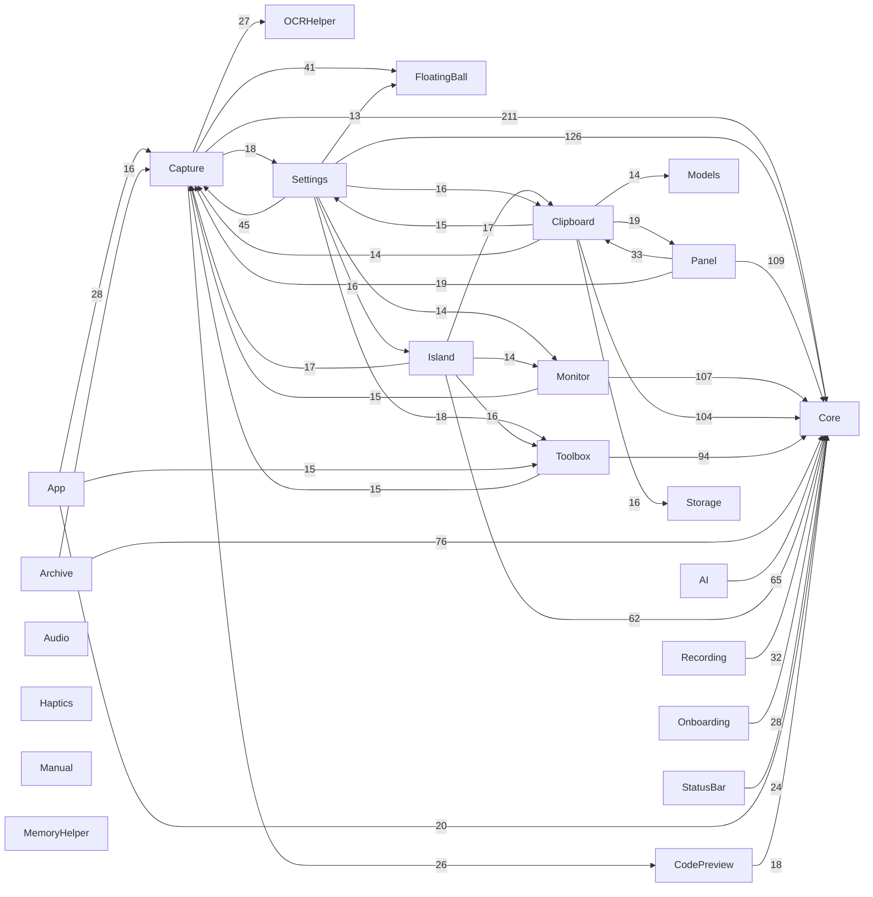

# FrsetNext 模块依赖与规模

> 自动生成，重算：`python3 tools/swift_catalog.py`　共 23 个模块 / 325 文件 / 113,602 行 / 11,379 个声明 / 149 条模块引用边
>
> 成员口径复用 `tools/func_table.py`（唯一解析器）；跨模块边 = 引用到的对方顶层类型数（≥3 才画），import 在单 target 工程里恒为空。

## 模块规模

| 模块 | 文件 | 行数 | 声明 |
|---|---:|---:|---:|
| Capture | 61 | 23,753 | 2198 |
| Monitor | 34 | 13,001 | 1353 |
| Clipboard | 22 | 10,543 | 1037 |
| Archive | 20 | 9,811 | 846 |
| Panel | 22 | 9,012 | 797 |
| Settings | 23 | 8,483 | 780 |
| Toolbox | 24 | 7,657 | 698 |
| Core | 28 | 6,639 | 845 |
| Island | 14 | 5,065 | 735 |
| AI | 25 | 4,460 | 530 |
| CodePreview | 7 | 2,250 | 181 |
| Recording | 10 | 2,213 | 233 |
| StatusBar | 6 | 1,996 | 240 |
| Onboarding | 7 | 1,750 | 155 |
| App | 2 | 1,597 | 69 |
| FloatingBall | 3 | 1,040 | 156 |
| Haptics | 6 | 1,027 | 119 |
| Manual | 3 | 1,015 | 81 |
| Storage | 1 | 699 | 54 |
| Models | 2 | 656 | 157 |
| Audio | 2 | 622 | 72 |
| MemoryHelper | 1 | 189 | 18 |
| OCRHelper | 2 | 124 | 25 |

## 模块依赖（顶层类型被跨模块引用，边权=引用到的类型数）

## 高复杂度成员 Top 30

| 复杂度 | 行数 | 成员 | 位置 |
|---:|---:|---|---|
| 88 | 431 | AppDelegate.application | `App/FrsetNextApp.swift:219` |
| 68 | 39 | CodeLanguageCatalog.detectFromContent | `Features/CodePreview/CodeLanguage.swift:102` |
| 58 | 62 | ShortcutManager.keyText | `Features/Toolbox/Shortcuts/ShortcutManager.swift:236` |
| 52 | 89 | StatisticsSettingsPane.applyImportedPreferences | `Features/Settings/Panes/StatisticsSettingsPane.swift:271` |
| 46 | 170 | ClipboardBackup.apply | `Features/Clipboard/Store/ClipboardBackup.swift:484` |
| 45 | 69 | SettingsUIState.applyPaneMapping | `Features/Settings/Shell/SettingsWindowController.swift:61` |
| 44 | 190 | LongScreenshotStitcher.searchOffset | `Features/Capture/LongScreenshot/LongScreenshotStitcher.swift:554` |
| 42 | 253 | GenieWarp.play | `Core/Motion/GenieWarp.swift:282` |
| 41 | 95 | CodeLexer.markWordsAndNumbers | `Features/CodePreview/CodeLexer.swift:142` |
| 39 | 285 | StatsDataProvider.refresh | `Features/Monitor/Sampling/StatsDataProvider.swift:234` |
| 39 | 226 | MermaidRenderer.draw | `Features/Panel/Preview/MermaidRenderer.swift:242` |
| 35 | 18 | PreviewMarkdownRenderer.detectLanguage | `Features/Panel/Preview/PreviewMarkdownRenderer.swift:261` |
| 33 | 126 | LongScreenshotSession.captureTick | `Features/Capture/LongScreenshot/LongScreenshotSession.swift:288` |
| 33 | 151 | ArchiveCore.create | `Features/Archive/Core/ArchiveCore.swift:1213` |
| 31 | 97 | FileNameIndex.search | `Features/Toolbox/Search/FileNameIndex.swift:109` |
| 31 | 81 | IslandController.installMonitors | `Features/Island/IslandController.swift:879` |
| 31 | 61 | ClipboardManager.copy | `Features/Clipboard/Store/ClipboardManager.swift:601` |
| 30 | 137 | DiskIndexScanner.walk | `Features/Monitor/Storage/DiskIndex.swift:511` |
| 30 | 193 | Spec.forLanguage | `Features/CodePreview/CodeLexer.swift:374` |
| 30 | 64 | ClipboardBackup.readManifest | `Features/Clipboard/Store/ClipboardBackup.swift:362` |
| 29 | 46 | CaptureSettingsDraft.save | `Features/Capture/Screenshot/CaptureSettingsPane.swift:58` |
| 29 | 168 | PanelController.show | `Features/Panel/Presentation/PanelController.swift:246` |
| 29 | 189 | SearchSectionView.webResultArea | `Features/Toolbox/Search/SearchSectionView.swift:1151` |
| 28 | 78 | IslandController.updatePointer | `Features/Island/IslandController.swift:961` |
| 27 | 66 | IslandRootView.loadRecords | `Features/Island/IslandContent.swift:397` |
| 27 | 85 | FloatingClipboardWindowController.installKeyMonitor | `Features/Clipboard/Floating/FloatingClipboardWindow.swift:304` |
| 26 | 71 | AnnotationCompositor.draw | `Features/Capture/Annotation/AnnotationCompositor.swift:254` |
| 26 | 75 | ManualDocument.parseBlocks | `Features/Manual/ManualDocument.swift:154` |
| 25 | 119 | ScreenSnapshot.captureScreenForScreenshot | `Features/Capture/Screenshot/ScreenSnapshot.swift:275` |
| 25 | 194 | AnnotationCanvasView.draw | `Features/Capture/Annotation/AnnotationEditorWindow.swift:160` |
