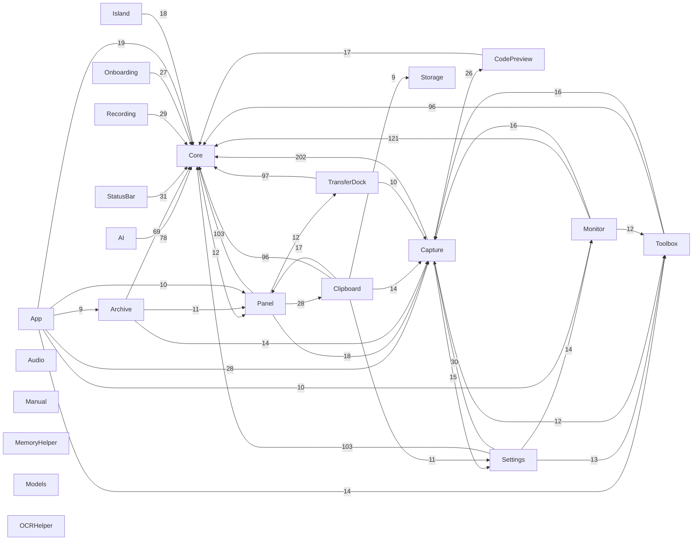

# FrsetNext 模块依赖与规模

> 自动生成，重算：`python3 tools/swift_catalog.py`　共 22 个模块 / 313 文件 / 104,701 行 / 10,037 个声明 / 112 条模块引用边
>
> 成员口径复用 `tools/func_table.py`（唯一解析器）；跨模块边 = 引用到的对方顶层类型数（≥3 才画），import 在单 target 工程里恒为空。

## 模块规模

| 模块 | 文件 | 行数 | 声明 |
|---|---:|---:|---:|
| Capture | 59 | 21,936 | 2030 |
| Monitor | 36 | 13,216 | 1285 |
| TransferDock | 23 | 9,113 | 786 |
| Panel | 21 | 9,012 | 806 |
| Archive | 19 | 7,774 | 659 |
| Clipboard | 19 | 7,666 | 804 |
| Toolbox | 25 | 7,021 | 605 |
| Settings | 19 | 6,742 | 602 |
| Core | 22 | 5,108 | 672 |
| AI | 25 | 4,445 | 515 |
| CodePreview | 7 | 2,199 | 178 |
| Recording | 10 | 2,150 | 225 |
| StatusBar | 7 | 2,083 | 253 |
| Onboarding | 6 | 1,333 | 107 |
| App | 2 | 1,187 | 37 |
| Manual | 2 | 1,100 | 98 |
| Island | 4 | 765 | 110 |
| Storage | 1 | 650 | 54 |
| Models | 2 | 563 | 131 |
| Audio | 1 | 330 | 37 |
| MemoryHelper | 1 | 184 | 18 |
| OCRHelper | 2 | 124 | 25 |

## 模块依赖（顶层类型被跨模块引用，边权=引用到的类型数）

## 高复杂度成员 Top 30

| 复杂度 | 行数 | 成员 | 位置 |
|---:|---:|---|---|
| 84 | 415 | AppDelegate.application | `App/FrsetNextApp.swift:120` |
| 72 | 39 | CodeLanguageCatalog.detectFromContent | `Features/CodePreview/CodeLanguage.swift:102` |
| 58 | 62 | ShortcutManager.keyText | `Features/Toolbox/Shortcuts/ShortcutManager.swift:233` |
| 44 | 190 | LongScreenshotStitcher.searchOffset | `Features/Capture/LongScreenshot/LongScreenshotStitcher.swift:532` |
| 40 | 311 | StatsDataProvider.refresh | `Features/Monitor/Sampling/StatsDataProvider.swift:235` |
| 40 | 112 | StatisticsSettingsPane.performImport | `Features/Settings/Panes/StatisticsSettingsPane.swift:435` |
| 39 | 97 | CodeLexer.markWordsAndNumbers | `Features/CodePreview/CodeLexer.swift:139` |
| 39 | 226 | MermaidRenderer.draw | `Features/Panel/Preview/MermaidRenderer.swift:242` |
| 38 | 113 | ManualDocument.parseBlocks | `Features/Manual/ManualDocument.swift:193` |
| 35 | 19 | PreviewMarkdownRenderer.guessLanguage | `Features/Panel/Preview/PreviewMarkdownRenderer.swift:258` |
| 34 | 59 | SettingsUIState.applyPaneMapping | `Features/Settings/Shell/SettingsWindowController.swift:39` |
| 33 | 125 | LongScreenshotSession.captureTick | `Features/Capture/LongScreenshot/LongScreenshotSession.swift:282` |
| 30 | 194 | Spec.forLanguage | `Features/CodePreview/CodeLexer.swift:379` |
| 27 | 136 | ArchiveCore.create | `Features/Archive/Core/ArchiveCore.swift:967` |
| 26 | 73 | CodeLexer.markCommentsAndStrings | `Features/CodePreview/CodeLexer.swift:63` |
| 26 | 100 | DiskIndexScanner.walk | `Features/Monitor/Storage/DiskIndex.swift:247` |
| 25 | 201 | GenieWarp.play | `Core/Motion/GenieWarp.swift:267` |
| 25 | 136 | PanelController.show | `Features/Panel/Presentation/PanelController.swift:194` |
| 24 | 69 | DiffusionInpainter.sorSolve | `Features/Capture/Annotation/ObjectRemovalEngine.swift:144` |
| 24 | 59 | ClipboardPreviewWindowController.initialSize | `Features/Clipboard/UI/ClipboardPreviewWindow.swift:55` |
| 24 | 55 | MermaidRenderer.parse | `Features/Panel/Preview/MermaidRenderer.swift:88` |
| 23 | 73 | FloatingClipboardWindowController.installKeyMonitor | `Features/Clipboard/Floating/FloatingClipboardWindow.swift:342` |
| 23 | 71 | PortInspector.parse | `Features/Monitor/Views/PortInspector.swift:180` |
| 23 | 151 | PreviewMarkdownRenderer.parseSourced | `Features/Panel/Preview/PreviewMarkdownRenderer.swift:88` |
| 23 | 121 | ScreenRecorder.start | `Features/Recording/ScreenRecorder.swift:360` |
| 23 | 29 | ColorKeyControl.swatch | `Features/Settings/Panes/MonitorWidgetsPane.swift:550` |
| 23 | 173 | SearchSectionView.webResultArea | `Features/Toolbox/Search/SearchSectionView.swift:1027` |
| 22 | 63 | AnnotationCompositor.draw | `Features/Capture/Annotation/AnnotationCompositor.swift:241` |
| 22 | 69 | ProcessFreezer.collectCandidates | `Features/Monitor/Memory/ProcessFreezer.swift:218` |
| 21 | 167 | AnnotationCanvasView.draw | `Features/Capture/Annotation/AnnotationEditorWindow.swift:152` |
