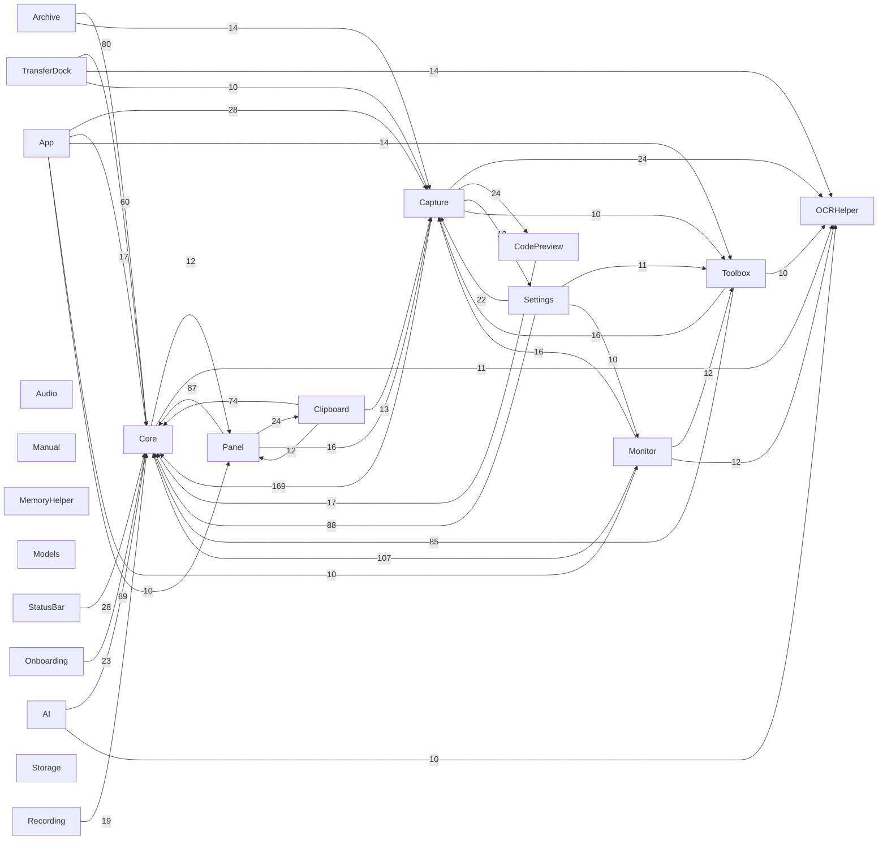

# FrsetNext 模块依赖与规模

> 自动生成，重算：`python3 tools/swift_catalog.py`　共 21 个模块 / 298 文件 / 99,063 行 / 9,128 个声明 / 111 条模块引用边
>
> 成员口径复用 `tools/func_table.py`（唯一解析器）；跨模块边 = 引用到的对方顶层类型数（≥3 才画），import 在单 target 工程里恒为空。

## 模块规模

| 模块 | 文件 | 行数 | 声明 |
|---|---:|---:|---:|
| Capture | 56 | 21,202 | 1915 |
| Monitor | 36 | 12,777 | 1199 |
| TransferDock | 22 | 8,753 | 696 |
| Panel | 20 | 8,507 | 751 |
| Archive | 19 | 7,323 | 612 |
| Toolbox | 25 | 6,809 | 555 |
| Clipboard | 17 | 6,562 | 666 |
| Settings | 17 | 6,392 | 507 |
| Core | 22 | 4,801 | 600 |
| AI | 25 | 4,424 | 513 |
| CodePreview | 7 | 2,200 | 176 |
| Recording | 8 | 1,964 | 206 |
| StatusBar | 7 | 1,940 | 230 |
| Onboarding | 6 | 1,327 | 107 |
| App | 2 | 1,170 | 38 |
| Manual | 2 | 1,100 | 98 |
| Storage | 1 | 650 | 54 |
| Models | 2 | 525 | 125 |
| Audio | 1 | 329 | 37 |
| MemoryHelper | 1 | 184 | 18 |
| OCRHelper | 2 | 124 | 25 |

## 模块依赖（顶层类型被跨模块引用，边权=引用到的类型数）

## 高复杂度成员 Top 30

| 复杂度 | 行数 | 成员 | 位置 |
|---:|---:|---|---|
| 83 | 411 | AppDelegate.application | `App/FrsetNextApp.swift:119` |
| 72 | 39 | CodeLanguageCatalog.detectFromContent | `Features/CodePreview/CodeLanguage.swift:102` |
| 58 | 62 | ShortcutManager.keyText | `Features/Toolbox/Shortcuts/ShortcutManager.swift:223` |
| 44 | 190 | LongScreenshotStitcher.searchOffset | `Features/Capture/LongScreenshot/LongScreenshotStitcher.swift:532` |
| 40 | 311 | StatsDataProvider.refresh | `Features/Monitor/Sampling/StatsDataProvider.swift:235` |
| 39 | 226 | MermaidRenderer.draw | `Features/Panel/Preview/MermaidRenderer.swift:242` |
| 39 | 97 | CodeLexer.markWordsAndNumbers | `Features/CodePreview/CodeLexer.swift:139` |
| 38 | 113 | ManualDocument.parseBlocks | `Features/Manual/ManualDocument.swift:193` |
| 35 | 19 | PreviewMarkdownRenderer.guessLanguage | `Features/Panel/Preview/PreviewMarkdownRenderer.swift:258` |
| 33 | 125 | LongScreenshotSession.captureTick | `Features/Capture/LongScreenshot/LongScreenshotSession.swift:282` |
| 30 | 194 | Spec.forLanguage | `Features/CodePreview/CodeLexer.swift:379` |
| 26 | 100 | DiskIndexScanner.walk | `Features/Monitor/Storage/DiskIndex.swift:247` |
| 26 | 73 | CodeLexer.markCommentsAndStrings | `Features/CodePreview/CodeLexer.swift:63` |
| 25 | 201 | GenieWarp.play | `Core/Motion/GenieWarp.swift:269` |
| 25 | 128 | ArchiveCore.create | `Features/Archive/Core/ArchiveCore.swift:946` |
| 24 | 69 | DiffusionInpainter.sorSolve | `Features/Capture/Annotation/ObjectRemovalEngine.swift:144` |
| 24 | 94 | StorageTreemap.tileView | `Features/Monitor/Storage/StorageTreemap.swift:202` |
| 24 | 55 | MermaidRenderer.parse | `Features/Panel/Preview/MermaidRenderer.swift:88` |
| 23 | 29 | ColorKeyControl.swatch | `Features/Settings/Panes/MonitorWidgetsPane.swift:785` |
| 23 | 71 | PortInspector.parse | `Features/Monitor/Views/PortInspector.swift:180` |
| 23 | 151 | PreviewMarkdownRenderer.parseSourced | `Features/Panel/Preview/PreviewMarkdownRenderer.swift:88` |
| 22 | 63 | AnnotationCompositor.draw | `Features/Capture/Annotation/AnnotationCompositor.swift:241` |
| 22 | 69 | ProcessFreezer.collectCandidates | `Features/Monitor/Memory/ProcessFreezer.swift:218` |
| 22 | 77 | FloatingClipboardWindowController.installKeyMonitor | `Features/Clipboard/Floating/FloatingClipboardWindow.swift:341` |
| 21 | 167 | AnnotationCanvasView.draw | `Features/Capture/Annotation/AnnotationEditorWindow.swift:152` |
| 21 | 90 | LongScreenshotMotionCrop.movingColumns | `Features/Capture/LongScreenshot/LongScreenshotMotionCrop.swift:26` |
| 20 | 49 | PinnedScreenshotContentView.continueWindowDrag | `Features/Capture/Pin/PinWindow.swift:1001` |
| 20 | 158 | LongScreenshotStitcher.append | `Features/Capture/LongScreenshot/LongScreenshotStitcher.swift:201` |
| 20 | 15 | PreviewMarkdownRenderer.looksLikeNakedCode | `Features/Panel/Preview/PreviewMarkdownRenderer.swift:241` |
| 20 | 25 | FilePreviewBuilder.kindLabel | `Features/TransferDock/Transfer/FileHoverPreview.swift:128` |
