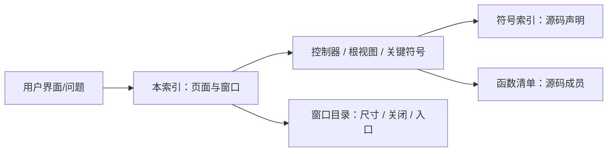

# Kitnest 界面与窗口索引

> 以用户可见界面为入口，定位设置页、独立窗、主面板页、弹层与关键源码。窗口尺寸、关闭方式及既有逐窗登记见[窗口目录](../40-审计与核对/数据表/预览窗口排查.csv)；符号和函数反查见[符号索引](符号索引.md)及[函数清单](../40-审计与核对/数据表/FrsetNext-函数清单.csv)。

## 源码覆盖

| 界面层 | 本地源码项目数 | 当前核对口径 |
|---|---:|---|
| 设置窗侧栏分类页 | 44 | 按 `SettingsGroup.pages` 与 `SettingsRootView.content` 一项项对应；入口和交互配置统一在「入口与交互」 |
| 设置窗页脚 | 1 | 使用手册 `.manual` |
| 主面板页 | 4 | 主页、性能监测、文件中转、投屏 |
| 性能详情模块 | 8 | 功耗、电池、CPU、内存、网络、磁盘、温度、GPU；复用 `MonitorDetailView` |
| 独立窗、浮层与系统宿主 | 58 | W-001…W-058；其中调试探针和不可见系统宿主各一项 |
| Sheet、Popover、系统对话框与选择面板 | 73 | A/F/P/S 编号；A-024 旧部件恢复默认对话框已移除 |
| 历史/非活动记录 | 8 | H-001…H-007 和 A-024，不计入当前界面 |
| 合计（当前入口记录） | 188 | 设置分类页、设置手册、主面板页、性能详情和当前窗口/附属呈现；不含历史记录 |

“源码已映射”不表示已在运行应用逐一操作。窗口目录中实测日期为“待实测”的界面，本索引继续保持未实测状态。

## 设置窗口

入口：`SettingsWindowController.open(pane:)` → `SettingsUIState.selectPane(_:)` → `SettingsRootView.content` → `panePage(_:)`。所有分类页共用固定宽侧栏、可伸展正文和纵向 `ScrollView`；每页保持独立编号，具体视图路由如下。可编辑设置通过 `SettingsEditingSession.draft(id:makeDraft:)` 维持草稿；`SettingsDraftEditorContent.body` 提供保存、取消和恢复本页默认，窗口尺寸变化不重建会话。定义见 [SettingsEditingSession.swift](../../apps/FrsetNext/Sources/Features/Settings/Shell/SettingsEditingSession.swift)。

v274（2026-11-22，用户：「预览不需要自动折叠，所有的这种界面都不需要自动折叠」）：设置内所有「效果预览 / 实时预览 / 入口预览 / 录屏效果预览」区块改为常驻展开——`SettingsSection(alwaysExpanded: true)` 保留标题与右侧摘要、不再画折叠箭头；通知条预览同时改为循环演示（显示 N 秒 → 隐藏 0.9 秒 → 再弹入），且首帧真正落地后才执行 springBouncy，保证弹入动作可见；该预览不复用系统「减弱动态效果」降级，与 `Toast.swift` 正式通知条固定弹簧的观感一致。

| 页面 ID | 用户路径 | 路由 / 根视图 | 源文件 | 关键入口符号 | 布局与实测 |
|---|---|---|---|---|---|
| SET-001 | 常规 → 启动与语言 | `generalStart` → `GeneralSettingsPane(section: .startup)` | [SettingsPanes.swift](../../apps/FrsetNext/Sources/Features/Settings/Shell/SettingsPanes.swift) | `SettingsWindowController.open(pane:) → SettingsUIState.selectPane(_:) → SettingsRootView.content / panePage(_:)` | 设置右侧随窗口宽度伸展；内容纵向滚动 | 源码路由已核对；实机布局待操作 |
| SET-002 | 常规 → 通知提示 | `generalNotifications` → `GeneralSettingsPane(section: .notifications)` | [SettingsPanes.swift](../../apps/FrsetNext/Sources/Features/Settings/Shell/SettingsPanes.swift) | `SettingsWindowController.open(pane:) → SettingsUIState.selectPane(_:) → SettingsRootView.content / panePage(_:)` | 设置右侧随窗口宽度伸展；内容纵向滚动 | 源码路由已核对；2026-11-22 03:38/03:45 安装版 940×720 实看：效果预览常驻展开且无折叠箭头，通知条循环弹入/隐藏，逐帧核对弹簧过冲后回落，下方时长与定位控件完整 |
| SET-003 | 常规 → 权限 | `permissions` → `GeneralSettingsPane(section: .permissions)` | [SettingsPanes.swift](../../apps/FrsetNext/Sources/Features/Settings/Shell/SettingsPanes.swift) | `SettingsWindowController.open(pane:) → SettingsUIState.selectPane(_:) → SettingsRootView.content / panePage(_:)` | 设置右侧随窗口宽度伸展；内容纵向滚动 | 2026-11-22 安装版 940×720 实看：标题提示「改完立即生效」，四行权限只留功能词，卡内无多余提示行；下方 ZIP / Finder / 加密段均为单行文案，无截断 |
| SET-004 | 触觉反馈 → 触觉反馈 | `haptics` → `HapticSettingsPane()`（v270 总开关 + 模拟所选场景） | [HapticSettingsPane.swift](../../apps/FrsetNext/Sources/Features/Settings/Panes/HapticSettingsPane.swift) | `SettingsWindowController.open(pane:) → SettingsUIState.selectPane(_:) → SettingsRootView.content / panePage(_:)` | 设置右侧随窗口宽度伸展；内容纵向滚动 | 源码路由已核对；实机布局待操作 |
| SET-005 | 主题外观 → 主题与颜色 | `generalPersonal` → `GeneralSettingsPane(section: .personalization)` | [SettingsPanes.swift](../../apps/FrsetNext/Sources/Features/Settings/Shell/SettingsPanes.swift) | `SettingsWindowController.open(pane:) → SettingsUIState.selectPane(_:) → SettingsRootView.content / panePage(_:)` | 设置右侧随窗口宽度伸展；内容纵向滚动 | 源码路由已核对；实机布局待操作 |
| SET-006 | 主题外观 → 文字与圆角 | `appearanceText` → `GeneralSettingsPane(section: .appearanceText)` | [SettingsPanes.swift](../../apps/FrsetNext/Sources/Features/Settings/Shell/SettingsPanes.swift) | `SettingsWindowController.open(pane:) → SettingsUIState.selectPane(_:) → SettingsRootView.content / panePage(_:)` | 设置右侧随窗口宽度伸展；内容纵向滚动 | 源码路由已核对；实机布局待操作 |
| SET-007 | 主题外观 → 窗口材质与动效 | `generalWindows` → `GeneralSettingsPane(section: .floating)` | [SettingsPanes.swift](../../apps/FrsetNext/Sources/Features/Settings/Shell/SettingsPanes.swift) | `SettingsWindowController.open(pane:) → SettingsUIState.selectPane(_:) → SettingsRootView.content / panePage(_:)` | 设置右侧随窗口宽度伸展；内容纵向滚动 | 源码路由已核对；实机布局待操作 |
| SET-008 | 入口与交互 → 主面板布局与页面 | `generalPanel` → `GeneralSettingsPane(section: .mainPanel)` | [SettingsPanes.swift](../../apps/FrsetNext/Sources/Features/Settings/Shell/SettingsPanes.swift) | `SettingsWindowController.open(pane:) → SettingsUIState.selectPane(_:) → SettingsRootView.content / panePage(_:)` | 设置右侧随窗口宽度伸展；内容纵向滚动 | 源码路由已核对；实机待操作 |
| SET-009 | 入口与交互 → 主面板背景图片 | `panelBackground` → `GeneralSettingsPane(section: .background)` | [SettingsPanes.swift](../../apps/FrsetNext/Sources/Features/Settings/Shell/SettingsPanes.swift) | `SettingsWindowController.open(pane:) → SettingsUIState.selectPane(_:) → SettingsRootView.content / panePage(_:)` | 设置右侧随窗口宽度伸展；内容纵向滚动 | 源码路由已核对；实机待操作 |
| SET-010 | 入口与交互 → 刘海唤出与收回 | `island` → `IslandSettingsPane(part: .activation)` | [IslandSettingsPane.swift](../../apps/FrsetNext/Sources/Features/Settings/Panes/IslandSettingsPane.swift) | `SettingsWindowController.open(pane:) → SettingsUIState.selectPane(_:) → SettingsRootView.content / panePage(_:)` | 设置右侧随窗口宽度伸展；内容纵向滚动 | 源码路由已核对；2026-11-22 实看启用开关与页面设置正常；「入口预览」「实时预览」改为常驻展开（位于页面下方，需滚动查看） |
| SET-011 | 入口与交互 → 刘海收起态 | `islandPeeks` → `IslandSettingsPane(part: .peeks)` | [IslandSettingsPane.swift](../../apps/FrsetNext/Sources/Features/Settings/Panes/IslandSettingsPane.swift) | `SettingsWindowController.open(pane:) → SettingsUIState.selectPane(_:) → SettingsRootView.content / panePage(_:)` | 设置右侧随窗口宽度伸展；内容纵向滚动 | 源码路由已核对；2026-11-22 实看「实时预览」常驻展开无折叠箭头；收起态预览由页内「展开预览」开关控制，默认展示收起尺寸 |
| SET-012 | 入口与交互 → 刘海画布与组件 | `islandCanvas` → `IslandSettingsPane(part: .canvas)` | [IslandSettingsPane.swift](../../apps/FrsetNext/Sources/Features/Settings/Panes/IslandSettingsPane.swift) | `SettingsWindowController.open(pane:) → SettingsUIState.selectPane(_:) → SettingsRootView.content / panePage(_:)` | 设置右侧随窗口宽度伸展；内容纵向滚动 | 源码路由已核对；「实时预览」改为常驻展开（源码核对，实机布局待实测） |
| SET-013 | 入口与交互 → 刘海材质与颜色 | `islandMaterial` → `IslandSettingsPane(part: .appearance)` | [IslandSettingsPane.swift](../../apps/FrsetNext/Sources/Features/Settings/Panes/IslandSettingsPane.swift) | `SettingsWindowController.open(pane:) → SettingsUIState.selectPane(_:) → SettingsRootView.content / panePage(_:)` | 设置右侧随窗口宽度伸展；内容纵向滚动 | 源码路由已核对；「实时预览」改为常驻展开（源码核对，实机布局待实测） |
| SET-014 | 入口与交互 → 菜单栏图标与入口 | `generalMenuBar` → `GeneralSettingsPane(section: .menuBar)` | [SettingsPanes.swift](../../apps/FrsetNext/Sources/Features/Settings/Shell/SettingsPanes.swift) | `SettingsWindowController.open(pane:) → SettingsUIState.selectPane(_:) → SettingsRootView.content / panePage(_:)` | 设置右侧随窗口宽度伸展；内容纵向滚动 | 源码路由已核对；实机布局待实测 |
| SET-015 | 入口与交互 → 菜单栏排列与间距 | `menuBarArrangement` → `GeneralSettingsPane(section: .menuBarArrangement)` | [SettingsPanes.swift](../../apps/FrsetNext/Sources/Features/Settings/Shell/SettingsPanes.swift) | `SettingsWindowController.open(pane:) → SettingsUIState.selectPane(_:) → SettingsRootView.content / panePage(_:)` | 设置右侧随窗口宽度伸展；内容纵向滚动 | 源码路由已核对；实机布局待实测 |
| SET-016 | 入口与交互 → 部件与颜色 | `monitorWidgets` → `MonitorWidgetsPane()` | [MonitorWidgetsPane.swift](../../apps/FrsetNext/Sources/Features/Settings/Panes/MonitorWidgetsPane.swift) | `SettingsWindowController.open(pane:) → SettingsUIState.selectPane(_:) → SettingsRootView.content / panePage(_:)` | 设置右侧随窗口宽度伸展；内容纵向滚动 | 源码路由已核对；实机布局待实测 |
| SET-017 | 剪贴板 → 捕获与隐私 | `clipboardCapture` → `ClipboardSettingsPane(section: .capture)` | [ClipboardSettingsPane.swift](../../apps/FrsetNext/Sources/Features/Clipboard/UI/ClipboardSettingsPane.swift) | `SettingsWindowController.open(pane:) → SettingsUIState.selectPane(_:) → SettingsRootView.content / panePage(_:)` | 设置右侧随窗口宽度伸展；内容纵向滚动 | 源码路由已核对；实机布局待操作 |
| SET-018 | 剪贴板 → 历史与备份 | `clipboardHistory` → `ClipboardSettingsPane(section: .history)` | [ClipboardSettingsPane.swift](../../apps/FrsetNext/Sources/Features/Clipboard/UI/ClipboardSettingsPane.swift) | `SettingsWindowController.open(pane:) → SettingsUIState.selectPane(_:) → SettingsRootView.content / panePage(_:)` | 设置右侧随窗口宽度伸展；内容纵向滚动 | 源码路由已核对；实机布局待操作 |
| SET-019 | 剪贴板 → 列表外观 | `clipboardAppearance` → `ClipboardSettingsPane(section: .appearance)` | [ClipboardSettingsPane.swift](../../apps/FrsetNext/Sources/Features/Clipboard/UI/ClipboardSettingsPane.swift) | `SettingsWindowController.open(pane:) → SettingsUIState.selectPane(_:) → SettingsRootView.content / panePage(_:)` | 设置右侧随窗口宽度伸展；内容纵向滚动 | 源码路由已核对；实机布局待操作 |
| SET-020 | 入口与交互 → 剪贴板浮动窗 | `clipboardFloating` → `ClipboardSettingsPane(section: .floating)` | [ClipboardSettingsPane.swift](../../apps/FrsetNext/Sources/Features/Clipboard/UI/ClipboardSettingsPane.swift) | `SettingsWindowController.open(pane:) → SettingsUIState.selectPane(_:) → SettingsRootView.content / panePage(_:)` | 设置右侧随窗口宽度伸展；内容纵向滚动 | 源码路由已核对；实机布局待实测 |
| SET-021 | 文件与传输 → 本地中转 | `transferLocal` → `TransferDockSettingsPane(section: .local)` | [TransferDockSettingsPane.swift](../../apps/FrsetNext/Sources/Features/TransferDock/UI/TransferDockSettingsPane.swift) | `SettingsWindowController.open(pane:) → SettingsUIState.selectPane(_:) → SettingsRootView.content / panePage(_:)` | 设置右侧随窗口宽度伸展；内容纵向滚动 | 源码路由已核对；实机布局待操作 |
| SET-022 | 文件与传输 → 手机直传 | `transferScan` → `TransferDockSettingsPane(section: .scan)` | [TransferDockSettingsPane.swift](../../apps/FrsetNext/Sources/Features/TransferDock/UI/TransferDockSettingsPane.swift) | `SettingsWindowController.open(pane:) → SettingsUIState.selectPane(_:) → SettingsRootView.content / panePage(_:)` | 设置右侧随窗口宽度伸展；内容纵向滚动 | 源码路由已核对；实机布局待操作 |
| SET-023 | 文件与传输 → 云端中转 | `transferCloud` → `TransferDockSettingsPane(section: .cloud)` | [TransferDockSettingsPane.swift](../../apps/FrsetNext/Sources/Features/TransferDock/UI/TransferDockSettingsPane.swift) | `SettingsWindowController.open(pane:) → SettingsUIState.selectPane(_:) → SettingsRootView.content / panePage(_:)` | 设置右侧随窗口宽度伸展；内容纵向滚动 | 源码路由已核对；实机布局待操作 |
| SET-024 | 文件与传输 → 投屏 | `transferCast` → `TransferDockSettingsPane(section: .cast)` | [TransferDockSettingsPane.swift](../../apps/FrsetNext/Sources/Features/TransferDock/UI/TransferDockSettingsPane.swift) | `SettingsWindowController.open(pane:) → SettingsUIState.selectPane(_:) → SettingsRootView.content / panePage(_:)` | 2026-11-19 实机：820×520 最小尺寸下文字换行且控件可见；860×600 与 1100×780 下表单随宽度调整、侧栏稳定；重启后切页、⌘W 关闭与深链重开正常 |
| SET-025 | 文件与传输 → 压缩与 Finder | `archive` → `SettingsRootView.content → ArchiveOpenBehaviorOptions / ArchiveHoverPreviewOptions / ArchiveProgressWindowOptions / ArchiveDefaultApplicationOption`（v273 ArcZip 1.2.5 四段结构） | [SettingsRootView.swift](../../apps/FrsetNext/Sources/Features/Settings/Shell/SettingsRootView.swift) | `SettingsWindowController.open(pane:) → SettingsUIState.selectPane(_:) → SettingsRootView.content / panePage(_:)` | 设置右侧随窗口宽度伸展；内容纵向滚动 | 源码路由已核对；实机布局待操作 |
| SET-026 | 截图与录屏 → 截图与保存 | `capture(.capture)` → `CaptureBlockPage(block: .capture) → CaptureSettingsPane` | [CaptureSettingsPane.swift](../../apps/FrsetNext/Sources/Features/Capture/Screenshot/CaptureSettingsPane.swift) | `SettingsWindowController.open(pane:) → SettingsUIState.selectPane(_:) → SettingsRootView.content / panePage(_:)` | 设置右侧随窗口宽度伸展；内容纵向滚动 | 源码路由已核对；实机布局待操作 |
| SET-027 | 截图与录屏 → 文字识别 | `ocr` → `CaptureSettingsPane(section: .ocr)` | [CaptureSettingsPane.swift](../../apps/FrsetNext/Sources/Features/Capture/Screenshot/CaptureSettingsPane.swift) | `SettingsWindowController.open(pane:) → SettingsUIState.selectPane(_:) → SettingsRootView.content / panePage(_:)` | 设置右侧随窗口宽度伸展；内容纵向滚动 | 源码路由已核对；实机布局待操作 |
| SET-028 | 截图与录屏 → 水印效果 | `watermark` → `CaptureSettingsPane(section: .watermark)` | [CaptureSettingsPane.swift](../../apps/FrsetNext/Sources/Features/Capture/Screenshot/CaptureSettingsPane.swift) | `SettingsWindowController.open(pane:) → SettingsUIState.selectPane(_:) → SettingsRootView.content / panePage(_:)` | 设置右侧随窗口宽度伸展；内容纵向滚动 | 源码路由已核对；实机布局待操作 |
| SET-029 | 截图与录屏 → 动作条 | `captureActions` → `GeneralSettingsPane(section: .captureToolbar)` | [SettingsPanes.swift](../../apps/FrsetNext/Sources/Features/Settings/Shell/SettingsPanes.swift) | `SettingsWindowController.open(pane:) → SettingsUIState.selectPane(_:) → SettingsRootView.content / panePage(_:)` | 设置右侧随窗口宽度伸展；内容纵向滚动 | 源码路由已核对；2026-11-22 实看「效果预览」常驻展开、正式动作条与三种排列可见，无折叠箭头 |
| SET-030 | 截图与录屏 → 钉图 | `capture(.pin)` → `CaptureBlockPage(block: .pin) → PinSettingsPane` | [PinSettingsPane.swift](../../apps/FrsetNext/Sources/Features/Settings/Panes/PinSettingsPane.swift) | `SettingsWindowController.open(pane:) → SettingsUIState.selectPane(_:) → SettingsRootView.content / panePage(_:)` | 设置右侧随窗口宽度伸展；内容纵向滚动 | 源码路由已核对；2026-11-22 实看「预览」常驻展开、模拟钉图与控制条可见，无折叠箭头 |
| SET-031 | 截图与录屏 → 图帘 | `capture(.curtain)` → `CaptureBlockPage(block: .curtain) → CurtainSettingsPane` | [CurtainSettingsPane.swift](../../apps/FrsetNext/Sources/Features/Settings/Panes/CurtainSettingsPane.swift) | `SettingsWindowController.open(pane:) → SettingsUIState.selectPane(_:) → SettingsRootView.content / panePage(_:)` | 设置右侧随窗口宽度伸展；内容纵向滚动 | 源码路由已核对；2026-11-22 实看「预览」常驻展开无折叠箭头；关闭态显示「图帘已关闭 · 保存后应用到正式图帘」 |
| SET-032 | 截图与录屏 → 录屏 | `capture(.recording)` → `CaptureBlockPage(block: .recording) → RecordingSettingsPane` | [RecordingSettingsPane.swift](../../apps/FrsetNext/Sources/Features/Recording/RecordingSettingsPane.swift) | `SettingsWindowController.open(pane:) → SettingsUIState.selectPane(_:) → SettingsRootView.content / panePage(_:)` | 设置右侧随窗口宽度伸展；内容纵向滚动 | 源码路由已核对；2026-11-22 实看「录屏效果预览」常驻展开、固定示意画面可见，无折叠箭头 |
| SET-033 | 截图与录屏 → 截图工作流 | `capture(.workflow)` → `CaptureBlockPage(block: .workflow) → WorkflowSettingsPane` | [WorkflowSettingsPane.swift](../../apps/FrsetNext/Sources/Features/Capture/Workflow/WorkflowSettingsPane.swift) | `SettingsWindowController.open(pane:) → SettingsUIState.selectPane(_:) → SettingsRootView.content / panePage(_:)` | 设置右侧随窗口宽度伸展；内容纵向滚动 | 2026-11-21安装版已操作启用、路径编辑、保存和取消；新构建重启后无配置文件，首次禁用示例直接显示已保存 |
| SET-034 | 搜索与 AI → 搜索与引擎 | `search` → `SearchSettingsPane()` | [SearchSettingsPane.swift](../../apps/FrsetNext/Sources/Features/Settings/Panes/SearchSettingsPane.swift) | `SettingsWindowController.open(pane:) → SettingsUIState.selectPane(_:) → SettingsRootView.content / panePage(_:)` | 设置右侧随窗口宽度伸展；内容纵向滚动 | 源码路由已核对；实机布局待操作 |
| SET-035 | 搜索与 AI → AI 服务 | `ai` → `AISettingsPane()` | [AISettingsPane.swift](../../apps/FrsetNext/Sources/Features/AI/Views/AISettingsPane.swift) | `SettingsWindowController.open(pane:) → SettingsUIState.selectPane(_:) → SettingsRootView.content / panePage(_:)` | 设置右侧随窗口宽度伸展；内容纵向滚动 | 源码路由已核对；实机布局待操作 |
| SET-036 | 工具 → 工具集合 | `tools` → `ToolSettingsPane(part: .collection)` | [ToolSettingsPane.swift](../../apps/FrsetNext/Sources/Features/Toolbox/Tools/ToolSettingsPane.swift) | `SettingsWindowController.open(pane:) → SettingsUIState.selectPane(_:) → SettingsRootView.content / panePage(_:)` | 设置右侧随窗口宽度伸展；内容纵向滚动 | 源码路由已核对；实机布局待操作 |
| SET-037 | 工具 → AI 文本工具 | `aiText` → `ToolSettingsPane(part: .aiText)` | [ToolSettingsPane.swift](../../apps/FrsetNext/Sources/Features/Toolbox/Tools/ToolSettingsPane.swift) | `SettingsWindowController.open(pane:) → SettingsUIState.selectPane(_:) → SettingsRootView.content / panePage(_:)` | 设置右侧随窗口宽度伸展；内容纵向滚动 | 源码路由已核对；实机布局待操作 |
| SET-038 | 工具 → 日历 | `calendar` → `ToolSettingsPane(part: .calendar)` | [ToolSettingsPane.swift](../../apps/FrsetNext/Sources/Features/Toolbox/Tools/ToolSettingsPane.swift) | `SettingsWindowController.open(pane:) → SettingsUIState.selectPane(_:) → SettingsRootView.content / panePage(_:)` | 设置右侧随窗口宽度伸展；内容纵向滚动 | 源码路由已核对；实机布局待操作 |
| SET-039 | 入口与交互 → 全部快捷键绑定 | `shortcuts` → `ShortcutSettingsPane(targetID:)` | [ShortcutSettingsPane.swift](../../apps/FrsetNext/Sources/Features/Toolbox/Shortcuts/ShortcutSettingsPane.swift) | `SettingsWindowController.open(pane:) → SettingsUIState.selectPane(_:) → SettingsRootView.content / panePage(_:)` | 设置右侧随窗口宽度伸展；内容纵向滚动 | 2026-11-20 实机 940×720：绑定、清除与默认入口正常显示；234 项列表纵向滚动 |
| SET-040 | 性能监测 → 采样与显示 | `monitorSettings` → `MonitorSettingsPane()` | [MonitorSettingsPane.swift](../../apps/FrsetNext/Sources/Features/Monitor/Window/MonitorSettingsPane.swift) | `SettingsWindowController.open(pane:) → SettingsUIState.selectPane(_:) → SettingsRootView.content / panePage(_:)` | 设置右侧随窗口宽度伸展；内容纵向滚动 | 源码路由已核对；实机布局待操作 |
| SET-041 | 数据与帮助 → 配置导出与导入 | `configTransfer` → `StatisticsSettingsPane()` | [StatisticsSettingsPane.swift](../../apps/FrsetNext/Sources/Features/Settings/Panes/StatisticsSettingsPane.swift) | `SettingsWindowController.open(pane:) → SettingsUIState.selectPane(_:) → SettingsRootView.content / panePage(_:)` | 设置右侧随窗口宽度伸展；内容纵向滚动 | 源码路由已核对；实机布局待操作 |
| SET-042 | 数据与帮助 → 诊断 | `diagnostics` → `SettingsRootView.diagnostics` | [SettingsRootView.swift](../../apps/FrsetNext/Sources/Features/Settings/Shell/SettingsRootView.swift) | `SettingsWindowController.open(pane:) → SettingsUIState.selectPane(_:) → SettingsRootView.content / panePage(_:)` | 设置右侧随窗口宽度伸展；内容纵向滚动 | 源码路由已核对；实机布局待操作 |
| SET-043 | 数据与帮助 → 关于与更新 | `about` → `AboutSettingsPane()` | [SettingsPanes.swift](../../apps/FrsetNext/Sources/Features/Settings/Shell/SettingsPanes.swift) | `SettingsWindowController.open(pane:) → SettingsUIState.selectPane(_:) → SettingsRootView.content / panePage(_:)` | 设置右侧随窗口宽度伸展；内容纵向滚动 | 源码路由已核对；实机布局待操作 |
| SET-044 | 页脚 → 使用手册 | `manual` → `ManualPaneView()` | [ManualView.swift](../../apps/FrsetNext/Sources/Features/Manual/ManualView.swift) | `SettingsWindowController.open(pane:) → SettingsUIState.selectPane(_:) → SettingsRootView.content` | 手册自有内容容器 | 源码路由已核对；实机布局待操作 |
| SET-045 | 入口与交互 → 悬浮球与快捷小窗 | `floatingBall` → `FloatingBallSettingsPane()` | [FloatingBallSettingsPane.swift](../../apps/FrsetNext/Sources/Features/Settings/Panes/FloatingBallSettingsPane.swift) | `SettingsWindowController.open(pane:) → SettingsUIState.selectPane(_:) → SettingsRootView.content / panePage(_:)` | 组件、排序、球体尺寸、快捷窗宽高、列数、透明度、分页、默认页、逐屏记忆与展开方式 | 2026-11-21安装版已实测：悬浮球齿轮进入本页，940×720→1140×882→820×532 拖动缩放内容自适应 |

侧栏之外的兼容路由（`audio`、`transferDisplay`、`statistics`）映射到已有页面，不另算用户页。性能模块的深链共用“采样与显示”页面，通过 `MonitorModuleID` 选择详情模块。

## 主面板与性能详情

| 页面 | 根视图 / 状态 | 源文件 | 关键切换 |
|---|---|---|---|
| 主页 | `PanelRootView.homePage` | [PanelRootView.swift](../../apps/FrsetNext/Sources/Features/Panel/Presentation/PanelRootView.swift) | `MonitorCenterPresenter.selectHome()` |
| 性能监测 | `PanelRootView.segmentMonitor` → `MonitorPerformanceContent` | [PanelRootView.swift](../../apps/FrsetNext/Sources/Features/Panel/Presentation/PanelRootView.swift)、[MonitorCenterView.swift](../../apps/FrsetNext/Sources/Features/Monitor/Views/MonitorCenterView.swift) | `MonitorCenterPresenter.selectPerformance(module:)` |
| 文件中转 | `PanelRootView.segmentTransfer` → `TransferDockView` | [PanelRootView.swift](../../apps/FrsetNext/Sources/Features/Panel/Presentation/PanelRootView.swift)、[TransferDockView.swift](../../apps/FrsetNext/Sources/Features/TransferDock/UI/TransferDockView.swift) | `MonitorCenterPresenter.selectTransferDock()` |
| 投屏 | `PanelRootView.segmentCast` → `CastView` | [PanelRootView.swift](../../apps/FrsetNext/Sources/Features/Panel/Presentation/PanelRootView.swift)、[CastView.swift](../../apps/FrsetNext/Sources/Features/TransferDock/Cast/CastView.swift) | `MonitorCenterPresenter.selectCast()` |

性能详情由 `MonitorDetailView` 按 `MonitorModuleID` 切换，文件均定位于 [MonitorDetailView.swift](../../apps/FrsetNext/Sources/Features/Monitor/Views/MonitorDetailView.swift) 与 [MonitorPreferences.swift](../../apps/FrsetNext/Sources/Features/Monitor/Sampling/MonitorPreferences.swift)。

| 模块 ID | 用户标题 | 内容分派 |
|---|---|---|
| power | 功耗 | `MonitorDetailContent.powerPanel` |
| battery | 电池 | `MonitorDetailContent.batteryPanel` |
| cpu | CPU | `MonitorDetailContent.cpuPanel` |
| memory | 内存 | `MonitorDetailContent.memoryPanel` |
| network | 网络 | `MonitorDetailContent.networkPanel` |
| disk | 磁盘 | `MonitorDetailContent.diskPanel` |
| sensors | 温度 | `MonitorDetailContent.sensorsPanel` |
| gpu | GPU | `MonitorDetailContent.gpuPanel` |

## 窗口、面板及宿主

每一行都单独对应一个界面；“控制器/视图入口”保留窗口目录中的真实符号，源码列可直接打开实现。精确尺寸、窗口状态与关闭交互以链接的 W 记录为准。

| ID | 界面 / 入口 | 类型 / 模块 | 窗口控制器 / 入口符号 | 根视图 / 内容宿主 | 实现文件 | 操作状态 |
|---|---|---|---|---|---|---|
| [W-001](../40-审计与核对/数据表/预览窗口排查.csv) | 状态栏主面板 | 浮动面板 · Panel | `FloatingPanel.init(contentRect:rootView:) / PanelController.prepare()` | `PanelRootView` | [FloatingPanel.swift](../../apps/FrsetNext/Sources/Features/Panel/Presentation/FloatingPanel.swift)、[PanelController.swift](../../apps/FrsetNext/Sources/Features/Panel/Presentation/PanelController.swift) | 源码登记；界面操作待实测 |
| [W-002](../40-审计与核对/数据表/预览窗口排查.csv) | 状态栏菜单或设置入口 | 独立窗口 · Settings | `SettingsWindowController.ensureWindow() / windowDidChangeScreen(_:) / SettingsRootView.body / panePage(_:)` | `SettingsRootView` | [SettingsWindowController.swift](../../apps/FrsetNext/Sources/Features/Settings/Shell/SettingsWindowController.swift) | 投屏页在 820×520、860×600、1100×780 缩放，重启、切页、⌘W 关闭及深链重开已实机确认；2026-11-20 快捷键页 940×720 实机可见绑定、清除与默认入口 |
| [W-003](../40-审计与核对/数据表/预览窗口排查.csv) | 调试探针展示设置组件 | 独立窗口 · Settings | `SettingsBlockProbeWindowController.open(block:)` | `ScrollView<AnyView> (设置区块)` | [SettingsBlockProbeWindow.swift](../../apps/FrsetNext/Sources/Features/Settings/Shell/SettingsBlockProbeWindow.swift) | 源码登记；界面操作待实测 |
| [W-004](../40-审计与核对/数据表/预览窗口排查.csv) | 欢迎任务与交互式新手教程 | 独立窗口 · Onboarding | `WelcomeWindow / WelcomeWindowController.ensureWindow()`；`QuickTutorialController` | `WelcomeView`；剪贴板与文件中转页内教程提示 | [WelcomeWindowController.swift](../../apps/FrsetNext/Sources/Features/Onboarding/WelcomeWindowController.swift)、[WelcomeView.swift](../../apps/FrsetNext/Sources/Features/Onboarding/WelcomeView.swift)、[QuickTutorialController.swift](../../apps/FrsetNext/Sources/Features/Onboarding/QuickTutorialController.swift) | 实机显示三项新手任务；截图教程可跳过、稍后关闭、重开续学并取消；手册三个互动入口可启动教程 |
| [W-005](../40-审计与核对/数据表/预览窗口排查.csv) | 权限引导 | 独立窗口 · Onboarding | `PermissionGuideWindow / PermissionGuideWindowController.ensureWindow()` | `PermissionGuideView` | [PermissionGuideWindowController.swift](../../apps/FrsetNext/Sources/Features/Onboarding/PermissionGuideWindowController.swift)、[PermissionGuideView.swift](../../apps/FrsetNext/Sources/Features/Onboarding/PermissionGuideView.swift) | 源码登记；界面操作待实测 |
| [W-006](../40-审计与核对/数据表/预览窗口排查.csv) | 版本更新说明 | 独立窗口 · Onboarding | `WhatsNewWindow / WhatsNewWindowController.ensureWindow()` | `WhatsNewView` | [WhatsNew.swift](../../apps/FrsetNext/Sources/Features/Onboarding/WhatsNew.swift) | 源码登记；界面操作待实测 |
| [W-007](../40-审计与核对/数据表/预览窗口排查.csv) | 状态栏菜单打开使用统计 | 独立窗口 · StatusBar | `StatisticsWindowController.init() / installContent(in:)` | `StatisticsRootView` | [StatisticsWindowController.swift](../../apps/FrsetNext/Sources/Features/StatusBar/StatisticsWindowController.swift)、[StatisticsRootView.swift](../../apps/FrsetNext/Sources/Features/StatusBar/StatisticsRootView.swift) | 源码登记；界面操作待实测 |
| [W-008](../40-审计与核对/数据表/预览窗口排查.csv) | 剪贴板浮动窗 | 浮动面板 · Clipboard | `FloatingClipboardPanel.init(contentRect:) / FloatingClipboardWindowController` | `FloatingClipboardDeskView` | [FloatingClipboardWindow.swift](../../apps/FrsetNext/Sources/Features/Clipboard/Floating/FloatingClipboardWindow.swift)、[FloatingClipboardDesk.swift](../../apps/FrsetNext/Sources/Features/Clipboard/Floating/FloatingClipboardDesk.swift) | 安装版1120×720实看：搜索、分类与预览分栏可读；收藏以独立星标筛选入口与分类分组；跨窗星标同步沿同一`is_favorite`数据；标签增删改、粘贴焦点、编辑删除待实测 |
| [W-009](../40-审计与核对/数据表/预览窗口排查.csv) | 主面板/悬浮剪贴板/文件中转/归档条目的统一预览 | 独立窗口 · Clipboard | `HoverPreviewWindow / ClipboardPreviewWindowController.init(model:showsHint:) / MainPanelPreviewPopoverCoordinator` | `ClipboardPreviewWindowView` | [ClipboardPreviewWindow.swift](../../apps/FrsetNext/Sources/Features/Clipboard/UI/ClipboardPreviewWindow.swift) | 剪贴板预览字号四档；安装版已实看纯文本、Markdown 与 JSON |
| [W-010](../40-审计与核对/数据表/预览窗口排查.csv) | 剪贴板项目编辑或重命名 | 独立窗口 · Clipboard | `ClipboardItemEditWindowController.init(item:)` | `NSStackView + ClipboardItemEditTextView` | [ClipboardItemEditWindowController.swift](../../apps/FrsetNext/Sources/Features/Clipboard/UI/ClipboardItemEditWindowController.swift) | 源码登记；界面操作待实测 |
| [W-011](../40-审计与核对/数据表/预览窗口排查.csv) | 最近剪贴板多选列表 | 浮动面板 · Clipboard | `RecentClipboardWindowController.init() / show(returnTo:items:format:)` | `NSStackView + ClipboardTableView` | [RecentClipboardWindow.swift](../../apps/FrsetNext/Sources/Features/Clipboard/UI/RecentClipboardWindow.swift) | 源码登记；界面操作待实测 |
| [W-012](../40-审计与核对/数据表/预览窗口排查.csv) | 快捷键唤起命令搜索 | 浮动面板 · Toolbox | `CommandPalettePanel.init(initialQuery:selection:)` | `CommandPaletteView` | [CommandPalette.swift](../../apps/FrsetNext/Sources/Features/Toolbox/Search/CommandPalette.swift) | 源码登记；界面操作待实测 |
| [W-013](../40-审计与核对/数据表/预览窗口排查.csv) | 工具箱打开独立工具 | 独立窗口 · Toolbox | `ToolRunnerWindowController.show(toolID:autoRun:input:intent:)` | `ToolRunnerView / AISummaryView` | [ToolRunnerWindow.swift](../../apps/FrsetNext/Sources/Features/Toolbox/Tools/ToolRunnerWindow.swift) | 源码登记；界面操作待实测 |
| [W-014](../40-审计与核对/数据表/预览窗口排查.csv) | 取得系统 TranslationSession 的不可见宿主 | 隐藏宿主 · AI | `AppleTranslationBridge.ensureWindow()` | `AppleTranslationBridgeView（隐藏宿主）` | [AppleTranslationProvider.swift](../../apps/FrsetNext/Sources/Features/AI/Translation/AppleTranslationProvider.swift) | 源码登记；界面操作待实测 |
| [W-015](../40-审计与核对/数据表/预览窗口排查.csv) | 网盘链接中心 | 独立窗口 · Panel | `CloudLinkCenterController.show(link:)` | `CloudLinkCenterView` | [CloudLinkCenter.swift](../../apps/FrsetNext/Sources/Features/Panel/CloudLink/CloudLinkCenter.swift) | 源码登记；界面操作待实测 |
| [W-016](../40-审计与核对/数据表/预览窗口排查.csv) | 打开压缩包浏览内容 | 独立窗口 · Archive | `ArchiveBrowserWindowController.init(url:)` | `ArchiveBrowserView` | [ArchiveBrowserWindow.swift](../../apps/FrsetNext/Sources/Features/Archive/UI/ArchiveBrowserWindow.swift) | 源码登记；界面操作待实测 |
| [W-017](../40-审计与核对/数据表/预览窗口排查.csv) | 创建压缩包入口 | 独立窗口 · Archive | `ArchiveCreateWindowController.init(files:key:)` | `ArchiveCreateView` | [ArchiveCreateSheet.swift](../../apps/FrsetNext/Sources/Features/Archive/UI/ArchiveCreateSheet.swift) | 源码登记；界面操作待实测 |
| [W-018](../40-审计与核对/数据表/预览窗口排查.csv) | 压缩与解压进度/结果 | 独立窗口 · Archive | `ArchiveProgressWindowController.init()` | `ArchiveProgressPanel` | [ArchiveProgressPanel.swift](../../apps/FrsetNext/Sources/Features/Archive/UI/ArchiveProgressPanel.swift) | 源码登记；界面操作待实测 |
| [W-019](../40-审计与核对/数据表/预览窗口排查.csv) | 压缩包轻量查看 | 独立窗口 · Archive | `ArchiveMiniWindowController.init(url:)` | `ArchiveMiniView` | [ArchiveMiniWindow.swift](../../apps/FrsetNext/Sources/Features/Archive/UI/ArchiveMiniWindow.swift) | 源码登记；界面操作待实测 |
| [W-020](../40-审计与核对/数据表/预览窗口排查.csv) | 文件拖放盒 | 浮动面板 · Archive | `ArchiveFileBoxWindow.init() / show()` | `ArchiveFileBoxView` | [ArchiveFileBox.swift](../../apps/FrsetNext/Sources/Features/Archive/Table/ArchiveFileBox.swift) | 源码登记；界面操作待实测 |
| [W-021](../40-审计与核对/数据表/预览窗口排查.csv) | 任务状态短提示 | 浮动面板 · Archive | `ArchiveTaskHUDController.ensurePanel()` | `ArchiveTaskHUDView` | [ArchiveTaskHUD.swift](../../apps/FrsetNext/Sources/Features/Archive/UI/ArchiveTaskHUD.swift) | 源码登记；界面操作待实测 |
| [W-022](../40-审计与核对/数据表/预览窗口排查.csv) | 投屏应用库 | 独立窗口 · TransferDock | `CastAppLibraryWindowController.show()` | `CastAppLibraryView` | [CastAppLibraryWindow.swift](../../apps/FrsetNext/Sources/Features/TransferDock/Cast/CastAppLibraryWindow.swift) | 源码登记；界面操作待实测 |
| [W-023](../40-审计与核对/数据表/预览窗口排查.csv) | 投屏控制条 | 浮动面板 · TransferDock | `ScrcpyControlBarController.makePanel()` | `CastControlBarView` | [CastControlBar.swift](../../apps/FrsetNext/Sources/Features/TransferDock/Cast/CastControlBar.swift) | 源码登记；界面操作待实测 |
| [W-024](../40-审计与核对/数据表/预览窗口排查.csv) | 批量图片压缩 | 独立窗口 · TransferDock | `BatchImageCompressionWindowController.init() / show` | `BatchImageCompressionView` | [BatchImageCompressionWindow.swift](../../apps/FrsetNext/Sources/Features/TransferDock/UI/BatchImageCompressionWindow.swift) | 源码登记；界面操作待实测 |
| [W-025](../40-审计与核对/数据表/预览窗口排查.csv) | 性能监测独立窗 | 浮动面板 · Monitor | `MonitorPopoutPanel / MonitorPopoutWindowController.init()` | `PopoutRootView` | [MonitorPopoutWindow.swift](../../apps/FrsetNext/Sources/Features/Monitor/Window/MonitorPopoutWindow.swift) | 源码登记；界面操作待实测 |
| [W-026](../40-审计与核对/数据表/预览窗口排查.csv) | 存储管理 | 独立窗口 · Monitor | `StorageManagerWindowController.init() / show` | `StorageManagerRootView` | [StorageManagerWindow.swift](../../apps/FrsetNext/Sources/Features/Monitor/Storage/StorageManagerWindow.swift) | 安装版已确认顶部操作区、目录卡及点击进退；2026-11-22 v274 实拍：三按钮上移到红绿灯行，外轮廓顶边抬到按钮下方 y≈103，搜索卡 y≈128 位于轮廓内，深色图块仍从 y≈193 开始，左侧清单按曲线裁切且文字不越界，1pt 外轮廓清晰；双指手势与悬停动效观感待触控板实测 |
| [W-027](../40-审计与核对/数据表/预览窗口排查.csv) | 截图历史入口 | 独立窗口 · Capture | `CaptureHistoryWindowController.show()` | `CaptureHistoryView` | [CaptureHistoryView.swift](../../apps/FrsetNext/Sources/Features/Capture/History/CaptureHistoryView.swift) | 源码登记；界面操作待实测 |
| [W-028](../40-审计与核对/数据表/预览窗口排查.csv) | 截图选区；录屏选区共用 | 屏幕覆盖 · Capture | `ScreenshotOverlayWindow.init(screen:snapshot:)` | `ScreenshotOverlayView` | [ScreenshotOverlay.swift](../../apps/FrsetNext/Sources/Features/Capture/Screenshot/ScreenshotOverlay.swift) | 源码登记；界面操作待实测 |
| [W-029](../40-审计与核对/数据表/预览窗口排查.csv) | 截图完成后的动作工具条 | 浮动面板 · Capture | `CaptureActionToolbarPanel.init / update` | `CaptureActionToolbarView` | [CaptureActionChain.swift](../../apps/FrsetNext/Sources/Features/Capture/Screenshot/CaptureActionChain.swift) | 源码登记；界面操作待实测 |
| [W-030](../40-审计与核对/数据表/预览窗口排查.csv) | 截图识字状态提示 | 浮动面板 · Capture | `OCRNotePanel.init() / show` | `OCRNotePanel 原生 NSView 层级` | [CaptureOCRNotify.swift](../../apps/FrsetNext/Sources/Features/Capture/Screenshot/CaptureOCRNotify.swift) | 源码登记；界面操作待实测 |
| [W-031](../40-审计与核对/数据表/预览窗口排查.csv) | 截图识字结果 | 独立窗口 · Capture | `ScreenshotOCRResultWindow.init(sourceImage:text:qrPayloads:)` | `ScreenshotOCRResultWindow 原生 NSSplitView 层级` | [ScreenshotOCRWindow.swift](../../apps/FrsetNext/Sources/Features/Capture/OCR/ScreenshotOCRWindow.swift) | 源码登记；界面操作待实测 |
| [W-032](../40-审计与核对/数据表/预览窗口排查.csv) | 取色器颜色值浮窗 | 浮动面板 · Capture | `ColorValuePanel / ColorValuePanelController.show(color:recentColors:at:)` | `ColorValueView` | [ColorValuePanel.swift](../../apps/FrsetNext/Sources/Features/Capture/Screenshot/ColorValuePanel.swift) | 源码登记；界面操作待实测 |
| [W-033](../40-审计与核对/数据表/预览窗口排查.csv) | 延时截图倒计时 | 屏幕覆盖 · Capture | `DelayedCountdownWindow.init(screen:)` | `DelayedCountdownWindow 的 NSView 层级` | [DelayedCaptureHUD.swift](../../apps/FrsetNext/Sources/Features/Capture/Screenshot/DelayedCaptureHUD.swift) | 源码登记；界面操作待实测 |
| [W-034](../40-审计与核对/数据表/预览窗口排查.csv) | 屏幕取色 | 屏幕覆盖 · Capture | `EyedropperWindow.init(screen:snapshot:)` | `EyedropperView` | [Eyedropper.swift](../../apps/FrsetNext/Sources/Features/Capture/Screenshot/Eyedropper.swift) | 源码登记；界面操作待实测 |
| [W-035](../40-审计与核对/数据表/预览窗口排查.csv) | 长截图选区边框 | 屏幕覆盖 · Capture | `LongScreenshotSelectionBorderWindow.init(rect:)` | `BorderView` | [LongScreenshotHUD.swift](../../apps/FrsetNext/Sources/Features/Capture/LongScreenshot/LongScreenshotHUD.swift) | 源码登记；界面操作待实测 |
| [W-036](../40-审计与核对/数据表/预览窗口排查.csv) | 长截图采集实时预览 | 浮动面板 · Capture | `LongScreenshotLivePreviewPanel.init() / update(image:near:)` | `LongScreenshotLivePreviewPanel` 内的 `FlippedCard`、`NSImageView` 与标签 | [LongScreenshotPreviewWindow.swift](../../apps/FrsetNext/Sources/Features/Capture/LongScreenshot/LongScreenshotPreviewWindow.swift) | 源码登记；界面操作待实测 |
| [W-037](../40-审计与核对/数据表/预览窗口排查.csv) | 长截图结果编辑 | 独立窗口 · Capture | `LongScreenshotEditorWindow.init(document:onSave:onCopy:onClose:)` | `LongScreenshotEditorContainerView` | [LongScreenshotPreviewWindow.swift](../../apps/FrsetNext/Sources/Features/Capture/LongScreenshot/LongScreenshotPreviewWindow.swift) | 源码登记；界面操作待实测 |
| [W-038](../40-审计与核对/数据表/预览窗口排查.csv) | 截图美化编辑器 | 独立窗口 · Capture | `BeautifyWindow.init(image:)` | `BeautifyControlsView` | [BeautifyPanel.swift](../../apps/FrsetNext/Sources/Features/Capture/Annotation/BeautifyPanel.swift) | 源码登记；界面操作待实测 |
| [W-039](../40-审计与核对/数据表/预览窗口排查.csv) | 截图标注 | 独立窗口 · Capture | `AnnotationEditorWindow.init(image:)` | `AnnotationCanvasView + ToolRailHost` | [AnnotationEditorWindow.swift](../../apps/FrsetNext/Sources/Features/Capture/Annotation/AnnotationEditorWindow.swift) | 源码登记；界面操作待实测 |
| [W-040](../40-审计与核对/数据表/预览窗口排查.csv) | 截图幕帘/边缘收纳 | 浮动面板 · Capture | `CurtainPanel.init() / CurtainController` | `CurtainHostView + CurtainCanvasView` | [CurtainWindow.swift](../../apps/FrsetNext/Sources/Features/Capture/Curtain/CurtainWindow.swift) | 源码登记；界面操作待实测 |
| [W-041](../40-审计与核对/数据表/预览窗口排查.csv) | 幕帘边缘唤出条 | 浮动面板 · Capture | `RevealStripPanel.init(contentRect:) / CurtainRevealController` | `RevealStripView` | [CurtainRevealController.swift](../../apps/FrsetNext/Sources/Features/Capture/Curtain/CurtainRevealController.swift) | 源码登记；界面操作待实测 |
| [W-042](../40-审计与核对/数据表/预览窗口排查.csv) | 钉图操作的说明气泡 | 浮动面板 · Capture | `PinBubblePanel.init() / show(_:above:)` | `PinBubbleView` | [PinChrome.swift](../../apps/FrsetNext/Sources/Features/Capture/Pin/PinChrome.swift) | 源码登记；界面操作待实测 |
| [W-043](../40-审计与核对/数据表/预览窗口排查.csv) | 钉图菜单 | 浮动面板 · Capture | `PinMenuPanel.init() / show` | `PinMenuView` | [PinChrome.swift](../../apps/FrsetNext/Sources/Features/Capture/Pin/PinChrome.swift) | 源码登记；界面操作待实测 |
| [W-044](../40-审计与核对/数据表/预览窗口排查.csv) | 钉住的截图图片 | 浮动面板 · Capture | `PinnedScreenshotWindow.init(image:origin:appearance:)` | `PinnedScreenshotContentView` | [PinWindow.swift](../../apps/FrsetNext/Sources/Features/Capture/Pin/PinWindow.swift) | 源码登记；界面操作待实测 |
| [W-045](../40-审计与核对/数据表/预览窗口排查.csv) | 录屏状态控制条 | 浮动面板 · Recording | `RecordingHUDController.makePanel()` | `RecordingHUDController.makePanel() 的 NSView 层级` | [RecordingHUD.swift](../../apps/FrsetNext/Sources/Features/Recording/RecordingHUD.swift) | 源码登记；界面操作待实测 |
| [W-046](../40-审计与核对/数据表/预览窗口排查.csv) | 录屏回看/编辑 | 独立窗口 · Recording | `RecordingEditorController.makeWindow()` | `AVPlayerLayer` 预览 + `NSView` 编辑控件 | [RecordingEditorWindow.swift](../../apps/FrsetNext/Sources/Features/Recording/RecordingEditorWindow.swift) | 源码登记；界面操作待实测 |
| [W-047](../40-审计与核对/数据表/预览窗口排查.csv) | 刘海工作台主体 | 浮动面板 · Island | `IslandController.open(page:) / selectDeepLinkPage(_:) / IslandPanel` | `IslandRootView / IslandRecordPreview` | [IslandController.swift](../../apps/FrsetNext/Sources/Features/Island/IslandController.swift)、[IslandContent.swift](../../apps/FrsetNext/Sources/Features/Island/IslandContent.swift)、[SearchSectionView.swift](../../apps/FrsetNext/Sources/Features/Toolbox/Search/SearchSectionView.swift) | 安装版双屏实看常用、剪贴板、搜索、我的空间四页及独立设置页；搜索空态提供命令入口；自定义页空白状态定位设置；剪贴板正文不再被目录栏挤窄；正式设置由独立设置窗管理 |
| [W-048](../40-审计与核对/数据表/预览窗口排查.csv) | 其他显示器轻量入口 | 浮动面板 · Island | `IslandController.refreshEntries() / entries[display.id]` | `IslandEntryView` | [IslandController.swift](../../apps/FrsetNext/Sources/Features/Island/IslandController.swift) | 源码登记；界面操作待实测 |
| [W-049](../40-审计与核对/数据表/预览窗口排查.csv) | 应用内短提示 | 浮动面板 · Core | `MenuBarToastManager.ensureWindow() / show` | `MenuBarToastContentView` | [Toast.swift](../../apps/FrsetNext/Sources/Core/UI/Toast.swift) | 源码登记；界面操作待实测 |
| [W-050](../40-审计与核对/数据表/预览窗口排查.csv) | 窗口开合动效覆盖 | 动效覆盖 · Core | `GenieWarp.play / GenieOverlayPanel` | `GenieOverlayPanel 动效宿主` | [GenieWarp.swift](../../apps/FrsetNext/Sources/Core/Motion/GenieWarp.swift) | 源码登记；界面操作待实测 |
| [W-051](../40-审计与核对/数据表/预览窗口排查.csv) | 双击手势说明 | 浮动面板 · Toolbox | `DoubleTapTipPanel / DoubleTapTipWindowController.show()` | `DoubleTapTipPanel 的 AppKit 视图层级` | [DoubleTapTipWindow.swift](../../apps/FrsetNext/Sources/Features/Toolbox/Shortcuts/DoubleTapTipWindow.swift) | 源码登记；界面操作待实测 |
| [W-052](../40-审计与核对/数据表/预览窗口排查.csv) | 原生录屏区域选择 | 屏幕覆盖 · FrsetStatsBar | `FSRegionOverlayShow / g_regionWins` | `FSRegionView` | [frset_recorder.m](../../apps/FrsetNext/Sources/FrsetStatsBar/frset_recorder.m) | 源码登记；界面操作待实测 |
| [W-053](../40-审计与核对/数据表/预览窗口排查.csv) | 原生录屏计时条 | 浮动面板 · FrsetStatsBar | `FSRecBarShow / g_barWin` | `FSRecBarBox` | [frset_recorder.m](../../apps/FrsetNext/Sources/FrsetStatsBar/frset_recorder.m) | 源码登记；界面操作待实测 |
| [W-054](../40-审计与核对/数据表/预览窗口排查.csv) | 原生录屏设置小窗 | 浮动面板 · FrsetStatsBar | `FSScreenRecOpenSettings / g_settingsPanel` | `FSRecPanelView` | [frset_recorder.m](../../apps/FrsetNext/Sources/FrsetStatsBar/frset_recorder.m) | 源码登记；界面操作待实测 |
| [W-055](../40-审计与核对/数据表/预览窗口排查.csv) | 原生录屏保存结果提示 | 浮动面板 · FrsetStatsBar | `FSRecShowDonePanel / g_donePanel` | `FSRecDoneView` | [frset_recorder.m](../../apps/FrsetNext/Sources/FrsetStatsBar/frset_recorder.m) | 源码登记；界面操作待实测 |
| [W-056](../40-审计与核对/数据表/预览窗口排查.csv) | 长截图采集进度与完成/取消条 | 浮动面板 · Capture | `LongScreenshotHUDController.show(near:avoiding:)` | `LongScreenshotHUDController 的 AppKit 视图层级` | [LongScreenshotHUD.swift](../../apps/FrsetNext/Sources/Features/Capture/LongScreenshot/LongScreenshotHUD.swift) | 源码登记；界面操作待实测 |
| [W-057](../40-审计与核对/数据表/预览窗口排查.csv) | 悬浮球与快捷小窗 | 浮动面板 · FloatingBall | `FloatingBallController.ensurePanel() / expand() / collapse()` | `FloatingBallView` | [FloatingBallController.swift](../../apps/FrsetNext/Sources/Features/FloatingBall/FloatingBallController.swift) | 默认关闭；拖动后左右贴边；稳定显示器身份保存相对位置；快捷窗左下设设置入口；半隐藏以 visibleFrame 为界避开侧边 Dock；共用 `IslandWidget` 目录；宽高160–480pt并自动分页；安装版已实测展开与设置入口 |
| [W-059](../40-审计与核对/数据表/预览窗口排查.csv) | 悬浮球组件内容 | 独立窗口 · FloatingBall | `FloatingBallController.openModule(_:) / windowWillClose(_:)` | `FloatingBallModuleView` | [FloatingBallController.swift](../../apps/FrsetNext/Sources/Features/FloatingBall/FloatingBallController.swift) | 单个窗口复用真实业务视图；刘海关闭时可用；初始640×520pt，最小360×280pt；关闭释放内容 |
| [W-058](../40-审计与核对/数据表/预览窗口排查.csv) | 全局收藏 | 独立窗口 · Clipboard | `FavoritesWindowController.show() / FavoritesView.reload()` | `FavoritesView` | [FavoritesStore.swift](../../apps/FrsetNext/Sources/Features/Clipboard/Store/FavoritesStore.swift) | 430×520；最小360×360；SQLite 条目变化通知刷新；运行操作待实测 |

## Sheet、Popover、对话框与系统面板

| ID | 界面 / 触发 | 类型 / 模块 | 关键函数 / 状态 | 实现文件 | 操作状态 |
|---|---|---|---|---|---|
| [A-001](../40-审计与核对/数据表/预览窗口排查.csv) | 发现新版本 | 提示/确认对话框 · Core | `198 · func presentUpdate(build: Int, versionName: String, pageURL: String, notes: String,` | [AppUpdateChecker.swift](../../apps/FrsetNext/Sources/Core/Runtime/AppUpdateChecker.swift) | 源码登记；触发操作待实测 |
| [F-001](../40-审计与核对/数据表/预览窗口排查.csv) | 建议栏：全部解压目录 | 系统打开面板 · Archive | `164 · func extractAll(url: URL)` | [ArchiveFlowRecommender.swift](../../apps/FrsetNext/Sources/Features/Archive/Core/ArchiveFlowRecommender.swift) | 源码登记；触发操作待实测 |
| [F-002](../40-审计与核对/数据表/预览窗口排查.csv) | 建议栏：选中条目解压目录 | 系统打开面板 · Archive | `179 · func extractEntries(_ entries: [ArchiveEntry], of url: URL)` | [ArchiveFlowRecommender.swift](../../apps/FrsetNext/Sources/Features/Archive/Core/ArchiveFlowRecommender.swift) | 源码登记；触发操作待实测 |
| [F-003](../40-审计与核对/数据表/预览窗口排查.csv) | Finder 服务：解压目录 | 系统打开面板 · Archive | `185 · func extractTo(_ pboard: NSPasteboard, userData: String,` | [ArchiveServices.swift](../../apps/FrsetNext/Sources/Features/Archive/Core/ArchiveServices.swift) | 源码登记；触发操作待实测 |
| [A-002](../40-审计与核对/数据表/预览窗口排查.csv) | 压缩完成后原文件处理 | 提示/确认对话框 · Archive | `48 · func ask(sources: [URL], output: URL)` | [ArchiveSourceHandling.swift](../../apps/FrsetNext/Sources/Features/Archive/Core/ArchiveSourceHandling.swift) | 源码登记；触发操作待实测 |
| [A-003](../40-审计与核对/数据表/预览窗口排查.csv) | 退出前的未完成归档任务提示 | 提示/确认对话框 · Archive | `238 · func confirmQuitIfNeeded() -> Bool` | [ArchiveTaskQueue.swift](../../apps/FrsetNext/Sources/Features/Archive/Core/ArchiveTaskQueue.swift) | 源码登记；触发操作待实测 |
| [A-004](../40-审计与核对/数据表/预览窗口排查.csv) | 归档外部变更覆盖确认 | 提示/确认对话框 · Archive | `73 · func confirmOverwriteIfSourceChanged() -> Bool` | [ArchiveBrowserWindow.swift](../../apps/FrsetNext/Sources/Features/Archive/UI/ArchiveBrowserWindow.swift) | 源码登记；触发操作待实测 |
| [A-005](../40-审计与核对/数据表/预览窗口排查.csv) | 归档密码输入 | 提示/确认对话框 · Archive | `278 · func promptPassword()` | [ArchiveBrowserWindow.swift](../../apps/FrsetNext/Sources/Features/Archive/UI/ArchiveBrowserWindow.swift) | 源码登记；触发操作待实测 |
| [A-006](../40-审计与核对/数据表/预览窗口排查.csv) | 添加文件时的 Windows 文件名提示 | 提示/确认对话框 · Archive | `473 · func addFiles(_ files: [URL])` | [ArchiveBrowserWindow.swift](../../apps/FrsetNext/Sources/Features/Archive/UI/ArchiveBrowserWindow.swift) | 源码登记；触发操作待实测 |
| [F-004](../40-审计与核对/数据表/预览窗口排查.csv) | 向压缩包添加文件 | 系统打开面板 · Archive | `561 · func pickAndAddFiles()` | [ArchiveBrowserWindow.swift](../../apps/FrsetNext/Sources/Features/Archive/UI/ArchiveBrowserWindow.swift) | 源码登记；触发操作待实测 |
| [A-007](../40-审计与核对/数据表/预览窗口排查.csv) | 重命名归档条目 | 提示/确认对话框 · Archive | `604 · func renameSelected()` | [ArchiveBrowserWindow.swift](../../apps/FrsetNext/Sources/Features/Archive/UI/ArchiveBrowserWindow.swift) | 源码登记；触发操作待实测 |
| [A-008](../40-审计与核对/数据表/预览窗口排查.csv) | 解压同名文件/文件夹处理 | 提示/确认对话框 · Archive | `664 · func decideExtractConflicts(_ paths: [String], in dir: URL) -> ExtractConflictDecision` | [ArchiveBrowserWindow.swift](../../apps/FrsetNext/Sources/Features/Archive/UI/ArchiveBrowserWindow.swift) | 源码登记；触发操作待实测 |
| [F-005](../40-审计与核对/数据表/预览窗口排查.csv) | 归档浏览器解压目录 | 系统打开面板 · Archive | `740 · func pickExtractDirectory() -> URL?` | [ArchiveBrowserWindow.swift](../../apps/FrsetNext/Sources/Features/Archive/UI/ArchiveBrowserWindow.swift) | 源码登记；触发操作待实测 |
| [A-009](../40-审计与核对/数据表/预览窗口排查.csv) | 另存为加密归档 | 提示/确认对话框 · Archive | `765 · func saveEncryptedCopy()` | [ArchiveBrowserWindow.swift](../../apps/FrsetNext/Sources/Features/Archive/UI/ArchiveBrowserWindow.swift) | 源码登记；触发操作待实测 |
| [A-010](../40-审计与核对/数据表/预览窗口排查.csv) | 归档编辑草稿保存确认 | 提示/确认对话框 · Archive | `949 · func windowShouldClose(_ sender: NSWindow) -> Bool` | [ArchiveBrowserWindow.swift](../../apps/FrsetNext/Sources/Features/Archive/UI/ArchiveBrowserWindow.swift) | 源码登记；触发操作待实测 |
| [A-011](../40-审计与核对/数据表/预览窗口排查.csv) | 创建压缩包的文件名提示 | 提示/确认对话框 · Archive | `127 · func create(completion: @escaping (Bool, String) -> Void)` | [ArchiveCreateSheet.swift](../../apps/FrsetNext/Sources/Features/Archive/UI/ArchiveCreateSheet.swift) | 源码登记；触发操作待实测 |
| [A-012](../40-审计与核对/数据表/预览窗口排查.csv) | 压缩进行中的关闭选择 | 提示/确认对话框 · Archive | `494 · func windowShouldClose(_ sender: NSWindow) -> Bool` | [ArchiveCreateSheet.swift](../../apps/FrsetNext/Sources/Features/Archive/UI/ArchiveCreateSheet.swift) | 源码登记；触发操作待实测 |
| [F-006](../40-审计与核对/数据表/预览窗口排查.csv) | Mini 窗口全部解压目录 | 系统打开面板 · Archive | `137 · func extractAll()` | [ArchiveMiniWindow.swift](../../apps/FrsetNext/Sources/Features/Archive/UI/ArchiveMiniWindow.swift) | 源码登记；触发操作待实测 |
| [P-001](../40-审计与核对/数据表/预览窗口排查.csv) | 标注工具：截图圆角 | 附属浮层 · Capture | `407 · showCorner / cornerPopover` | [AnnotationToolbarView.swift](../../apps/FrsetNext/Sources/Features/Capture/Annotation/AnnotationToolbarView.swift) | 源码登记；触发操作待实测 |
| [P-002](../40-审计与核对/数据表/预览窗口排查.csv) | 标注工具：颜色面板 | 附属浮层 · Capture | `484 · showPalette / palettePopover` | [AnnotationToolbarView.swift](../../apps/FrsetNext/Sources/Features/Capture/Annotation/AnnotationToolbarView.swift) | 源码登记；触发操作待实测 |
| [P-003](../40-审计与核对/数据表/预览窗口排查.csv) | 标注工具：马赛克块大小 | 附属浮层 · Capture | `629 · showBlock / blockPopover` | [AnnotationToolbarView.swift](../../apps/FrsetNext/Sources/Features/Capture/Annotation/AnnotationToolbarView.swift) | 源码登记；触发操作待实测 |
| [F-007](../40-审计与核对/数据表/预览窗口排查.csv) | 幕帘截图另存为 | 系统保存面板 · Capture | `332 · func saveAs(_ item: CurtainItem)` | [CurtainController.swift](../../apps/FrsetNext/Sources/Features/Capture/Curtain/CurtainController.swift) | 源码登记；触发操作待实测 |
| [A-013](../40-审计与核对/数据表/预览窗口排查.csv) | 开始长截图前清除标注确认 | 提示/确认对话框 · Capture | `103 · func confirmClearAnnotations(hasAnnotations: Bool) -> Bool` | [LongScreenshotCoordinator.swift](../../apps/FrsetNext/Sources/Features/Capture/LongScreenshot/LongScreenshotCoordinator.swift) | 源码登记；触发操作待实测 |
| [A-014](../40-审计与核对/数据表/预览窗口排查.csv) | 二维码识别结果 | 提示/确认对话框 · Capture | `41 · func run(image: CGImage)` | [QRCodeRecognizer.swift](../../apps/FrsetNext/Sources/Features/Capture/OCR/QRCodeRecognizer.swift) | 源码登记；触发操作待实测 |
| [F-008](../40-审计与核对/数据表/预览窗口排查.csv) | 拼接图片多选 | 系统打开面板 · Capture | `210 · func pickAndStitch()` | [CaptureSectionView.swift](../../apps/FrsetNext/Sources/Features/Capture/Screenshot/CaptureSectionView.swift) | 源码登记；触发操作待实测 |
| [F-009](../40-审计与核对/数据表/预览窗口排查.csv) | 截图页选择单张图片 | 系统打开面板 · Capture | `257 · func chooseSingleImage() -> URL?` | [CaptureSectionView.swift](../../apps/FrsetNext/Sources/Features/Capture/Screenshot/CaptureSectionView.swift) | 源码登记；触发操作待实测 |
| [F-010](../40-审计与核对/数据表/预览窗口排查.csv) | 截图默认保存目录 | 系统打开面板 · Capture | `424 · func chooseDirectory()` | [CaptureSettingsPane.swift](../../apps/FrsetNext/Sources/Features/Capture/Screenshot/CaptureSettingsPane.swift) | 源码登记；触发操作待实测 |
| [A-015](../40-审计与核对/数据表/预览窗口排查.csv) | 截图屏幕录制权限提示 | 提示/确认对话框 · Capture | `490 · func showPermissionAlert()` | [ScreenshotManager.swift](../../apps/FrsetNext/Sources/Features/Capture/Screenshot/ScreenshotManager.swift) | 源码登记；触发操作待实测 |
| [P-004](../40-审计与核对/数据表/预览窗口排查.csv) | 悬浮剪贴板标签筛选与管理入口 | 附属浮层 · Clipboard | `652 · showsTags / tagPopover` | [FloatingClipboardDesk.swift](../../apps/FrsetNext/Sources/Features/Clipboard/Floating/FloatingClipboardDesk.swift) | 管理入口打开 P-005；实机操作待实测 |
| [A-016](../40-审计与核对/数据表/预览窗口排查.csv) | 清除历史并保留已存项目确认 | 提示/确认对话框 · Clipboard | `748 · func clearUnsavedHistory(completion: @escaping () -> Void)` | [ClipboardManager.swift](../../apps/FrsetNext/Sources/Features/Clipboard/Store/ClipboardManager.swift) | 源码登记；触发操作待实测 |
| [A-017](../40-审计与核对/数据表/预览窗口排查.csv) | 历史删除未成功条目提示 | 提示/确认对话框 · Clipboard | `776 · func clearUnsavedHistory(completion: @escaping () -> Void)` | [ClipboardManager.swift](../../apps/FrsetNext/Sources/Features/Clipboard/Store/ClipboardManager.swift) | 源码登记；触发操作待实测 |
| [A-018](../40-审计与核对/数据表/预览窗口排查.csv) | 自动粘贴辅助功能权限提示 | 提示/确认对话框 · Clipboard | `1032 · func presentAccessibilityGuide()` | [ClipboardManager.swift](../../apps/FrsetNext/Sources/Features/Clipboard/Store/ClipboardManager.swift) | 源码登记；触发操作待实测 |
| [A-019](../40-审计与核对/数据表/预览窗口排查.csv) | 剪贴板摘要结果 | 提示/确认对话框 · Clipboard | `78 · summaryState.isPresented` | [ClipboardSectionView.swift](../../apps/FrsetNext/Sources/Features/Clipboard/UI/ClipboardSectionView.swift) | 源码登记；触发操作待实测 |
| [A-025](../40-审计与核对/数据表/预览窗口排查.csv) | 删除剪贴板记录确认 | 提示/确认对话框 · Clipboard | `764 · ClipboardManager.delete(_:)` | [ClipboardManager.swift](../../apps/FrsetNext/Sources/Features/Clipboard/Store/ClipboardManager.swift) | 主面板与工作台共用；实机操作待测 |
| [P-005](../40-审计与核对/数据表/预览窗口排查.csv) | 共用标签管理表单 | 附属表单 · Clipboard / Panel / Settings | `TagManagementSheet / TagStore.manageRequestedNotification` | [SettingsPanes.swift](../../apps/FrsetNext/Sources/Features/Settings/Shell/SettingsPanes.swift) | 设置页、主面板和剪贴板工作台共用；支持新建、重命名、删除；实机待测 |
| [P-006](../40-审计与核对/数据表/预览窗口排查.csv) | 剪贴板备份导入/导出选项 | 附属表单 · Clipboard | `126 · backupRequest / ClipboardBackupSheet` | [ClipboardSettingsPane.swift](../../apps/FrsetNext/Sources/Features/Clipboard/UI/ClipboardSettingsPane.swift) | 源码登记；触发操作待实测 |
| [F-011](../40-审计与核对/数据表/预览窗口排查.csv) | 剪贴板备份导出位置 | 系统保存面板 · Clipboard | `215 · 备份导出按钮 / NSSavePanel` | [ClipboardSettingsPane.swift](../../apps/FrsetNext/Sources/Features/Clipboard/UI/ClipboardSettingsPane.swift) | 源码登记；触发操作待实测 |
| [F-012](../40-审计与核对/数据表/预览窗口排查.csv) | 剪贴板备份导入文件 | 系统打开面板 · Clipboard | `223 · 备份导入按钮 / NSOpenPanel` | [ClipboardSettingsPane.swift](../../apps/FrsetNext/Sources/Features/Clipboard/UI/ClipboardSettingsPane.swift) | 源码登记；触发操作待实测 |
| [F-013](../40-审计与核对/数据表/预览窗口排查.csv) | 刘海工作台选择待标注图片 | 系统打开面板 · Island | `257 · 截图模式 annotate 无最近图时的 NSOpenPanel` | [IslandFeatureContent.swift](../../apps/FrsetNext/Sources/Features/Island/IslandFeatureContent.swift) | 源码登记；触发操作待实测 |
| [F-014](../40-审计与核对/数据表/预览窗口排查.csv) | 刘海工作台选择 OCR 图片 | 系统打开面板 · Island | `431 · chooseImage()` | [IslandFeatureContent.swift](../../apps/FrsetNext/Sources/Features/Island/IslandFeatureContent.swift) | 源码登记；触发操作待实测 |
| [F-015](../40-审计与核对/数据表/预览窗口排查.csv) | 刘海工作台打开/创建压缩包选文件 | 系统打开面板 · Island | `467 · choose(create:)` | [IslandFeatureContent.swift](../../apps/FrsetNext/Sources/Features/Island/IslandFeatureContent.swift) | 源码登记；触发操作待实测 |
| [A-020](../40-审计与核对/数据表/预览窗口排查.csv) | 监测页退出进程确认 | 提示/确认对话框 · Monitor | `525 · func confirmAndQuit(item: StatsProcItem)` | [StatsModulePanels.swift](../../apps/FrsetNext/Sources/Features/Monitor/StatusBar/StatsModulePanels.swift) | 源码登记；触发操作待实测 |
| [A-021](../40-审计与核对/数据表/预览窗口排查.csv) | 存储管理移到废纸篓确认 | 提示/确认对话框 · Monitor | `437 · confirmTrash` | [StorageManagerWindow.swift](../../apps/FrsetNext/Sources/Features/Monitor/Storage/StorageManagerWindow.swift) | 源码登记；触发操作待实测 |
| [P-007](../40-审计与核对/数据表/预览窗口排查.csv) | 存储工作记录 | 附属表单 · Monitor | `456 · showRecords / recordsSheet` | [StorageManagerWindow.swift](../../apps/FrsetNext/Sources/Features/Monitor/Storage/StorageManagerWindow.swift) | 源码登记；触发操作待实测 |
| [P-008](../40-审计与核对/数据表/预览窗口排查.csv) | 存储管理设置 | 附属表单 · Monitor | `444 · showSettings / settingsSheet` | [StorageManagerWindow.swift](../../apps/FrsetNext/Sources/Features/Monitor/Storage/StorageManagerWindow.swift) | 源码登记；触发操作待实测 |
| [P-009](../40-审计与核对/数据表/预览窗口排查.csv) | 存储管理复制 Agent 提示词 | 附属表单 · Monitor | `445 · showAgentSheet / agentSheet` | [StorageManagerWindow.swift](../../apps/FrsetNext/Sources/Features/Monitor/Storage/StorageManagerWindow.swift) | 源码登记；触发操作待实测 |
| [F-016](../40-审计与核对/数据表/预览窗口排查.csv) | 网盘解析中心脚本文件 | 系统打开面板 · Panel | `703 · func pickScript()` | [CloudLinkCenter.swift](../../apps/FrsetNext/Sources/Features/Panel/CloudLink/CloudLinkCenter.swift) | 源码登记；触发操作待实测 |
| [F-017](../40-审计与核对/数据表/预览窗口排查.csv) | 网盘解析中心下载目录 | 系统打开面板 · Panel | `717 · func pickDownloadDir()` | [CloudLinkCenter.swift](../../apps/FrsetNext/Sources/Features/Panel/CloudLink/CloudLinkCenter.swift) | 源码登记；触发操作待实测 |
| [P-010](../40-审计与核对/数据表/预览窗口排查.csv) | JSON 表格单元格详情 | 附属表单 · Panel | `1026 · state.detail / JSONCellDetailView` | [JSONInspectorView.swift](../../apps/FrsetNext/Sources/Features/Panel/Inspector/JSONInspectorView.swift) | 源码登记；触发操作待实测 |
| [P-011](../40-审计与核对/数据表/预览窗口排查.csv) | JSON 表格列筛选 | 附属浮层 · Panel | `1077 · state.filterPopoverColumn / filterPopover(for:columns:rows:)` | [JSONInspectorView.swift](../../apps/FrsetNext/Sources/Features/Panel/Inspector/JSONInspectorView.swift) | 源码登记；触发操作待实测 |
| [P-012](../40-审计与核对/数据表/预览窗口排查.csv) | 主面板标签管理入口 | 附属表单入口 · Panel | `150 · isShowingTagSheet / TagStore.manageRequestedNotification` | [PanelRootView.swift](../../apps/FrsetNext/Sources/Features/Panel/Presentation/PanelRootView.swift) | 打开共用表单 P-005；实机操作待测 |
| [P-013](../40-审计与核对/数据表/预览窗口排查.csv) | 拖入文件选择本地/云端去向 | 附属表单 · Panel | `275 · intake / TransferIntakeDialog` | [PanelRootView.swift](../../apps/FrsetNext/Sources/Features/Panel/Presentation/PanelRootView.swift) | 源码登记；触发操作待实测 |
| [P-014](../40-审计与核对/数据表/预览窗口排查.csv) | 云端中转登录 | 附属表单 · Panel | `305 · showsTransferLogin / TransferDockLoginView` | [PanelRootView.swift](../../apps/FrsetNext/Sources/Features/Panel/Presentation/PanelRootView.swift) | 源码登记；触发操作待实测 |
| [F-018](../40-审计与核对/数据表/预览窗口排查.csv) | 录屏剪辑导出 | 系统保存面板 · Recording | `188 · func exportMovie()` | [RecordingEditorWindow.swift](../../apps/FrsetNext/Sources/Features/Recording/RecordingEditorWindow.swift) | 源码登记；触发操作待实测 |
| [F-019](../40-审计与核对/数据表/预览窗口排查.csv) | 录屏排除应用列表选择 | 系统打开面板 · Recording | `371 · func addExcludedApp()` | [RecordingSettingsPane.swift](../../apps/FrsetNext/Sources/Features/Recording/RecordingSettingsPane.swift) | 源码登记；触发操作待实测 |
| [F-020](../40-审计与核对/数据表/预览窗口排查.csv) | 录屏默认保存目录 | 系统打开面板 · Recording | `392 · func chooseDirectory()` | [RecordingSettingsPane.swift](../../apps/FrsetNext/Sources/Features/Recording/RecordingSettingsPane.swift) | 源码登记；触发操作待实测 |
| [F-021](../40-审计与核对/数据表/预览窗口排查.csv) | 使用记录导出位置 | 系统保存面板 · Settings | `17 · func export()` | [DiagnosticsExporter.swift](../../apps/FrsetNext/Sources/Features/Settings/Panes/DiagnosticsExporter.swift) | 源码登记；触发操作待实测 |
| [F-022](../40-审计与核对/数据表/预览窗口排查.csv) | 个性化背景图片选择 | 系统打开面板 · Settings | `752 · func pickBackgroundImage()` | [PersonalizationSettingsPane.swift](../../apps/FrsetNext/Sources/Features/Settings/Panes/PersonalizationSettingsPane.swift) | 源码登记；触发操作待实测 |
| [A-022](../40-审计与核对/数据表/预览窗口排查.csv) | 删除搜索引擎确认 | 提示/确认对话框 · Settings | `332 · deleteConfirmBinding` | [SearchSettingsPane.swift](../../apps/FrsetNext/Sources/Features/Settings/Panes/SearchSettingsPane.swift) | 源码登记；触发操作待实测 |
| [A-023](../40-审计与核对/数据表/预览窗口排查.csv) | 导入配置确认 | 提示/确认对话框 · Settings | `142 · importConfirmBinding` | [StatisticsSettingsPane.swift](../../apps/FrsetNext/Sources/Features/Settings/Panes/StatisticsSettingsPane.swift) | 源码登记；触发操作待实测 |
| [F-023](../40-审计与核对/数据表/预览窗口排查.csv) | 设置配置导出位置 | 系统保存面板 · Settings | `198 · func performExport()` | [StatisticsSettingsPane.swift](../../apps/FrsetNext/Sources/Features/Settings/Panes/StatisticsSettingsPane.swift) | 源码登记；触发操作待实测 |
| [F-024](../40-审计与核对/数据表/预览窗口排查.csv) | 设置配置导入文件 | 系统打开面板 · Settings | `225 · func chooseImportFile()` | [StatisticsSettingsPane.swift](../../apps/FrsetNext/Sources/Features/Settings/Panes/StatisticsSettingsPane.swift) | 源码登记；触发操作待实测 |
| [F-025](../40-审计与核对/数据表/预览窗口排查.csv) | 应用规则添加应用 | 系统打开面板 · Settings | `627 · + 添加应用… 按钮 / NSOpenPanel` | [SettingsPanes.swift](../../apps/FrsetNext/Sources/Features/Settings/Shell/SettingsPanes.swift) | 源码登记；触发操作待实测 |
| [F-026](../40-审计与核对/数据表/预览窗口排查.csv) | 图片压缩工具选择图片 | 系统打开面板 · Toolbox | `449 · func chooseFile()` | [ToolboxSectionView.swift](../../apps/FrsetNext/Sources/Features/Toolbox/Shell/ToolboxSectionView.swift) | 源码登记；触发操作待实测 |
| [P-015](../40-审计与核对/数据表/预览窗口排查.csv) | 无线投屏扫码配对 | 附属浮层 · TransferDock | `224 · showQrPair / qrPairPopover` | [CastView.swift](../../apps/FrsetNext/Sources/Features/TransferDock/Cast/CastView.swift) | 源码登记；触发操作待实测 |
| [F-027](../40-审计与核对/数据表/预览窗口排查.csv) | 云端中转工程目录选择 | 系统打开面板 · TransferDock | `440 · func chooseBridgeFolder(_ draft: CloudTransferSettingsDraft)` | [TransferDockSettingsPane.swift](../../apps/FrsetNext/Sources/Features/TransferDock/UI/TransferDockSettingsPane.swift) | 源码登记；触发操作待实测 |
| [F-028](../40-审计与核对/数据表/预览窗口排查.csv) | 添加本地中转文件 | 系统打开面板 · TransferDock | `379 · func addFilesToStaging()` | [TransferDockView.swift](../../apps/FrsetNext/Sources/Features/TransferDock/UI/TransferDockView.swift) | 源码登记；触发操作待实测 |
| [F-029](../40-审计与核对/数据表/预览窗口排查.csv) | 云端中转上传文件 | 系统打开面板 · TransferDock | `1357 · func pickAndUpload()` | [TransferDockView.swift](../../apps/FrsetNext/Sources/Features/TransferDock/UI/TransferDockView.swift) | 源码登记；触发操作待实测 |
| [F-030](../40-审计与核对/数据表/预览窗口排查.csv) | 本地文件卡片解压目录 | 系统打开面板 · TransferDock | `1568 · LocalCardRowView 的 解压到… 菜单动作` | [TransferDockView.swift](../../apps/FrsetNext/Sources/Features/TransferDock/UI/TransferDockView.swift) | 源码登记；触发操作待实测 |
| [F-031](../40-审计与核对/数据表/预览窗口排查.csv) | 原生录屏保存目录 | 系统打开面板 · FrsetStatsBar | `618 · FSRecPanelView.pickDir` | [frset_recorder.m](../../apps/FrsetNext/Sources/FrsetStatsBar/frset_recorder.m) | 源码登记；触发操作待实测 |
| [P-016](../40-审计与核对/数据表/预览窗口排查.csv) | 标注画布文字字体编辑 | 附属浮层 · Capture | `AnnotationCanvasView.makeFontPopover() / closeFontPopover()` | [AnnotationEditorWindow.swift](../../apps/FrsetNext/Sources/Features/Capture/Annotation/AnnotationEditorWindow.swift) | 源码登记；触发操作待实测 |
| [S-001](../40-审计与核对/数据表/预览窗口排查.csv) | 快速查看文件 | 系统面板 · Panel | `QuickLookPresenter.show(_:) / QLPreviewPanel.shared()` | [PreviewPopoverContentView.swift](../../apps/FrsetNext/Sources/Features/Panel/Preview/PreviewPopoverContentView.swift) | 源码登记；触发操作待实测 |
| [S-002](../40-审计与核对/数据表/预览窗口排查.csv) | 自定义颜色选择 | 系统面板 · Capture; Settings | `ColorPicker / 系统共享颜色面板` | [MonitorWidgetsPane.swift](../../apps/FrsetNext/Sources/Features/Settings/Panes/MonitorWidgetsPane.swift) | 现行 SwiftUI 入口保留；触发操作待实测 |
| [A-027](../40-审计与核对/数据表/预览窗口排查.csv) | 截图工作流失败与重试此步骤 | 提示对话框 · Capture | `CaptureWorkflowRunner.presentFailure / run / createLinearIssue` | [CaptureWorkflow.swift](../../apps/FrsetNext/Sources/Features/Capture/Workflow/CaptureWorkflow.swift) | 失败保留原截图；重试沿用失败步骤上下文；真实联网操作缺少凭证 |

## 历史与函数索引关联

2026-11-22 删除无入口的旧 STATS 设置界面及其恢复默认对话框；A-024 沿原编号保留历史，现行设置使用 `MonitorWidgetsPane`。

当前非活动记录：[H-001 旧标题栏常驻预览](../40-审计与核对/数据表/预览窗口排查.csv)；[H-002 旧大文本独立预览](../40-审计与核对/数据表/预览窗口排查.csv)；[H-003 旧大文本窗容器](../40-审计与核对/数据表/预览窗口排查.csv)；[H-004 旧 JSON 检视器窗口](../40-审计与核对/数据表/预览窗口排查.csv)；[H-005 旧状态栏 popover 引用](../40-审计与核对/数据表/预览窗口排查.csv)；[H-006 SwiftUI 空设置场景](../40-审计与核对/数据表/预览窗口排查.csv)；[H-007 旧 STATS 独立设置窗口](../40-审计与核对/数据表/预览窗口排查.csv)。仅供识别旧代码，不作为用户可达入口。

- 从界面查源码：本页按页面名称与稳定 ID 搜索，打开“实现文件”，沿“控制器 / 视图入口符号”定位调用链。
- 从函数查界面：按本页源码路径或类型名在[符号索引](符号索引.md)和[函数清单](../40-审计与核对/数据表/FrsetNext-函数清单.csv)反查；函数索引由现有工具维护，本页不复制行号或成员清单。
- 设置缩放的具体链路：`SettingsWindowController.ensureWindow()` → 普通 `NSView` 容器 → `NSHostingView<SettingsRootView>` → `SettingsRootView.body / panePage(_:)` → 对应 `SettingsPage` 子视图。

## 实际界面核查边界

- 设置页：45 个页面已对应导航与根视图分派；共享窗口容器、投屏与快捷键页面已实机核对。其余页面的专属控件、保存行为及附属浮层尚未逐项操作，不据共享布局推定内容均正常。
- 其他窗口：沿用当前目录里的源码尺寸、呈现与关闭登记；没有把“已登记”改写成“实机正常”。
- 多屏、屏幕边缘弹层、系统权限对话框和第三方投屏设备窗口取决于本机状态；对应操作结果尚未确认。

