# Kitnest 用户手册

> **版本**：v1.0.0（对应源码 v264，2026-11-08）
> **覆盖范围**：34 个功能域 / 298 个 Swift 源文件（v264 B/C 档新增 18 个 / 3,795 行）
> **演示素材**：**37 段真机录屏 GIF，一章一段**，都在 `gifs/` 目录，未做加速、未删帧、未拼接
> **怎么写出来的**：逐文件读源码 + 对照 `FrsetNext-函数清单.csv`（8,693 条声明）+ CodeGraph 调用关系，
> 每一章末尾的「实现索引」列出该功能的关键函数与文件行号——不是装饰，是排查问题时的定位入口。

---

## 怎么用这本手册

- **想知道某个功能怎么用**：看目录，每章开头都有「功能是什么 / 用户怎么用」。
- **想确认某个快捷键**：直接翻附录 A，22 条默认热键全在表里，都能改绑。
- **想看实际怎么操作**：每章「演示」小节都是一段真机录屏 GIF（37 章全覆盖），光标、动画、耗时都是真的。
- **想确认「这个功能到底有没有」**：每章末尾的实现索引就是答案——有函数名、有文件、有行号。
- **遇到问题**：先看该章「注意事项」，再看附录 D「已知限制」。
- **想看某个版本改了什么**：附录 E。

文中 `等宽字体` 是快捷键、菜单项或函数名；中文引号里的是界面上的原文。

---

## 产品简介

Kitnest 是一款常驻 macOS 菜单栏的效率工具集。启动后它住在屏幕顶部的菜单栏里，**不占 Dock 位、没有主窗口**，随叫随到。

一个应用装下这些能力：

| 能力 | 一句话 |
|---|---|
| **剪贴板历史** | 复制过的文字、图片、文件、链接全都记着，随时搜回来 |
| **截图** | 区域 / 窗口 / 长截图，截完直接标注、识字、翻译、钉在屏幕上 |
| **图帘** | 截图后不落地，先挂在屏幕顶边那条帘线上，需要时再拖走 |
| **录屏** | 整屏或选区录制，可选帧率、分辨率、声音来源 |
| **工作流** | 截图后自动保存、识别、上传图床、建 GitHub / Linear issue |
| **钉图** | 把一张图钉在桌面最上层当参考，四种外观形态 |
| **系统监测** | CPU、内存、GPU、磁盘、网络、温度、电池、功耗，菜单栏一眼可见 |
| **内存维护** | 「深度释放」一键清缓存 + 暂停闲置应用，报告分项写清楚释放了什么 |
| **存储管理** | 全盘索引（248 万条目）、可视化堆块、一键移到废纸篓 |
| **文件中转** | 隔空投送 / 扫码直传 / ADB 互传 / 本地暂存，对端零安装 |
| **手机投屏** | Android 扫码直连、scrcpy 镜像、应用库、剪贴板双向同步 |
| **归档压缩** | 打开 40+ 种压缩包、预览、编辑回写、压缩、任务队列 |
| **工具箱** | 40+ 个小工具 + 代码预览 + 日历农历 + 全盘文件搜索 |
| **AI 助手** | 四类服务商接入，聊天、总结、翻译，密钥本地加密 |
| **使用统计** | 50+ 种行为事件，30 天柱图 + 跨年热力图，数据只存本机 |

---

## 快速上手

### 安装与启动

1. 把 `Kitnest.app` 拖进「应用程序」文件夹，首次双击打开。
2. 它是菜单栏应用：启动后**不会出现主窗口，也不会在 Dock 显示图标**，只在屏幕顶部菜单栏出现一个图标。
3. 若系统提示「无法验证开发者」，到「系统设置 → 隐私与安全性」里点「仍要打开」。
4. 退出：点菜单栏图标 →「退出 Kitnest」，或 `⌘Q`。

### 首次启动会看到什么

1. **欢迎窗**：功能导览 + 快捷键速查（`WelcomeWindowController`）。
2. **权限引导窗**：四类权限的状态、用途、一键授权（`PermissionGuideWindowController`）。状态是**实测**的，不是读配置。
3. 之后菜单栏图标右键 →「欢迎与权限…」可随时回看。

### 需要授权什么

| 权限 | 用途 | 不授予会怎样 |
|---|---|---|
| **屏幕录制** | 截图、录屏、长截图、OCR、取色 | 截图全黑或直接失败；应用会弹一次统一引导，不会反复骚扰 |
| **辅助功能** | 全局快捷键、双击修饰键、划词工具条、复制后自动粘贴 | 快捷键无响应；首次自动粘贴时弹一次引导 |
| **麦克风** | 录屏时收麦克风声音（可选） | 自动降级为只录系统声音 |
| **日历** | 主面板日历卡显示系统日程 | 日历卡只显示日期，UI 内有「去授权」入口 |
| **完全磁盘访问** | 存储管理索引 TCC 保护目录、文件搜索更全 | 存储索引少约 33GB（沙盒容器），搜索少一块；界面上会明确标出「未获授权」 |

> 全部可在「系统设置 → 隐私与安全性」随时开关。

### 界面总览

Kitnest 只有四个常驻界面 + 若干弹窗：

| 界面 | 怎么打开 | 是什么 |
|---|---|---|
| **菜单栏图标** | 常驻 | 左键开主面板，右键开功能菜单 |
| **主面板** | `⌥A` / 左键图标 | 360~440pt 宽的浮窗，首页是剪贴板 + 搜索 + 日历 |
| **性能监测窗** | `⌥P` / `⌥M` | 可常驻的系统监测窗口，玻璃态 |
| **悬浮剪贴板** | `⇧⌘V` | 贴在鼠标旁的迷你剪贴板 |
| **设置** | `⌘,` | 左侧大侧边栏，27 个设置页 |
| **命令面板** | `⌥K` | Spotlight 式全功能目录 |

---

# 第一部分 · 常驻入口

## 第一章 菜单栏与图标

### 功能是什么

菜单栏是 Kitnest 的总指挥部。主图标负责呼出主面板和功能菜单；图标右侧可以挂一排监控部件，实时显示系统数据；图标本身有四种样式。

### 用户怎么用

| 操作 | 入口 | 效果 |
|---|---|---|
| 打开主面板 | 左键点图标 / `⌥A` / `kitnest://panel` | 从图标下方「长出来」，再按一次收起 |
| 打开功能菜单 | 右键点图标 | 见下方菜单项 |
| 打开设置 | 菜单「设置…」/ `⌘,` | 设置窗口 |
| 打开使用统计 | 菜单「使用统计」 | 统计窗（第二章） |
| 切换监控部件 | 菜单「显示状态项」/「显示项」 | 逐模块开关 |
| 退出 | 菜单「退出 Kitnest」/ `⌘Q` | 结束进程 |

主图标右键菜单包含：打开面板、设置…、性能监测…、使用统计、显示状态项（总开关）、显示项（CPU / 内存 / 网络 / 磁盘 / 温度 / 功耗逐项）、欢迎与权限…、检查更新…、退出（`StatusBarMenuBuilder.mainMenu`）。

### 演示

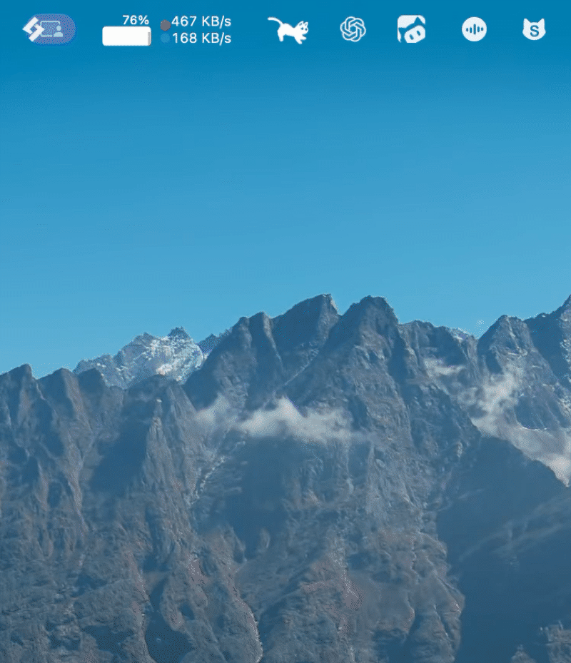

### 关键能力点

- **四种图标样式**（`MenuBarIconStyle.selectIconStyle`）
  - **应用图标**：默认 Logo。
  - **动态风扇**：旋转小风扇，转速随 CPU 使用率实时变化（`updateFanSpeed`，20Hz 平滑动画、3 秒换档）。
  - **日期**：菜单栏直接显示当天日期（`startDateTimer`）。
  - **自定义图标**：任意 SF Symbol 名称（`setSymbol`）。

- **自定义图标是彩蛋**：连续点击主图标若干次解锁，解锁后才有「自定义菜单栏图标」子菜单和庆祝动效（`MenuBarIconEasterEggManager.unlock` / `presentUnlockCelebration`）；解锁后还能把该选项藏起来或放回来（`hideIconOption` / `restoreIconOption`）。

- **图标位置记忆**：监控部件在菜单栏中的顺序会被保存，重启还原（`saveStatusItemPosition` / `restoreStatusItemPosition`）。

- **唯一实例保护**：重复启动会自动退出旧实例；检测到官方原版 Frset 同时在跑会提示（`enforceSingleMenubarOwner`）。

- **拖文件到图标**：把文件拖到菜单栏图标上可直接进「文件中转」暂存（`StatusItemDropProxy`——`NSStatusBarButton` 本身不是拖放目标，这里加了一层覆盖视图）。

### 注意事项

- 图标被系统折叠时，到「系统设置 → 控制中心 → 菜单栏」调整，或按住 `⌥` 点击菜单栏展开。
- 动态风扇持续旋转会增加少量菜单栏重绘；介意就换回应用图标。
- 菜单里「打开面板」显示的键位是历史遗留，**实际生效的是 `⌥A`**，以设置页「快捷键」里显示的为准。

### 实现索引

| 文件:行号 | 函数 | 职责 |
|---|---|---|
| `StatusBarController.swift:139` | `installMainItem` | 创建并安装主图标状态项 |
| `StatusBarController.swift:424` | `mainItemClicked` | 主图标点击分发（左键面板 / 右键菜单） |
| `StatusBarController.swift:256` | `saveStatusItemPosition` | 保存状态项在菜单栏的位置 |
| `StatusBarController.swift:262` | `restoreStatusItemPosition` | 重启后还原位置 |
| `StatusBarController.swift:270` | `rebuild` | 偏好变化后重建全部状态项 |
| `StatusBarMenuBuilder.swift:11` | `mainMenu` | 组装主图标右键菜单 |
| `StatusBarMenuBuilder.swift:83` | `customIconSubmenu` | 自定义图标子菜单 |
| `MenuBarIconStyle.swift:257` | `selectIconStyle` | 切换图标样式 |
| `MenuBarIconStyle.swift:476` | `startFan` | 启动风扇动画 |
| `MenuBarIconStyle.swift:513` | `updateFanSpeed` | 按 CPU 使用率调整转速 |
| `MenuBarIconStyle.swift:465` | `startDateTimer` | 日期样式定时刷新 |
| `StatusItemDropProxy.swift` | `draggingEntered` / `performDragOperation` | 拖文件到图标进中转 |

---

## 第二章 使用统计

### 功能是什么

记录你实际用了哪些功能、用了多少次，并以三层版面呈现：五张指标卡 → 总览 + 最近 30 天柱状图 → 跨年活动热力图。**数据只存本机 SQLite，不上传、不联网。**

### 用户怎么用

| 入口 | 操作 |
|---|---|
| 菜单栏右键 →「使用统计」 | 打开统计窗 |
| `kitnest://statistics` | 同上 |
| 设置 → 数据 → 统计 | 配置统计开关、导出/导入 |

窗口结构（`StatisticsRootView`）：

1. **顶部**：今天日期 + 今天的总事件数。
2. **五张指标卡**（`MetricCardView`）：常用动作的今日计数。
3. **总览 + 30 天柱图**：每天一根柱，看的是一段时间的趋势。
4. **跨年热力图**：GitHub 贡献图那种格子，颜色深浅表示当天活跃度（`heatCellView`）。

### 演示

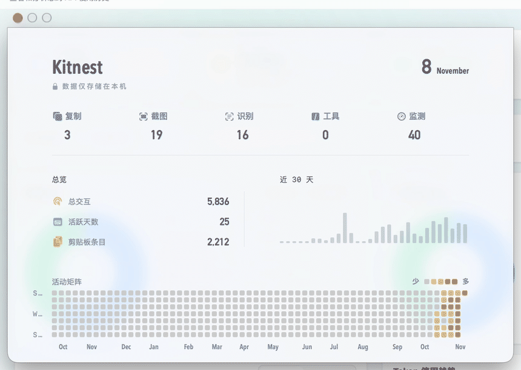

### 关键能力点

- **50+ 种事件**（`AnalyticsEvent`，`Storage/Database.swift:370`）
  - 剪贴板：`panelOpen` / `historyCopy` / `historyBatchCopy` / `clipboardCapture` / `clipboardPaste`（粘贴计数）…
  - 截图族：`screenshotCapture` / `longScreenshot` / `annotateEdit` / `pinImage` / `screenRecord` / `colorPickSuccess`
  - 搜索与工具：`searchExecute` / `toolExecuteSuccess` / `webSearchOpen` / `ocrUse` / `translationUse`
  - 传输：`fileDownload` / `fileTransferSend` / `fileTransferReceive` / `transferDockOpen` / `screenCastOpen`
  - 系统：`monitorPanelOpen` / `networkInfoClick` / `activityMonitorClick`
  - 设置：`settingsOpen` / `settingsExportSuccess` / `settingsImportSuccess` / `changelogClick`
  - 商业化（原版键位保留）：`proPageView` / `paywallView` / `proPurchaseSuccess` …

- **事件名自动派生**：camelCase → snake_case（`historyCopy` → `history_copy`），所以数据库里的键名和代码里的枚举一一对应。

- **按天聚合**：写入时按日期分桶，跨年热力图直接读年度表，不需要全表扫描。

- **导出/导入**：「设置 → 数据」里导出的偏好包里**包含统计**（`StatisticsSettingsPane.performExport`），换机不丢历史。

### 注意事项

- 统计是**纯本地**的：没有账号、没有上报、没有任何网络请求。
- 关闭统计开关后不再记新事件，但已有数据保留；需要彻底清空去「设置 → 数据」。
- 热力图的「今天」格子是实时数，当天多次打开都会累加。

### 实现索引

| 文件:行号 | 函数 | 职责 |
|---|---|---|
| `StatisticsRootView.swift:108` | `body`（三层版面） | 指标卡 → 总览/柱图 → 热力图 |
| `StatisticsRootView.swift:312` | `MetricCardView` | 单张指标卡 |
| `StatisticsRootView.swift:520` | `heatCellView` | 热力图单元格（column/day/count/level/isFuture） |
| `StatisticsWindowController.swift:83` | `show` | SwiftUI + NSWindow 底座 |
| `Database.swift:370` | `enum AnalyticsEvent` | 50+ 事件定义 |
| `Database.swift:398` | `eventName` | camelCase → snake_case |
| `StatisticsSettingsPane.swift:264` | 事件映射表 | 设置页展示用的事件名与中文说明 |

---

## 第三章 主面板与首页

### 功能是什么

主面板是 Kitnest 的核心窗口，从菜单栏图标「长出来」。顶部胶囊切页：**主页**（搜索 + 网盘链接 + 日历 + 剪贴板历史）、**性能监测**、**文件中转**、**投屏**——后三页可在设置里关掉。

### 用户怎么用

| 入口 | 操作 | 效果 |
|---|---|---|
| `⌥A` / 左键图标 | 呼出/收起 | 从图标下方展开，带三角指示器 |
| `⌥F` | 打开并搜索 | 面板打开且搜索框获得焦点 |
| `⌥V` | 打开剪贴板 | 面板打开并切回首页 |
| `⌘P` | 置顶 | 面板常驻，失焦不收起 |
| `Esc` | 关闭 | 面板收起 |
| 顶部工具条 | 截图 / 取色 / 悬浮剪贴板 / 三段切换 / 齿轮菜单 | 快速动作与切页 |
| 拖文件进面板 | 任意位置 | `.json` / `.txt` 打开 JSON 检查器，其他进中转 |

### 演示


### 关键能力点

- **首页从上到下**：搜索区段 → 网盘链接条 → 日历卡 → 剪贴板历史列表（`PanelRootView.homePage`）。

- **页签可自定义**（`PanelSegments`）：设置里能决定哪些页显不显示、顺序如何。关掉「文件中转」后，面板只剩主页和监测。

- **从图标长出来的动效**（`PanelMotion` + `WindowReveal`）：`scaleEffect(anchor: .top) 0.93→1` + 上移 10pt + 弹簧，配合根视图顶部 9pt 让位和居中三角指示器（尖端朝上指向图标）。这是 1:1 复刻原版的行为。

- **失焦自动收起**：面板是 transient 窗口，点别处就收（`TransientWindows`）。`⌘P` 置顶可改变这一行为。

- **宽度可调**（`Personalization.panelWidth`）：360 / 400 / 440 三档，设置里改完立刻生效。窗口宽度 = 选中值，**不再叠加字号缩放**（v73 修的三重缩放 bug）。

- **玻璃态**：面板用 `NSVisualEffectMaterial.popover`，能透出桌面模糊（`LiquidGlass`）。

- **子窗口身份**：面板里弹出的窗口打了一个可识别标记（`PanelChildWindow`），这样「点外收起」的逻辑不会误伤自己弹的窗。

### 注意事项

- 面板是「临时窗口」：**失焦即收**。需要长时间看着就 `⌘P` 置顶。
- 「文件中转」段可以关掉，关掉后底部只剩两页。
- 面板里点日期格会打开系统日历（`calendarDayOpen` 计数），不是应用内弹窗。

### 实现索引

| 文件:行号 | 函数 | 职责 |
|---|---|---|
| `PanelRootView.swift` | `homePage` / `body` | 首页版式与页签切换 |
| `PanelController.swift:1` | `show` / `hide` / `toggle` | 面板可见性与锚点展开 |
| `PanelController.swift` | `syncPanelFrameToPersonalization` | 个性化改动同步窗口尺寸 |
| `PanelSegments.swift` | `PanelSegment` 枚举 | 页签定义与显隐 |
| `FloatingPanel.swift` | `canBecomeKey` / `canBecomeMain` | 浮窗行为（不抢主窗口） |
| `PanelChildWindow.swift` | `isPanelChild` | 子窗口身份标记 |
| `PanelMotion.swift` | `present` / `dismiss` | 展开/收起动效参数 |
| `WindowReveal.swift:1` | `reveal` | 从点扩散到整窗的动画 |
| `TransientWindows.swift` | `installOutsideClickMonitor` | 点外收起（四路冗余监听） |
| `JSONInspectorView.swift` | `handleFileDrop` / `parse` | 拖入 JSON 打开检视器 |

---

## 第四章 剪贴板历史

### 功能是什么

自动记录你复制过的一切：文本、富文本、图片、文件、链接。支持搜索、类型筛选、标签、编辑、批量操作、暂停记录。**默认保留 30 天 / 上限 2GB，两个数都能改。**

### 用户怎么用

| 入口 | 操作 | 效果 |
|---|---|---|
| `⌥A` / `⌥V` | 打开面板首页 | 剪贴板历史列表 |
| `⇧⌘V` | 悬浮剪贴板 | 鼠标旁迷你列表（第五章） |
| 双击一条 / 回车 | 回贴 | 写回系统剪贴板 |
| 右键 | 菜单 | 置顶、标签、编辑、隔空投送、删除 |
| `⇧⌥R` | 暂停/恢复记录 | 处理敏感内容时用 |
| 底部工具条 | 筛选 / 标签 / 编辑 / 上传 | 批量与整理 |

### 演示

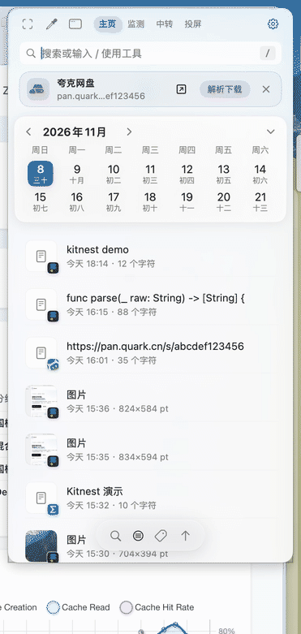

### 关键能力点

- **自动记录 + 去重**（`ClipboardManager.pollTick` / `ingest`）
  轮询系统剪贴板，按内容指纹去重。重复复制同一条只更新位置和计数，不新增一行（`ClipboardPasteboardReader.fingerprint`）。

- **多类型识别**（`ClipboardPasteboardReader`）
  - 纯文本、富文本（RTF 保真存储）、图片（记尺寸）、文件（记路径）、URL、颜色值分别入库。
  - 富文本粘贴时保留格式，不是拍平成纯文本。

- **来源应用**：每条显示来源 App 图标（`ClipboardAppIconCache`）。隐私名单里的应用复制的内容不记录。

- **类型筛选**（`ClipboardFilterKind`）：全部 / 文本 / 图片 / 链接 / 文件 / 代码 / 颜色 / 工具生成 / 笔记。

- **标签系统**（`TagStore`）：建标签、改名、设颜色、给条目打标签；支持批量加/减标签（`historyBatchTagAdd`）。

- **条目编辑**（`ClipboardItemEditWindowController`）：改正文、设别名标题、写备注。

- **图片自动 OCR**：图片入库后自动调度识别，识别出的文字能被全局搜索命中（`scheduleOCR`）。所以「截图里的一句话」也能搜到。

- **工具产出回流**（`ingestToolOutput`）：截图 OCR 结果、AI 总结、小工具输出会以「工具生成」类型进历史，和手动复制区分开。

- **清理策略**（`ClipboardPruneSchedulers.prune`）：按条数 / 天数 / 体积三个维度自动清理，设置里可调。

- **文件落盘**：图片和大文件存在 `~/Library/Application Support/FrsetNext/` 下，数据库里只存相对路径（`ClipboardFileStorages`）。所以备份数据目录 = 备份全部内容。

- **NSTableView 骨架**（`ClipboardTableHostView`）：列表不是 SwiftUI `List`，是 `NSScrollView + NSTableView`——为了多选、拖拽、行内编辑和滚动性能。

### 注意事项

- 密码管理器（1Password 等）的复制通常「几秒后清空剪贴板」，可能记录不到或被快速清理，属预期。
- 暂停记录期间复制的内容不进历史；恢复后从新内容开始。
- 大图历史会占磁盘：本机实测 89 张图约 440MB。介意就把上限调小。
- 数据库用 WAL 模式，`-wal` 文件超过 1MB 会 checkpoint 截断，不会无限涨。

### 实现索引

| 文件:行号 | 函数 | 职责 |
|---|---|---|
| `ClipboardManager.swift` | `pollTick` | 剪贴板轮询节拍 |
| `ClipboardManager.swift` | `ingest` | 入库（去重 + 分类） |
| `ClipboardManager.swift` | `ingestToolOutput` | 工具产出回流 |
| `ClipboardPasteboardReader.swift` | `readText` / `readRichText` / `readImage` / `readFiles` / `readURL` | 各类型归一化读取 |
| `ClipboardPasteboardReader.swift` | `fingerprint` | 内容指纹（去重键） |
| `ClipboardRepository.swift` | `insert` / `query` / `delete` | SQLite 读写 |
| `ClipboardFileStorages.swift` | `store` / `resolve` | 落盘文件与相对路径 |
| `ClipboardPruneSchedulers.swift` | `prune` | 条数/天数/体积三档清理 |
| `TagStore.swift` | `create` / `assign` / `toggle` | 标签 CRUD 与分配 |
| `ClipboardItemEditWindowController.swift` | `setContent` / `setAliasTitle` / `setNote` | 条目编辑 |
| `ClipboardTableHostView.swift` | `tableView(_:viewFor:)` | 行视图与拖拽 |
| `ClipboardSectionView.swift` | `body` / `refresh` | 面板内列表 |

---

## 第五章 悬浮剪贴板工作台

### 功能是什么

一个脱离主面板的迷你剪贴板：**贴在鼠标旁边**，`⇧⌘V` 唤出，找东西、粘贴、拖走都不用手移回屏幕角落。

### 用户怎么用

| 操作 | 效果 |
|---|---|
| `⇧⌘V` | 在鼠标位置弹出 / 收起 |
| 点击条目 | 复制到剪贴板并关闭 |
| 拖条目 | 拖成文件或文本到目标 App |
| 顶部图钉 | 钉住不自动收起 |
| 拖动标题区 | 移动位置，位置会被记住 |
| 底部搜索框 | 就地过滤 |

### 演示

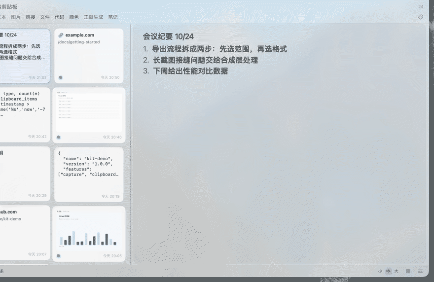

### 关键能力点

- **跟随鼠标**（`FloatingClipboardWindow.showNearMouse`）：唤出时以鼠标为锚点，自动避让屏幕边缘。
- **几何持久化**（`FloatingClipboardWindow`）：位置、尺寸、是否钉住全部落到 `floatingClipboard.*` 偏好键，重启还原。
- **工作台形态**（`FloatingClipboardDesk`，1095 行）：比迷你列表更强的一档——支持分组、批量、拖出，是 2026-11-03 按用户指定「一模一样」重做的版式。
- **不抢焦点**：唤出时不激活 App，当前正在编辑的文档不会失焦。
- **快捷键可改**：`floatingClipboard` 是 19 条默认热键之一，支持改绑或改成「双击修饰键」模式（连按两下 `⌘`）。

### 注意事项

- 悬浮窗不记录来源应用过滤，隐私名单照常生效（名单里的应用内容根本不会入库）。
- 钉住后不会自动收起，记得手动关。
- 拖出操作固定为「拷贝」，不会移动原始记录。

### 实现索引

| 文件:行号 | 函数 | 职责 |
|---|---|---|
| `FloatingClipboardWindow.swift:1` | `toggle` / `show` / `hide` | 显隐与动画 |
| `FloatingClipboardWindow.swift` | `showNearMouse` | 鼠标锚点定位 |
| `FloatingClipboardWindow.swift` | `setPinned` | 钉住状态落盘 |
| `FloatingClipboardDesk.swift:1` | `body` | 工作台版式（分组/批量/拖出） |
| `FloatingClipboardDesk.swift` | `beginDrag` | 拖出成文件 |

---

## 第六章 预览与编辑

### 功能是什么

鼠标悬停在剪贴板条目上，弹出内容预览：文本自动判 Markdown / 代码 / JSON 并高亮；图片显示缩略图并**自动识别二维码**；Markdown 里的 Mermaid 流程图直接渲染成图。拖入 `.json` 文件则打开独立的 JSON 检视器。

### 用户怎么用

| 操作 | 效果 |
|---|---|
| 悬停条目 | 弹出预览气泡 |
| 预览里点图片 | 放大查看 |
| 拖 `.json` / `.txt` 进面板 | 打开 JSON 检视器，可折叠节点 |
| 右键条目 →「编辑」 | 打开编辑窗（改正文/别名/备注） |

### 演示

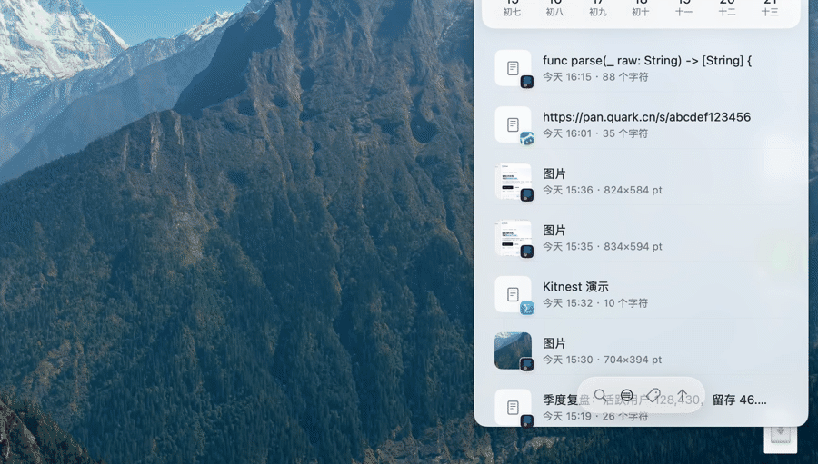

### 关键能力点

- **内容分态**（`PreviewPopoverContentModel`）：文本 / 落盘长文 / Markdown / JSON / 代码 / 图片 / 文件，七种状态各有渲染器。

- **Markdown 渲染**（`PreviewMarkdownRenderer`）：标题、列表、表格、引用、代码块、目录（`renderTOC`）、行内样式。够读 AI 回帖和 README，不追求完整 CommonMark。

- **Mermaid / PlantUML**（`MermaidRenderer`）：代码块里写 ` ```mermaid `，预览里直接出流程图，不用跳浏览器。

- **代码高亮**（`CodeHighlighter` + `CodeLexer`）：自研词法器，支持 20+ 语言，主题与「代码预览」工具共用。为什么自己写：本项目用 `swiftc` 直编、无 SPM 依赖，引第三方会把体积顶上去。

- **二维码识别**（`PreviewImageLoader.detectQRCode`）：图片预览时顺带扫二维码，识别到就在旁边显示内容，可一键复制。

- **大文本保护**（`LargeTextPreviewView`）：几 MB 的文本不做全量高亮，按纯文本呈现，滚动不卡。

- **JSON 检视器**（`JSONInspectorView`，1192 行）：树形结构、节点折叠、路径复制、格式化复制。为什么不做纯文本 pretty-print：几 MB 的 JSON 铺开就是几千行，既看不出结构也翻不到重点。

- **预览承载换过一次底座**（`MainPanelPreviewPopoverCoordinator`）：v71 起从 `NSPopover` 换成自绘窗口（`ClipboardPreviewWindowController`），因为 popover 在非激活面板里定位会漂。

### 注意事项

- 预览是延迟渲染：悬停约 150ms 才出，避免快速划过时狂建视图。
- Mermaid 渲染失败时显示源码，不报错。
- JSON 检视器只读；要改内容用「编辑」窗。

### 实现索引

| 文件:行号 | 函数 | 职责 |
|---|---|---|
| `PreviewPopoverContentModel.swift` | `classify` | 七态判定 |
| `PreviewPopoverContentView.swift` | `body` | 预览版式（1439 行） |
| `PreviewMarkdownRenderer.swift` | `render` / `renderTable` / `renderTOC` | Markdown 渲染 |
| `MermaidRenderer.swift` | `renderDiagram` | Mermaid/PlantUML → 图 |
| `PreviewImageLoader.swift` | `detectQRCode` | 图片里的二维码 |
| `LargeTextPreviewView.swift` | `body` | 大文本降级渲染 |
| `JSONInspectorView.swift` | `parse` / `copyFormatted` | JSON 树与复制 |
| `ClipboardPreviewWindow.swift` | `present` | 预览窗口底座 |
| `CodeHighlighter.swift` | `highlight` | 代码高亮入口 |
| `CodeLexer.swift` | `tokenize` | 词法分析 |

---

# 第二部分 · 截图族

> 这一族有 6 个功能共享同一条产出链路：**截图 → 动作条 → 落地**。
> 动作条是理解所有截图功能的中枢，先看它。

## 第七章 截图主流程

### 功能是什么

截图覆盖层是**自适应**的，不需要先选「窗口 / 区域」：

- 鼠标移到窗口里 → 整窗高亮并标出窗口名，**单击就截这个窗口**（被遮挡的部分也能完整还原）
- **想自己选范围，直接按下拖** → 拖出 4pt 以上就变成自定义框，松手截这个框
- 单击**空白桌面** → 截整个屏幕
- `⌘` 单击窗口 → 勾选多个，回车一次性截完并纵向拼成一张

v267 起删掉了「自动识别窗口 / 手动框选」这个模式开关和设置里的默认值选项——
动作本身就是模式。截完弹出**动作条**（19 个动作分 6 组），直接用，不用先保存再打开。

### 用户怎么用

| 快捷键 | 截什么 | 说明 |
|---|---|---|
| `⌥S` | 截图 | 自适应：悬停窗口单击截整窗 / 拖拽截自定义范围 / 点空白截全屏 |
| `⇧⌥W` | 窗口截图 | 与 `⌥S` 完全一致（自适应已包含窗口识别，保留此键只为习惯） |
| `⇧⌥L` | 长截图 | 框选区域后自动滚动采集拼接（第十章） |
| `⇧⌥C` | 截图并复制 | 截完直接进剪贴板，不弹动作条 |
| `⇧⌥S` | 截图提取文字 | 截完直接 OCR（第十四章） |
| `⇧⌥T` | 截图翻译 | 截完 OCR + 翻译（第十四章） |
| `⇧⌥P` | 截图并贴图 | 截完直接钉在屏幕上（第十一章） |

悬停窗口 → 整窗高亮并标出窗口名，单击即截；**按下后直接拖拽**则拉出自定义矩形，
松手截这个框。两条路在同一次截图里随时可换，不用切模式。
`⌘` 单击可勾选多个窗口（带序号），回车一次性截完并纵向拼成一张图。
单击没有窗口的空白处 = 截整个屏幕（相当于「全屏截图」，但不用换入口）。

通用操作：`Esc` / `Delete` / 右键取消；拖框时 `⇧` 出正方形、`⌥` 临时关闭元素吸附
（吸附会把框边对齐到光标下的控件/文本块边缘 8pt 内，但不会吸成整窗）。
第一次点击就生效，不需要先点一下把窗口激活。

> 旧版本有「窗口模式 / 区域模式」两档和覆盖层顶部的切换开关，v267 起全部移除；
> 偏好键 `capture.defaultPickMode` 不再读取。

### 动作条（19 个动作 / 6 组）

| 组 | 图标 | 展开项 |
|---|---|---|
| **复制** | 复制图标 | 复制 / 复制并识别 / 复制并翻译 / 保存 |
| **识别** | 文字框 | 识字 / 识码 / 翻译 / 屏幕翻译 |
| **钉住** | 图钉 | 钉住（当前外观）/ 经典 / 无边框 / 卡片 / 强调 / 挂到图帘 |
| **长截图** | 上下箭头 | （独立成组，点即用） |
| **编辑** | 铅笔 | 标注 / 美化 |
| **更多** | 省略号 | 空投 / 历史 |

- **点图标**执行该组的默认动作；**悬停**展开竖排子项列表（带组名标题，一个形态一行）。
- 「钉住」组里前五项是**外观形态**，只作用于这一张，不会改掉你以后钉图的默认外观。
- 键盘也能选：动作条上每个动作有字母键，例如 `p` = 钉住。

### 演示


### 关键能力点

- **窗口自动识别**（`CGWindowList` 快照 + 悬停命中）：进入截图即缓存所有在屏窗口矩形，
  鼠标进窗整窗高亮、单击截取；优先用 ScreenCaptureKit 做窗口级抓取，被遮挡的部分也能完整还原。
  这不是「抓最前台窗口」，是让你自己指哪个窗口。
- **窗口吸附**（`ElementSnap`，仅手动框选模式）：鼠标靠近控件/窗口边缘时吸附到边界；
  与上面的「窗口自动识别」是两套机制，按住 `⌥` 可临时关闭吸附。

- **延时截图**（`DelayedCaptureHUD`）：可选 3 / 5 / 10 秒倒计时，倒计时期间屏幕上有 HUD，方便摆好菜单再截。

- **取色**（`⌥C`，`Eyedropper`）：全屏透明层 + 跟随光标的放大镜，点击取色并复制 HEX；色值面板（`ColorValuePanel`）同时给出 RGB / HSL / 可点复制。

- **截图事件总屏**（`CaptureEventBus`）：每次截图产出都会广播，剪贴板、历史、图帘、统计各自订阅，互不直接引用。

- **动作条可换形态**（`CaptureToolbarStyle`）：图标条 / 药丸条 / 主副分栏三种，设置里选，默认药丸条。

- **非激活面板**（`CaptureActionChain`）：动作条是 `.nonactivatingPanel`，点它不会抢走你正在编辑的文档焦点。

### 注意事项

- 截图需要「屏幕录制」权限；第一次截会弹一次统一引导，之后只 Toast 提示。
- 截图不会自动进「截图历史」——需要保存或手动挂到图帘/钉图才留痕（历史记录的是**落盘文件**）。
- 动作条位置自动避让：默认贴选区下方，下方放不下就翻到上方。
- 多显示器时以鼠标所在屏为准。

### 实现索引

| 文件:行号 | 函数 | 职责 |
|---|---|---|
| `ScreenshotManager.swift:1` | `captureRegion` / `captureWindow` / `captureAndCopy` / `captureAndOCR` / `captureAndPin` | 六个截图入口 |
| `ScreenshotManager.swift` | `cGImage` / `capture(rect:)` | 按屏幕原生像素截取 |
| `ScreenshotManager.swift:408` | `ensureScreenRecordingPermission` | 权限探测（每次启动最多请求一次） |
| `ScreenshotOverlay.swift` | `mouseDown` / `keyDown` | 框选交互与取消 |
| `ElementSnap.swift` | `snapRect` | 窗口边界吸附 |
| `DelayedCaptureHUD.swift` | `start` | 延时倒计时 |
| `Eyedropper.swift` | `start` / `mouseMoved` | 取色与放大镜 |
| `ColorValuePanel.swift` | `body` | 色值面板 |
| `CaptureActionChain.swift` | `groups` / `present` | 动作条 6 组 19 项与呈现 |
| `CaptureActionToolbarView.swift` | `submenu` | 竖排子项列表 |
| `CaptureEventBus.swift` | `emit` / `subscribe` | 截图产出广播 |
| `CaptureToolbarStyle.swift` | `style` | 三种工具条形态 |

---

## 第八章 标注编辑器

### 功能是什么

截完点「编辑」进入标注窗口：12 种标注工具 + 撤销重做 + 导出。工具条竖排贴在右侧，颜色、线宽、字号都在里面调。

### 用户怎么用

| 工具 | 用途 |
|---|---|
| **矩形** | 框重点，可设描边/填充 |
| **椭圆** | 圈重点 |
| **箭头** | 指向说明 |
| **画笔** | 自由手绘，带压感宽度 |
| **文字** | 打字，可调字体/字号/颜色 |
| **备注** | 带引线的文字气泡 |
| **序号** | 自动递增的圆形编号（1、2、3…） |
| **荧光笔** | 半透明高亮，模拟马克笔 |
| **马赛克** | 像素化遮挡 |
| **模糊** | 高斯模糊遮挡 |
| **橡皮** | 擦除单条标注 |
| **智能擦除** | 涂抹移除图中物体（第九章） |

快捷键：`⌘Z` 撤销、`⇧⌘Z` 重做、`⌘S` 保存、`⌘C` 复制、`Esc` 关闭。

### 演示


### 关键能力点

- **画布用中性灰而不是纯黑**（`AnnotationEditorWindow`）：图片是主角，深色底会让人误判截图本身的明暗。

- **标注是可编辑对象，不是画上去的像素**（`AnnotationCompositor`）：每条标注记位置/样式/内容，撤销重做是操作栈，导出时才合成。

- **绕夹子/锚点旋转**：旋转矩形时围绕中心，箭头围绕起点，符合直觉。

- **文字工具条**（`TextFontPopover`）：字体、字号、颜色、对齐，参考 Snipaste / CleanShot 的版式。

- **竖排工具条的气泡说明**（`PinChrome`）：标题 11.5pt + 快捷键徽章 9.5pt + 一句用法 10pt，鼠标悬停才出现，不占地方。

- **导出合成**（`AnnotationCompositor.render`）：按屏幕缩放因子输出，2x 屏不会糊。

### 注意事项

- 标注窗口是独立窗口，可以同时开多个（不同截图）。
- 马赛克/模糊是**破坏性**的：导出后就还原不了原图细节，敏感信息处理前先留一份原图。
- 文字标注的字体列表取系统已安装字体，装了什么就有什么。

### 实现索引

| 文件:行号 | 函数 | 职责 |
|---|---|---|
| `AnnotationEditorWindow.swift:1` | `body` | 画布 + 工具栏版式（1882 行） |
| `AnnotationEditorWindow.swift` | `mouseDown` / `mouseDragged` | 绘制与拖拽 |
| `AnnotationCompositor.swift:13` | `enum Tool` | 12 种工具定义 |
| `AnnotationCompositor.swift` | `render` | 合成导出 |
| `AnnotationToolbarView.swift` | `body` | 竖排工具条 |
| `TextFontPopover.swift` | `body` | 文字样式面板 |
| `PinChrome.swift` | `bubble` | 悬停气泡说明 |
| `AnnotationSelfTest.swift` | `run` | 12 种工具的自检例程 |

---

## 第九章 美化与物体擦除

### 功能是什么

两个「让截图好看」的能力：

- **美化**（`BeautifyPanel`）：给截图加背景（纯色/渐变）、内边距、圆角、投影，做成可以直接发社交平台的样子。
- **物体擦除**（`ObjectRemovalEngine`）：涂掉图里不想要的东西（路人、水印、杂物），用双引擎填补。

### 用户怎么用

| 入口 | 操作 |
|---|---|
| 动作条 →「编辑」→「美化」 | 打开美化面板，实时预览 |
| 标注工具栏 →「智能擦除」 | 涂抹要移除的区域，松手自动填补 |
| 设置 → 截图 → 水印 | 给导出图加水印（第九章末） |

### 演示

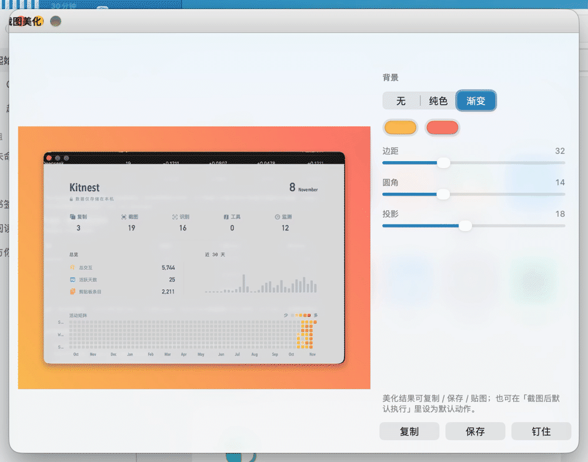

### 关键能力点

- **背景美化**（`BeautifyPanel`）
  - 纯色 / 渐变背景，内置几套配色。
  - 内边距可调（0~120pt），圆角可调，投影开关。
  - 全部纯 CoreGraphics 绘制，零第三方依赖。

- **双引擎擦除**（`ObjectRemovalEngine`）
  - 主力：基于周围像素的内容感知填充（inpainting）。
  - 兜底：纹理合成，处理大面积纯色区域更快。
  - 为什么两个：前者对复杂纹理好但慢，后者对纯色背景快但不适合复杂图。

- **水印**（`Watermark`）
  - 和「背景美化」不是一回事：水印是**叠加**在图上，美化是**包边**。
  - 支持文字水印，位置四角/平铺，透明度可调。
  - 「导出时加水印」是独立开关，不影响预览。

### 注意事项

- 擦除是重计算：大图（4K 以上）涂抹后要等 1~3 秒，面板上有进度指示。
- 美化只影响导出，不改原图文件。
- 水印开关在「设置 → 截图 → 导出」里，默认关。

### 实现索引

| 文件:行号 | 函数 | 职责 |
|---|---|---|
| `BeautifyPanel.swift:1` | `body` | 背景/内边距/圆角/投影面板 |
| `BeautifyPanel.swift` | `render` | 合成美化结果 |
| `ObjectRemovalEngine.swift:1` | `remove(in:mask:)` | 双引擎调度 |
| `ObjectRemovalEngine.swift` | `inpaint` / `textureSynthesize` | 两个填充引擎 |
| `Watermark.swift` | `apply` | 水印叠加 |

---

## 第十章 长截图

### 功能是什么

框一块区域，程序**自动滚动并连续采集**，最后拼成一张长图。适合聊天记录、长网页、长文档。

### 用户怎么用

| 步骤 | 操作 |
|---|---|
| 1 | `⇧⌥L` 进入长截图 |
| 2 | 框选要截的区域（只框内容区，别框滚动条） |
| 3 | 按提示滚动（有的页面要手动滚，有的自动滚） |
| 4 | 采集中 HUD 显示已采集帧数与高度 |
| 5 | 点「完成」进入拼接预览，可裁剪、导出 |

### 演示

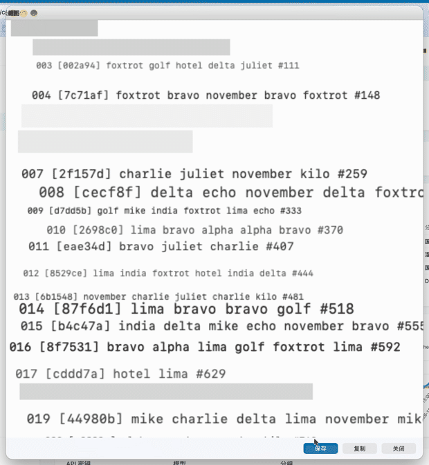

### 关键能力点

- **会话状态机**（`LongScreenshotSession`）
  `IDLE → RUNNING → CAPTURING → PROCESSING → FINISHED / CANCELLED`，每步都能取消，不会卡死。

- **采集走 30fps SCStream**（`LongScreenshotFrameStream`）
  旧实现每次 tick 都 `sckCaptureSync`，一帧 100ms+；改成会话期开一条流（`sourceRect` = 选区、排除本 App 全部窗口），帧率稳、CPU 低。

- **拼接基于已知位移**（`LongScreenshotStitcher`）
  不是简单的「重叠区域匹配」，而是记录每帧的滚动偏移，按偏移对齐后只保留新增的那一条。这样即使页面有渐变背景也能接准。

- **动态内容裁切**（`LongScreenshotMotionCrop`）
  滚动时画面里常有不跟着滚的东西（视频、光标、悬浮按钮）。这一层识别「没动的部分」并从新增条里剔除，避免它们重复出现。

- **实时预览卡**（`LongScreenshotPreviewWindow`）
  采集过程中右侧浮出一张缩略长图，随时能看到拼到哪了；可以翻到左边、也能在超宽时切换布局。

- **HUD 进度**（`LongScreenshotHUD`）
  旧实现框选确认后只剩一个 Toast，采集中完全没反馈。现在 HUD 常驻显示帧数、当前高度、耗时。

- **离线自检**（`LongScreenshotDiagnostics`）
  `kitnest://longshotcheck` 用「合成长图 + 已知位移切片」回灌拼接器，校验画布尺寸/接缝/重复帧/向上滚动——不碰鼠标也能验证算法。

### 注意事项

- 只框**内容区**：把滚动条框进去会导致每帧右侧差异，接缝处会看到条状残影。
- 页面里如果有固定悬浮元素（回到顶部按钮、客服气泡），它们会被动态裁切层识别；识别失败就手动裁掉。
- 采集帧率默认 30fps，滚动越快越容易掉帧；慢慢滚质量更好。
- 拼接结果先进预览窗，**确认后才落盘**，不会覆盖原截图。

### 实现索引

| 文件:行号 | 函数 | 职责 |
|---|---|---|
| `LongScreenshotSession.swift:477` | `begin` / `tick` / `finish` | 状态机全流程 |
| `LongScreenshotFrameStream.swift:18` | `start` / `stream(_:didOutput:)` | 30fps SCStream 采集 |
| `LongScreenshotStitcher.swift:731` | `stitch` | 按偏移对齐拼接 |
| `LongScreenshotMotionCrop.swift` | `crop` | 动态元素剔除 |
| `LongScreenshotHUD.swift` | `update` | 采集进度 HUD |
| `LongScreenshotPreviewWindow.swift` | `present` | 实时预览卡 |
| `LongScreenshotCoordinator.swift:423` | `beginSelection` / `finishCurrentSession` | 入口与收尾 |
| `LongScreenshotDiagnostics.swift` | `runStitcherCheck` | 离线拼接自检 |
| `Stitcher.swift` | `merge` | 基础拼接算法 |

---

## 第十一章 钉图

### 功能是什么

把一张截图**钉在桌面最上层**当参考：可以拖动、缩放、改透明度、加标注，始终浮在其他窗口上面。

### 用户怎么用

| 操作 | 效果 |
|---|---|
| `⇧⌥P` | 截完直接钉住（用当前默认外观） |
| 动作条「钉住」组 | 按指定形态钉：经典 / 无边框 / 卡片 / 强调 |
| 拖动 | 移动位置 |
| 滚轮 / 双指 | 缩放（10%~400%） |
| 右键 | 菜单：标注、OCR、翻译、保存、透明度、关闭 |
| 悬停 | 浮出控制条（关闭 / 缩放 / 透明度 / 更多） |

### 四种形态

| 形态 | 边框 | 圆角 | 阴影 | 适合 |
|---|---|---|---|---|
| **经典** | 1.5pt 自动取色 | 10pt | 有 | 默认，任何背景都不违和 |
| **无边框** | 无 | 0 | 无 | 贴图当壁纸、无缝拼 |
| **卡片** | 2pt 白 | 16pt | 有 | 放在深色桌面，像一张卡片 |
| **强调** | 2pt 主题色 | 12pt | 有 | 演示时突出 |

> 形态**只作用于这一张**（`PinAppearance`）。在右键菜单里改外观会同时写回全局，保持「新钉图沿用上次设置」的老行为。

### 演示


### 关键能力点

- **自动取边框色**（`PinStyle.sampledBorderColor`）：按图片平均亮度决定描边是深还是浅，深色图用白边、浅色图用深边。取样结果按图缓存一次。

- **磁性吸附**（`PinStyle.magnet`）：拖到屏幕边缘或别的钉图旁边会吸过去对齐。

- **控制条自动隐藏**（`PinStyle.chromeAutoHide`）：悬停才出现，几秒不动自己淡出，不挡图。

- **每张图独立外观**（`PinWindow` + `PinAppearance`）：边框宽度、颜色、圆角、阴影、磁性、透明度、控制条超时，全部随窗口带一份。

- **逆向外观参数**：阴影 `opacity 0.23 / radius 9 / offset (0,-5)`、圆角 `25`（按卡片宽度自适应到 8~25）——这些数值是从 1Capture 二进制里逐条还原的，不是拍脑袋。

- **标注竖栏**（`PinChrome`）：钉图上也能直接加标注，工具条竖排在右侧，样式与标注编辑器一致。

### 注意事项

- 钉图数量多会占内存：每张是一份完整位图。用完记得关，右键菜单有「关闭全部」。
- 钉图**不参与截图**（`sharingType = .none`），所以钉一张参考图再截别的图，参考图不会跑进截图里。
- 透明度过低时容易找不到，控制条上有恢复默认。

### 实现索引

| 文件:行号 | 函数 | 职责 |
|---|---|---|
| `PinWindow.swift:500` | `PinnedScreenshotContentView.draw` | 绘制（边框/圆角/透明度） |
| `PinWindow.swift:1140` | `menu` | 右键菜单 |
| `PinWindow.swift:1380` | `PinnedScreenshotWindow` | 窗口（非激活、置顶、阴影） |
| `PinWindow.swift` | `PinAppearance` / `preset` | 四形态参数 |
| `PinWindow.swift` | `showControls` / `magnify` | 控制条与缩放 |
| `PinChrome.swift` | `bubble` / `toolbar` | 标注竖栏与说明气泡 |
| `PinStyle.sampledBorderColor` | — | 按图取边框色 |

---

## 第十二章 图帘

### 功能是什么

截图后**不落地**，先挂在屏幕顶边的一条帘线上，像晾衣绳上的夹子。需要时拖进聊天窗口、复制、保存或钉图；到时间自己收起，但内容不删。

> 名字：v263 之前叫「悬挂架 / 袋子 / 晾衣杆」，v263 起统一叫**图帘**。

### 用户怎么用

| 操作 | 效果 |
|---|---|
| `⇧⌥G` | 展开 / 收起图帘 |
| 截图后（开启「自动上架」时） | 自动挂上去 |
| 动作条 → 钉住组 →「挂到图帘」 | 手动挂一张 |
| 单击卡片 | 复制图片 |
| 拖卡片 | 拖出成文件（Finder / 聊天窗 / 编辑器都行） |
| 悬停卡片 | 浮出保存 / 钉图 / 移除三个按钮 |
| 右键卡片 | 菜单：复制、保存到…、在 Finder 中显示、钉住、放大/缩小图帘、移除 |
| **按住 `⌘` 左右拖** | 整条图帘等比放大（72~420pt） |
| `⌘` + 滚轮 | 同上 |

### 演示

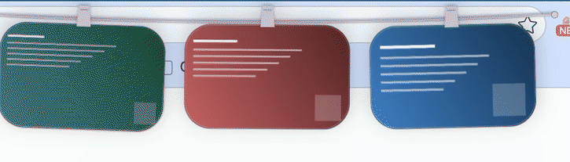

### 关键能力点

- **四种帘线**（`CurtainRopeStyle`）
  - **原版**：一根半透明的线，任何桌面都不抢眼。
  - **拐杖糖**：白线缠红条纹，最像晾衣绳。
  - **圣诞彩灯**：线上等距小灯，四色循环，深色桌面最好看。
  - **积雪**：线上积雪，冬天用。
  - 四种全部用 CoreGraphics 画，**不引入粒子层**——常驻粒子在滚动/缩放时掉帧。

- **几何是从二进制还原的**（`CurtainRopeGeometry`）
  - 三次贝塞尔，控制点在 1/3 和 2/3（不是二次贝塞尔的单控制点）。
  - 下垂量按宽度算：`min(width × 0.018, 28)`，和挂了几张无关。
  - 线端距视图顶 12pt；每道描边带 `shadow(黑 28%, offset(0,1), blur 2)`——靠阴影勾轮廓，而不是双色描边。

- **卡片跟着帘线歪**（`CurtainRopeGeometry.tilt`）：按该点切线斜率旋转，限幅 ±4°。挂在一根下垂的线上还笔直垂着，是「假」的最大来源。

- **常驻微摆**用 `CABasicAnimation` 改 transform（不重绘、跑在 render server）；已经在摆就不重挂，避免设置页拖滑块时整排卡片跳动。

- **缩放整条帘**（`CurtainController.resizeStep`）
  - ⌘ 拖动 / ⌘ 滚轮 / 右键菜单三入口。
  - 缩放按**屏幕坐标**算增量——用视图坐标会随窗口变宽形成正反馈（实测一拖就冲到上限）。
  - 拖动中只改临时宽度并原地重排（`updateLayout`），**不重建视图、不重挂动画**；松手才写偏好。
  - 帘线、夹子、绳结、间距、垂度统一乘 `railScale`（卡片宽 / 140，夹 0.8~3）。

- **「帘线缩放」可以单独关**（`CurtainPref.railScalesWithCards`）：关掉后只放大图片，帘线保持原粗细。

- **屏幕放不下时自动收窄**：优先保证整条帘子完整可见，张数变少会自己放大回去。

- **不常驻**：开关关着时不建窗口、不占内存。默认**关闭**。

- **不进截图**（`sharingType = .none`）：帘子浮在桌面上，但你截别的图时它不会跑进去。

### 注意事项

- 默认关闭，开关在「设置 → 截图与钉图 → 图帘」。
- 到点只**收起**，不删内容；下次唤出内容还在。
- 超过「最多张数」（默认 8）时从最旧的开始挤出帘子，**文件不删**。
- 卡片放大到 220pt 以上会自动重解一次高清缩略图，只重解一次。

### 实现索引

| 文件:行号 | 函数 | 职责 |
|---|---|---|
| `CurtainController.swift:1` | `attach` / `insert` | 挂载与插入（含去重/上限） |
| `CurtainController.swift` | `show` / `hide` / `dismissAll` | 生命周期 |
| `CurtainController.swift` | `layoutMetrics` / `contentSize` | 按屏幕反算卡片宽 |
| `CurtainController.swift` | `resizeStep` / `resizeEnd` | ⌘ 缩放（临时宽度 → 落盘） |
| `CurtainController.swift` | `upgradeThumbnailsIfNeeded` | 放大后重解缩略图 |
| `CurtainModel.swift` | `CurtainItem` / `CurtainPref` / `CurtainRopeStyle` | 模型与偏好 |
| `CurtainWindow.swift` | `CurtainRopeGeometry` | 三次贝塞尔几何与切线 |
| `CurtainWindow.swift` | `drawClip` / `drawLights` / `drawSnow` | 夹子与四种帘线 |
| `CurtainWindow.swift` | `reload` / `updateLayout` | 重建 vs 原地重排 |
| `CurtainWindow.swift` | `animateDrop` / `startSway` | 落入摆动与常驻微摆 |
| `CurtainSettingsPane.swift` | `body` | 设置页（开关/样式/时长/张数/宽度/帘线缩放） |

---

## 第十三章 截图历史

### 功能是什么

所有**落盘过**的截图都在这里：缩略图网格、按时间分组、点击定位到文件。

### 用户怎么用

| 入口 | 操作 |
|---|---|
| 面板首页 → 截图区段 →「历史」 | 打开历史网格 |
| 动作条 →「更多」→「历史」 | 同上 |
| `kitnest://capture?history=1` | 深链直达 |

### 演示

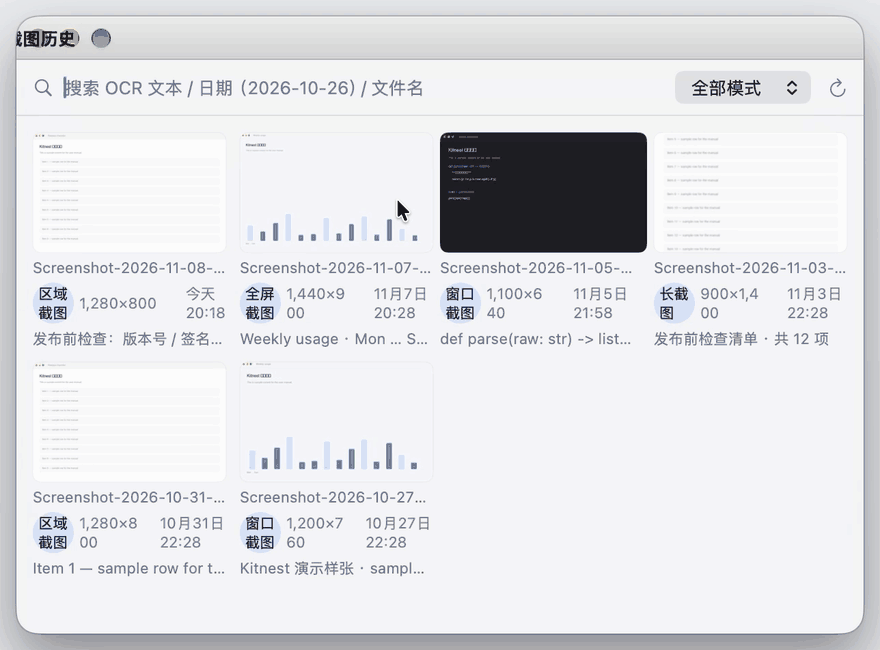

### 关键能力点

- **只记落盘文件**（`CaptureHistoryStore`）：内存里截完就丢的不进历史。所以历史条目都能在 Finder 里找到。
- **缩略图分级解码**（`ArchiveEntryThumbnail` 同款策略）：先出小图，滚动停止后再补大图，避免一次解码几十张 6K 截图。
- **按时间分组**：今天 / 昨天 / 更早，每组一个标题。
- **点击定位**：单击选中，双击用系统预览打开，右键「在 Finder 中显示」。

### 注意事项

- 历史只记**本应用截的图**，系统截图（`⇧⌘3/4`）不会进来。
- 删除历史条目**不删原文件**，只是从索引里去掉。

### 实现索引

| 文件:行号 | 函数 | 职责 |
|---|---|---|
| `CaptureHistoryStore.swift:294` | `append` / `all` | 落盘记录索引 |
| `CaptureHistoryView.swift:410` | `body` / `grid` | 缩略图网格 |

---

## 第十四章 文字识别、翻译与二维码

### 功能是什么

三件事共享一条「图 → 文字」的链路：

- **识字**：截图或图片转可复制文本。
- **翻译**：识别后翻译，译文回流剪贴板。
- **识码**：二维码 / 条形码内容提取。

### 用户怎么用

| 快捷键 / 入口 | 效果 |
|---|---|
| `⇧⌥S` | 截图并识字，结果窗可选中复制 |
| `⇧⌥T` | 截图并翻译，译文弹提示并进剪贴板 |
| `⇧⌥D` | 划词翻译（翻译当前选中的文本） |
| 动作条「识别」组 | 识字 / 识码 / 翻译 / 屏幕翻译 |
| 图片预览 | 自动识别二维码，旁边显示内容 |
| 截图历史 → 右键 | 对历史截图识字 |

### 演示

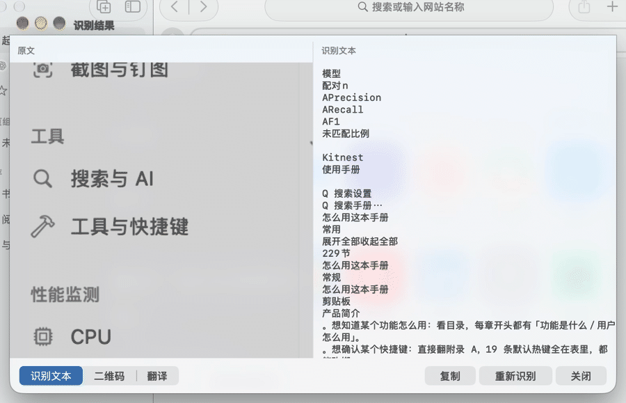

### 关键能力点

- **两级 OCR 引擎**（`PPOCROCR`）
  - **Apple Vision 负责「文字在哪」**：文本行检测，快且准。
  - **PP-OCR 负责「这是什么」**：逐行识别，中文识别率更高。
  - 组合起来比单用任一个都准：Vision 单独用对中文长句容易断，PP-OCR 单独用定位差。

- **PP-OCR 走子进程**（`PPOCROCREmote` + `FrsetOCRHelper`）
  为什么不在进程内：ONNX Runtime 加载模型要几百 MB 内存，常驻会一直占着。
  子进程按需启动、识别完退出，内存立即归还。代价是首次识别多约 300ms。

- **结果窗**（`ScreenshotOCRWindow`）
  原文视图可选中、默认不可编辑（防止误改）；译文区可编辑；有「复制全部」「对照视图」两个模式。

- **翻译 Provider 链**（`TranslationProvider`）
  - 优先外部 API（`QNWTranslator`，需配置）。
  - 其次 Apple 系统翻译（`AppleTranslationProvider`，离线可用，质量一般）。
  - 最后 AI 服务商（第三十章）。
  - 抽象成统一接口 + 注册表，加新引擎不用改调用方。

- **屏幕翻译**（`ScreenTranslator`）
  框选 → OCR → 翻译 → 译文以浮层贴回原位置（可选覆盖原文或并列显示）。

- **二维码识别**（`QRCodeRecognizer`）
  用 Vision 的条码检测，支持 QR / EAN / Code128 等；图片预览里顺带扫，识别到就显示可复制内容。

- **识别质量兜底**（`OCRRefiner`）
  识别结果做一次后处理：去多余空格、修正常见误识（`0`/`O`、`l`/`1`）、合并断行。

### 注意事项

- PP-OCR 模型随包分发（约 30MB），首次识别会有一次加载；之后子进程复用。
- 屏幕翻译需要「屏幕录制」；划词翻译需要「辅助功能」。
- 翻译失败会保留原文，不会吞掉识别结果。
- 手写体、艺术字识别率明显低于印刷体，这是模型能力边界。

### 实现索引

| 文件:行号 | 函数 | 职责 |
|---|---|---|
| `OCRService.swift:614` | `recognize(image:)` | OCR 总入口 |
| `PPOCROCR.swift:220` | `recognizeLines` | Vision + PP-OCR 组合 |
| `PPOCROCREmote.swift:156` | `recognize` | 子进程调度 |
| `OCRRefiner.swift` | `refine` | 结果后处理 |
| `ScreenshotOCRWindow.swift:684` | `body` | 原文/译文结果窗 |
| `QRCodeRecognizer.swift` | `recognize` | 二维码/条码 |
| `ScreenTranslator.swift:297` | `translate(rect:)` | 屏幕翻译全链路 |
| `TranslationProvider.swift` | `translate` | Provider 抽象 |
| `QNWTranslator.swift` | `translate` | 外部 API 翻译 |
| `AppleTranslationProvider.swift` | `translate` | 系统翻译兜底 |
| `TranslationToolSession.swift` | `translate` | 翻译会话（供截图/AI/划词共用） |
| `OCRDiagnostics.swift` | `runPipelineCheck` | 无鼠标自检（`kitnest://ocr`） |

---

## 第十五章 录屏

### 功能是什么

基于 ScreenCaptureKit + AVAssetWriter 的屏幕录制：整屏或选区，可选帧率、分辨率、声音来源、输出格式。录制时有毛玻璃计时窗显示时长。

> 实现是 ObjC（`FrsetStatsBar/frset_recorder.m`，1227 行），Swift 侧通过 `StatsBarEngine.openRecorder()` 调起——所以它不在 Swift 函数清单里。

### 用户怎么用

| 入口 | 操作 |
|---|---|
| 面板首页 → 截图区 →「录屏」 | 打开录屏设置小窗 |
| 菜单栏 STATS 部件 | 录屏入口 |
| `kitnest://record` | 深链直达 |

设置小窗里选参数 → 点「开始录制」→（选了「选择区域」就拖框、回车确认）→ 录制 → 点计时窗「停止」。

### 设置项

| 设置 | 可选值 | 说明 |
|---|---|---|
| 帧率 | 15 / 24 / 30 / 60 | 越高越流畅，文件越大 |
| 分辨率 | 原始 / 75% / 50% | 缩放录制，减小体积 |
| 区域 | 整个屏幕 / 选择区域 | 选区时 `Esc` 取消、回车确认 |
| 声音 | 无 / 系统音 / 麦克风 / 系统+麦克风 | 内录与麦克风混音 |
| 格式 | MOV / MP4 / GIF | GIF 会自动压到 ≤720px、≤12fps |
| 保存目录 | 默认「影片」，可改 | — |

所有参数存 `widgets.plist` 的 `Recorder_*` 键，和注入版共用。

### 演示

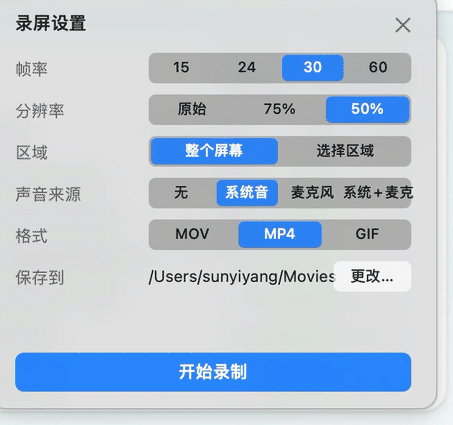

### 关键能力点

- **管线**：`SCStream`（display filter + sourceRect）→ `CMSampleBuffer` → `AVAssetWriter`（H.264 + AAC）。
- **GIF 是两段式**：AVAssetWriter 写不了 GIF 容器，所以录制阶段落成 mov 临时文件，停止后再用 ImageIO 转 GIF 并删临时文件。
- **计时窗**：毛玻璃浮层，显示时长 + 停止按钮，跟着录制区域走。
- **区域框选**（`FSRegionOverlayIsActive`）：录制选区时浮动层会主动让路，不挡住框选。
- **麦克风降级**：没授权麦克风时自动只录系统音，不报错。

### 注意事项

- 录制中切换用户或锁屏可能中断（系统行为）。
- GIF 体积仍然偏大（没有调色板优化），做演示够用，长时间录制建议 MOV/MP4。
- 录屏需要「屏幕录制」权限；首次开始时会请求一次。
- 录制的是**整个显示器**再由 `sourceRect` 裁切，所以选区版也吃整屏采集的带宽。

### 实现索引

| 文件 | 函数 | 职责 |
|---|---|---|
| `frset_recorder.h` | `FSScreenRecOpenSettings` | 打开设置小窗 |
| `frset_recorder.h` | `FSScreenRecBeginFromSettings` | 按当前设置开始录 |
| `frset_recorder.h` | `FSScreenRecStop` | 停止并收尾 |
| `frset_recorder.m:79` | `audioMode` / `format` | 声音与格式状态 |
| `frset_recorder.m:133` | GIF 导出段 | mov → GIF（≤720px / ≤12fps） |
| `StatsBarEngine.swift` | `openRecorder` | Swift 侧唯一入口 |

---

# 第三部分 · 系统

## 第十六章 系统监测

### 功能是什么

实时监测 Mac 的运行状态，三个展示层级：**菜单栏部件**（一眼可见）、**监测独立窗**（详情）、**状态栏浮层**（点部件弹出）。八个模块共用一套读取引擎。

### 用户怎么用

| 入口 | 操作 | 效果 |
|---|---|---|
| `⌥P` | 打开/关闭监测独立窗 | 可常驻的玻璃窗 |
| `⌥M` | 同上（另一条默认键） | — |
| 主面板「性能监测」页 | 点分段切换 | 面板内嵌同一套内容 |
| 菜单栏部件 | 点击 | 弹出该模块详情浮层 |
| 菜单「显示项」 | 逐项勾选 | 控制各模块部件显隐 |
| 设置 → 性能监测 | 选模块 | 配采样间隔、模块开关、部件形态 |

### 八个模块

| 模块 | 看什么 |
|---|---|
| **CPU** | 总占用、每核心、集群（性能核 / 能效核 / 中核）、平均负载、占用最高的进程 |
| **内存** | 已用 / 压缩 / 联动 / 可用、交换区、内存压力（活动监视器口径） |
| **GPU** | 使用率、显存、渲染/分块引擎占用 |
| **磁盘** | 读写速度、容量、SMART 健康度、高占用进程、外接卷自动识别 |
| **网络** | 上下行速度、连接状态、延迟、高占用进程 |
| **传感器** | 温度、电压、电流、功率、风扇转速（无对应硬件则不显示） |
| **电池** | 电量、健康度（设计容量/标称容量双口径）、循环次数、适配器功率、CPU 能耗影响 |
| **功耗** | 整机瓦数，区分「输入（充电中）」与「输出」 |

### 演示

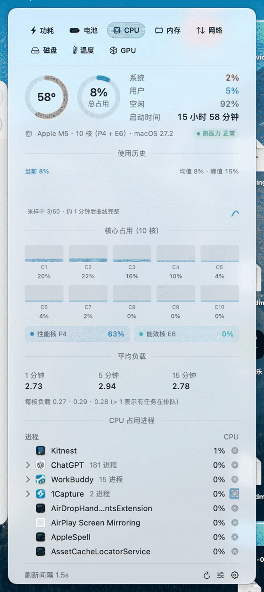

### 关键能力点

- **十二种部件形态**（`StatsBarEngine` + `frset_barwidgets.m`）
  迷你数值、折线、柱状、饼图、速度、状态点、标签、图标……按模块分别设置，改完立即生效。配置与 Stats 引擎互通。

- **采样引擎**（`MonitorSampler`）
  按设定间隔（0.5~10 秒，默认 2 秒）采样；面板/窗口都不可见时自动降频到 5 秒，省电省 CPU。

- **数据源同源**（v76 起的硬约束）
  菜单栏部件、主面板性能页、独立窗显示的是**同一时刻的同一组数值**——核心指标直接读 C 引擎快照（`g_snap`，0.5s tick），不再各采一份。

- **温度可视化**
  20–110°C 固定标尺的橙色条形，计算项（Average / Hottest CPU / GPU）与 27 项传感器全部带条，风扇保留 RPM 条。

- **网络诊断**（网络模块详情内）
  公网 IP 与归属地、多目标延迟、DNS 解析、系统代理与本地代理端口检测（`NetworkDiagnostics`）。

- **端口占用**（`PortInspector` / `PortOccupancySection`）
  列出正在监听的端口、对应进程、是否对局域网开放。排查「谁占了 8080」不用开终端。

- **外接卷自动识别**（`DiskVolumes`）：插上 U 盘 / 移动硬盘，磁盘模块里自动多一块。

- **独立窗的点外收起**：四路冗余监听（全局监视器 + 本 app 内监视器 + 50ms 轮询 + app 失活通知），不依赖辅助功能授权。

### 注意事项

- 温度依赖 SMC，Intel 与 Apple Silicon 的传感器列表不同；个别机型某些传感器无读数属正常。
- 功耗需要电池或电源适配器在位，部分台式机显示「无数据」。
- 同时运行官方原版 Frset 会画两套菜单栏组件，建议二选一（应用会提示）。
- 电池健康度给了两个口径：按「设计容量」算和按「标称容量」算，两个数都显示——不同工具算法不同，并排看才不困惑。

### 实现索引

| 文件:行号 | 函数 | 职责 |
|---|---|---|
| `MonitorSampler.swift:330` | `scheduleNext` / `sampleOnce` | 采样节拍与降频 |
| `MonitorReader.swift:628` | `readCPU` / `readMemory` / `readNetworkRate` / `readDiskRate` / `readPower` / `readBatteryLevel` | 主机层指标 |
| `MonitorReader.swift` | `readSMCTemperature` | SMC 温度直读 |
| `StatsBarEngine.swift:318` | `openMonitor` / `openSettings` | 部件点击与设置入口 |
| `StatsModulePanels.swift:1342` | 模块面板 | 各模块浮层版式 |
| `MonitorDetailView.swift:1277` | `body` | 详情窗（模块切换条） |
| `MonitorPopoutWindow.swift:479` | `open` / `dismissPopout` | 独立窗生命周期 |
| `MonitorCharts.swift:306` | `LineChart` / `BarChart` | 折线与柱状 |
| `BatteryPanel.swift:622` | `body` | 电池详情（双口径健康度） |
| `BatteryEnergy.swift:261` | `energyImpact` | CPU 能耗影响 |
| `DiskVolumes.swift:118` | `volumes` | 外接卷枚举 |
| `NetworkDiagnostics.swift:442` | `probePublicIP` / `probeLatencies` / `probeDNS` / `detectProxyProcess` | 网络诊断四件套 |
| `PortInspector.swift:252` | `listeners` | 端口占用枚举 |
| `MonitorHistory.swift:39` | `append` | 环形缓冲（迷你图数据） |

---

## 第十七章 内存维护

### 功能是什么

内存详情页底部的「内存维护」区：**一个按钮做两件事**——清缓存 + 暂停闲置应用。做完给一份**诚实的报告**，分项写清楚释放了什么、什么没变。

> 名字：「深度释放」。早期版本是「清缓存」和「冻结闲置」两个按钮，v259 按用户要求合并成一个。

### 用户怎么用

| 操作 | 效果 |
|---|---|
| 点「深度释放」 | 跑一次完整流程（清缓存 + 暂停闲置），出报告 |
| 勾选「暂停闲置」 | 决定这次是否包含冻结（默认勾选） |
| 「全部唤醒」 | 把所有被冻结的应用解冻 |
| 已暂停清单 | 显示当前冻结了哪些应用，可单个唤醒 |

### 报告看什么

| 分项 | 含义 |
|---|---|
| **应用** | 应用实际占用（`ri_phys_footprint`，不是 RSS） |
| **压缩** | 内存压缩器占用 |
| **缓存** | 文件缓存 |
| **空闲** | 完全空闲的页 |
| **已暂停** | 这次冻结了几个应用 |

实测样本（本机）：应用 −306MB / 缓存 −1164MB / 压缩 +497MB / 空闲 +1022MB。

> 注意「压缩 +497MB」：purge 把内存页挤出去后，一部分进了压缩器。所以「释放量」不等于「空闲增加量」，报告分开列才不误导。

### 演示

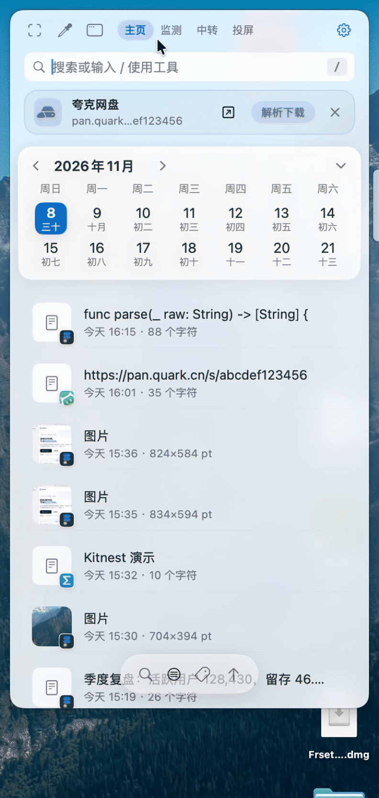

### 关键能力点

- **两档动作**
  - **清缓存**：`malloc_zone_pressure_relief` + 内存压力广播 + `purge`（需要 root helper）。
  - **暂停闲置**：给符合条件的进程发 `SIGSTOP`，让它彻底不占 CPU；唤醒发 `SIGCONT`。

- **暂停白名单**（`ProcessFreezer`）
  终端、IDE、虚拟机、会议软件、输入法、宿主进程一律不冻——冻了会出事。

- **「屏幕有窗口」和「5 分钟内激活过」的不冻**：判断依据是进程有没有可见窗口、最近有没有交互，避免冻掉你正在用的东西。

- **30 分钟自动解冻**：暂停不是永久的，到点自己恢复。

- **watchdog 自愈**：用 `posix_spawn` 起一个独立守护进程（不是 `Process.run()`，那个在 App 内会被吞错），App 崩了 5 秒内把冻结的进程全部 `SIGCONT`。

- **root helper**：`FrsetNextHelper` 是一个 LaunchDaemon，装一次长期可用；没装时降级为「只清用户态缓存」。

- **诚实报告**（`MemoryOptimizer`）
  采样前 → 执行 → 采样后 → 分项对比。不做「释放了 2GB！」这种把压缩算进释放的话术。

### 注意事项

- 冻结的进程**不是被杀**，是暂停：内存还在、窗口还在，点它一下会自动解冻。
- 频繁点「深度释放」没有额外收益：第一次能吐出来的，第二次基本没有。
- 内存压力大时系统自己会回收，第三方工具的作用有限——这个功能的价值在「主动释放 + 报告清楚」，不在「神奇加速」。

### 实现索引

| 文件:行号 | 函数 | 职责 |
|---|---|---|
| `MemoryOptimizer.swift:175` | `optimize` | 采样→执行→采样→报告 |
| `MemoryOptimizeCard.swift:199` | `body` | 按钮 + 复选框 + 已暂停清单 |
| `ProcessFreezer.swift:458` | `freezeIdle` / `thawAll` / `thawOrphans` | 冻结/解冻/孤儿清理 |
| `ProcessFreezer.swift` | `isProtected` | 白名单判定 |
| `ProcessFreezer.swift` | `startWatchdog` | posix_spawn 守护 |
| `MemoryBreakdown.swift:89` | `breakdown` | 内存分类（活动监视器口径） |
| `ProcessMemoryInspector.swift:102` | `topConsumers` | 按应用归并物理占用 |
| `MemoryHelperClient.swift:208` | `installHelper` / `run` | root helper 通信 |
| `MemoryHelper/main.swift:185` | `main` | helper 进程入口 |

---

## 第十八章 存储管理

### 功能是什么

一块**可视化**的磁盘占用面板：全盘索引（不限深度）、气泡堆块、可清理候选清单、一键移到废纸篓。索引只在打开面板时加载，平时零常驻。

### 用户怎么用

| 入口 | 操作 |
|---|---|
| 状态栏监测 → 存储 →「存储管理」 | 打开面板 |
| 面板性能页 → 磁盘 →「管理存储」 | 同上 |
| `kitnest://storage` | 深链直达 |
| `kitnest://storage?scan=1` | 打开并立即扫描 |

面板结构：顶部大数字（可清理总量）+ 索引状态行；左侧可清理清单（勾选）；右侧气泡堆块（点击下钻、面包屑返回）。

### 演示

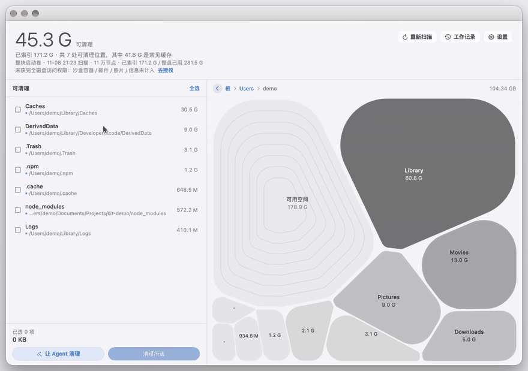

### 关键能力点

- **扫描口径**（v264 重做）
  - **不限深度**：`Xcode.app/Contents/Developer/Platforms/…` 这类深层内容全部计入。
  - **含隐藏目录**：`.workbuddy` / `.cursor` / `.npm` / `.cargo` 都进。
  - **含 `~/Library`** 与系统只读卷。
  - 不跳 `/System`，只跳 `/System/Volumes`（那是 `/Users` 的另一张脸，算了两遍）。
  - **大小按磁盘实际块**（`st_blocks`），与 `df`/`du` 同一口径——APFS 透明压缩下 `st_size` 会虚高（`/System` 逻辑 30GB / 物理 13GB）。

- **实测规模**：248.7 万条目 / 185.6 GB / 52 秒 / 缓存 59MB（二进制 plist）。

- **覆盖率如实显示**：状态行写「已索引 185.6 G / 整盘已用 273.4 G」。差额来自：
  - `~/Library/Containers`（沙盒容器，本机 33GB）——没授权「完全磁盘访问」时系统不让读，界面有「去授权」按钮直达系统设置；
  - APFS 本地快照、交换文件、文件系统元数据——不在任何目录里，索引天然覆盖不到。

- **可清理候选**（`DiskIndexStore.candidates`）
  只认真正的缓存目录名（`Caches` / `node_modules` / `DerivedData` / `.npm` / `__pycache__` …）且体积 >20MB 的。
  **故意排除了** `Downloads`（用户数据）、`/tmp`（会打断运行中的进程）、`.rustup`/`.cargo`/`Xcode`（工具链，删了要重装）。

- **气泡堆块**（`StorageTreemap` + `StorageVoronoi`）
  按面积表示体积的 Voronoi 分割，颜色按目录层级，点击下钻。用户对照 Kanso 截图要求过颜色和色块，这一版是按反馈重做的。

- **删除只到废纸篓**（`FileManager.trashItem`）：可恢复，不做永久删除。
- **工作记录**：每次清理记一条（时间/路径/大小/是否全部成功），最多 50 条。
- **让 Agent 清理**：把本次扫描明细生成一段结构化提示词，复制给本地 Agent，由它判断哪些能清（应用本身不动手）。

### 注意事项

- 首次建立索引约 50 秒（248 万条目），期间可以取消。
- 索引缓存有版本号：源结构一变（比如 v264 改了口径），旧缓存自动作废并提示重扫，不会拿错数据骗人。
- 没有「完全磁盘访问」时覆盖率会明显偏低，这不是漏扫，是系统不让读。
- 「可清理」清单只是建议，**勾选后仍会弹确认框**列明路径和总大小。

### 实现索引

| 文件:行号 | 函数 | 职责 |
|---|---|---|
| `DiskIndex.swift:117` | `scan` | 扫描调度（后台队列 + 可取消） |
| `DiskIndex.swift` | `walk` | 递归建树（d_type 判目录，文件取 st_blocks） |
| `DiskIndex.swift` | `physicalSize` | 物理占用（st_blocks × 512） |
| `DiskIndex.swift` | `hasFullDiskAccess` | FDA 探测（读系统级 TCC.db） |
| `DiskIndex.swift:273` | `DiskIndexStore.candidates` | 可清理候选筛选 |
| `DiskIndex.swift` | `trash` | 移到废纸篓 + 更新树 |
| `DiskIndex.swift` | `decodeSnapshot` | 缓存解码 + schema 校验 |
| `StorageManagerWindow.swift:1020` | `body` / `header` | 面板版式与状态行 |
| `StorageManagerWindow.swift` | `statusLine` | 「已索引 / 整盘已用」 |
| `StorageTreemap.swift:367` | `render` | 堆块绘制 |
| `StorageVoronoi.swift:321` | `compute` | Voronoi 分割 |

---

## 第十九章 网络诊断与端口

### 功能是什么

两块能力，都在监测的「网络」模块里：

- **网络诊断**：公网 IP 与归属地、多目标延迟、DNS 解析、系统代理检测。
- **端口占用**：谁在监听、哪个进程、是否对局域网开放。

### 用户怎么用

| 入口 | 操作 |
|---|---|
| 监测窗 → 网络模块 | 下方「诊断」区 |
| 状态栏网络部件 → 点击 | 详情浮层里同样有 |
| 面板 → 性能监测 → 网络 | 同上 |

点「开始诊断」逐项跑，每项独立超时，不会因为一项失败卡住全部。

### 演示

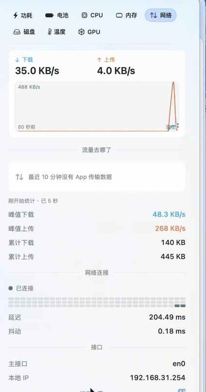

### 关键能力点

- **公网 IP + 归属地**（`IPAddressService.queryPublicIP`）
  调 `api.ipify.org`（免 Key 公共服务），带超时；归属地另走一次查询。

- **多目标延迟**（`probeLatencies`）
  同时对多个目标（网关 / 公共 DNS / 常用站点）发探测，分别给毫秒数——单项延迟说明不了问题，横向对比才看得出是本地网络还是目标站点的问题。

- **DNS 解析**（`probeDNS`）
  指定域名解析一遍，看返回的 IP 与耗时；解析失败会明确说是「无响应」还是「NXDOMAIN」。

- **代理检测**（`detectProxyProcess`）
  读系统代理配置 + 扫本地常见代理端口（7890 / 1080 / 8080 等），告诉你「现在有没有代理在拦」。

- **端口占用**（`PortInspector.listeners`）
  枚举正在监听的 TCP/UDP 端口、对应 pid 与进程名、绑定地址（`127.0.0.1` 仅本机 / `0.0.0.0` 对局域网开放）。排查「谁占了 8080」不用开终端。

- **端口区块**（`PortOccupancySection`）
  在网络详情里以列表呈现，可排序、可搜索；点进程名可定位到可执行文件。

### 注意事项

- 公网 IP 查询会向 `api.ipify.org` 发一次请求——这是唯一一个对外请求，介意可以不用这项。
- 端口枚举用的是 `netstat`/`lsof` 等价能力，需要普通用户权限即可；部分系统进程的端口可能看不到。
- 代理检测是「读配置 + 扫端口」，不是流量拦截。

### 实现索引

| 文件:行号 | 函数 | 职责 |
|---|---|---|
| `NetworkDiagnostics.swift:442` | `probePublicIP` | 公网 IP 与归属地 |
| `NetworkDiagnostics.swift` | `probeLatencies` | 多目标延迟 |
| `NetworkDiagnostics.swift` | `probeDNS` | DNS 解析 |
| `NetworkDiagnostics.swift` | `detectProxyProcess` | 系统代理与本地端口 |
| `PortInspector.swift:252` | `listeners` | 端口枚举 |
| `PortOccupancySection.swift:209` | `body` | 端口列表 UI |
| `IPAddressService.swift:126` | `queryPublicIP` / `localIPAddress` | IP 查询 |
| `NetworkFlowTracker.swift:313` | `track` | 高占用进程归因 |

---

# 第四部分 · 传输

## 第二十章 文件中转

### 功能是什么

一个「池子」+ 多条出口：所有来路的文件都汇进**本地暂存**，勾选后按对方设备选出口——隔空投送、扫码直传、ADB 直传、云端。

### 用户怎么用

| 入口 | 操作 |
|---|---|
| `⌥T` | 打开面板并切到「文件中转」 |
| 拖文件到菜单栏图标 | 直接进暂存 |
| 拖文件进面板 | 同上 |
| 截图动作条 →「空投」 | 截图直接发隔空投送 |
| 剪贴板条目右键 →「隔空投送」 | 同上 |

### 四种出口

| 出口 | 对方设备 | 说明 |
|---|---|---|
| **隔空投送** | iPhone / iPad / Mac | 系统面板，对端零安装 |
| **扫码直传** | 任何有浏览器的设备 | 本机起一个小 HTTP 服务，二维码里带一次性 token；对方浏览器上传/下载 |
| **ADB 直传** | Android | 大文件或批量走 USB 3.0 |
| **云端中转** | 跨时间/跨设备 | 登录 OPPO 中转站后存云端 |

### 演示

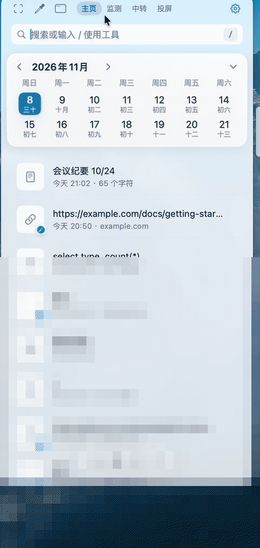

### 关键能力点

- **本地暂存**（`LocalTransferStore`）
  所有来路文件的统一落点：隔空投送接收、手机拉取、拖入、剪贴板。按时间倒序，可多选、可删除、可清空。

- **隔空投送接收**（`AirDropReceiveWatcher`）
  监听 `~/Downloads`（`DispatchSource`），跳过 `.download` 未完成文件，落盘后自动入暂存。

- **扫码直传**（`LanTransferServer`，867 行）
  起一个局域网 HTTP 服务，二维码内容为 `http://<局域网IP>:<port>/s/<token>/`。token 是一次性的，别人拿到链接也只能用一次。
  - 支持对方上传（手机 → Mac）和下载（Mac → 手机）。
  - 不需要装任何 App，浏览器打开就能用。

- **ADB 文件桥**（`ADBFileBridge`）
  推送：暂存项 → 手机 `Download/FrsetNext/`，逐文件精确报数。
  拉取：清空暂存目录 → `adb pull` → `LocalTransferStore.add` 正式入索引。

- **文件悬停预览**（`FileHoverPreview`，511 行）
  Word / PPT / Excel / PDF / 图片等格式，悬停即出缩略图或首页内容，不用打开文件。

- **MCP Server**（`MCPServer`）
  把手机能力暴露成 HTTP + JSON-RPC 2.0，本机 AI 客户端（Claude / Cursor / 自家 AI）可以直接控制手机。这是给自动化场景留的口子。

- **拖文件到图标**（`StatusItemDropProxy`）：菜单栏图标不是拖放目标，加了一层覆盖视图接住。

### 注意事项

- 隔空投送只通苹果设备；安卓/Windows 用扫码直传或 ADB 补齐。
- 扫码直传要求两台设备在同一局域网，且 macOS 防火墙允许传入连接（首次会询问）。
- ADB 直传需要手机开启 USB 调试；无线调试见下一章。
- 云端中转需要登录 OPPO 账号，登录走官方三段式签名，应用本身不存密码。

### 实现索引

| 文件:行号 | 函数 | 职责 |
|---|---|---|
| `LocalTransferStore.swift:329` | `add` / `remove` / `all` | 暂存池 |
| `LanTransferServer.swift:867` | `start` / `handle` | 局域网 HTTP 服务 |
| `QRCodeView.swift` | `body` | 二维码渲染 |
| `TransferDockService.swift:437` | `upload` / `download` | 云端中转 |
| `TransferDockView.swift:1406` | `body` | 中转页（上下分区） |
| `FileHoverPreview.swift:511` | `present` | 悬停预览 |
| `MCPServer.swift:318` | `start` | AI 控制通道 |
| `TransferIntakeDialog.swift` | `present` | 接收确认 |
| `StatusItemDropProxy.swift` | `performDragOperation` | 拖到菜单栏图标 |

---

## 第二十一章 手机投屏

### 功能是什么

Android 设备中心：检测设备、无线配对、scrcpy 镜像、应用库、控制条、锁屏保持。**对端零安装**（scrcpy 在电脑侧跑）。

### 用户怎么用

| 步骤 | 操作 |
|---|---|
| 1 | USB 连上手机，打开「USB 调试」 |
| 2 | 点「检测设备」→ 选设备 |
| 3 | 点「开始投屏」 |
| 4 | 想摆脱线缆：点「一键无线」（自动 `adb tcpip 5555` + 连接 Wi-Fi 地址） |
| 5 | 扫码直连：点「扫码配对」，手机扫电脑上的二维码（Android 11+ 无线调试） |

### 演示

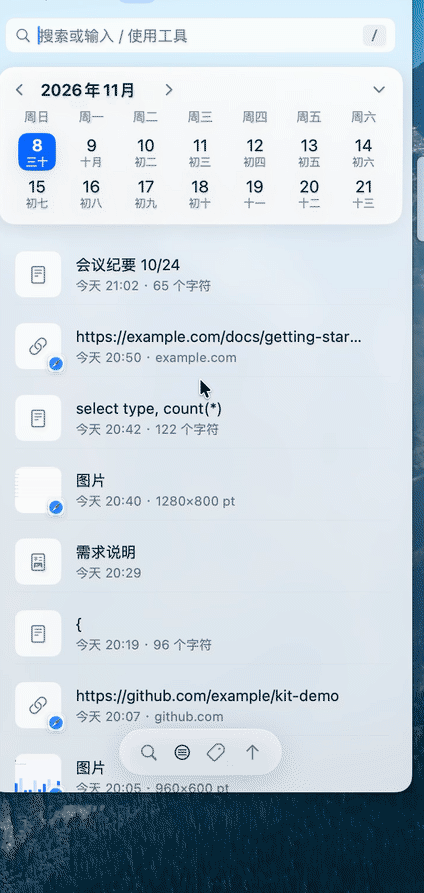

### 关键能力点

- **一键无线**（`ADBExtrasEngine`）
  USB 连一次 → 自动执行 `adb tcpip 5555` → 连上手机的 Wi-Fi 地址。之后同一网络下直接检测，**不用再开无线调试、不用配对码**。

- **扫码配对**（`AdbQrPairing`，506 行）
  按 Android 11+ 的无线调试协议生成配对二维码，手机扫一下完成配对。用户 2026-10-29 明确要求「最重要的是扫码直连，而不是基于某个局域网再 adb 连」——这一版就是按这个要求重做的。

- **Bonjour 发现**（`AdbBonjour`）
  用系统 `NetServiceBrowser` 发现 `_adb-tls-connect._tcp` 服务，自动列出同网段的可用设备。

- **投屏记忆**（`AdbCastMemory`）
  配对一次，之后零交互——记住设备与端口，下次直接连。

- **应用库**（`DeviceAppCatalog` + `CastAppLibraryWindow`）
  手机上已安装应用的**真实图标 + 真实名称 + 使用频率**，可在电脑上直接启动、卸载、搜索。

- **控制条**（`CastControlBar`）
  贴在 scrcpy 窗口底部：返回 / 桌面 / 多任务 / 音量 / 电源。不用记快捷键。

- **锁屏保持**（`CastScreenKeeper`）
  手机一旦休眠（黑屏），自动唤醒到**锁屏界面**，不是解锁——既保持投屏不断，也不绕过锁屏。

- **WebDAV 挂载**（`AndroidWebDAVServer`）
  把 `/sdcard` 以 WebDAV 暴露在 `127.0.0.1:8766`，Finder「前往 → 连接服务器」即可当网络盘用。

### 注意事项

- 需要手机开启 USB 调试（Android 11+ 支持无线配对）。
- scrcpy 未安装时会引导 `brew install scrcpy`。
- 首次配对需在手机「无线调试」页确认。
- 投屏期间剪贴板双向同步（`--clipboard-autosync`），在电脑复制能直接粘到手机。
- 部分国产 ROM 会杀后台导致连接断开，建议给 scrcpy 加电池白名单。

### 实现索引

| 文件:行号 | 函数 | 职责 |
|---|---|---|
| `TransferCastEngines.swift:837` | `startCast` / `stopCast` | scrcpy 会话 |
| `ADBExtrasEngine.swift:368` | `enableWireless` | 一键无线（tcpip 5555） |
| `AdbQrPairing.swift:506` | `generatePairingQR` | 扫码配对 |
| `AdbBonjour.swift:124` | `startBrowse` | Bonjour 发现 |
| `AdbCastMemory.swift:131` | `remember` / `recall` | 设备记忆 |
| `CastView.swift:924` | `body` | 投屏页 |
| `CastControlBar.swift:282` | `body` | 底部控制条 |
| `CastScreenKeeper.swift:100` | `keepAwake` | 锁屏保持 |
| `DeviceAppCatalog.swift:201` | `apps` | 应用库 |
| `AndroidWebDAVServer.swift:311` | `start` | WebDAV 服务 |

---

# 第五部分 · 文件与工具

## 第二十二章 归档压缩

### 功能是什么

一个**能看能改**的压缩包管理器：打开 40+ 种压缩包、预览里面每个文件、直接编辑文本并写回、压缩新包、队列化任务。底层用随包分发的 `7zz`（LGPL）。

### 用户怎么用

| 入口 | 操作 |
|---|---|
| 双击压缩包（关联后） | 打开归档浏览器 |
| 面板 → 工具 →「打开压缩包」 | 同上 |
| 拖压缩包进面板 | 同上 |
| `kitnest://archive?path=…` | 深链直达 |
| `kitnest://archive?path=…&action=mini` | Mini 小窗浏览 |
| `kitnest://archive?action=compress&path=…` | 直接进入压缩流程 |

### 界面结构

- **左列**：包内条目树，按路径分组，显示大小与修改时间。
- **右侧**：选中条目的预览。
- **底部**：任务进度抽屉（可展开/收起）。
- **拖出**：把条目拖到 Finder，走文件承诺（`NSFilePromiseProvider`），落盘时才真正解压。

### 预览支持

| 类型 | 预览方式 |
|---|---|
| 文本（txt / md / json / 代码） | 带语法高亮的文本视图 |
| 图片 | 缩略图 + 尺寸 |
| HTML | **直接渲染成网页**（不是显示源码） |
| Office（doc/xls/ppt） | 分级解码缩略图（不自己渲染，取系统已生成的预览） |
| PDF | 首页缩略图 |

### 演示

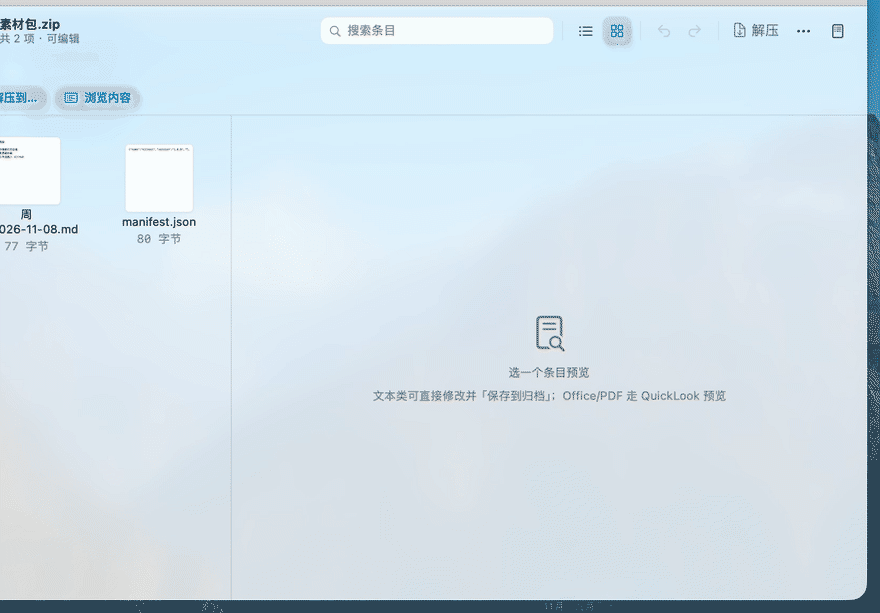

### 关键能力点

- **真实解压/压缩/回写**（`ArchiveCore`，1134 行）
  不是只读浏览器：文本类条目可以直接改，保存时用 `7zz a` 写回原包。
  回写前会捕获可逆信息（`ArchiveUndoStack`），支持撤销。

- **格式支持**：7z / zip / rar / tar / gz / bz2 / xz / iso / dmg 等（取决于 `7zz` 编译进去的编解码器）。

- **压缩流程**（`ArchiveCreateSheet`）
  选格式、压缩级别、密码、是否分卷；源可以是文件、文件夹或当前选中的条目。

- **任务队列**（`ArchiveTaskQueue`）
  多个压缩/解压任务排队执行，每个有独立进度与取消；队列在后台跑，关窗口不中断。

- **Flow 推荐**（`ArchiveFlowRecommender`）
  根据包内容推荐此刻最合适的操作——比如「里面全是图片」就推荐「解压到图片文件夹」，「只有一个文件夹」就推荐「直接解压」。
  这是按 ArcZip 的交互思路做的，不是硬编码规则。

- **压缩完成问一次**（`ArchiveSourceHandling`）
  压缩成功后主动问「原文件保留还是收走」，对齐 ArcZip 的 completion 逻辑。

- **Mini 小窗**（`ArchiveMiniWindow`）
  不打开大窗口，用一个小浮窗快速看包里有什么，适合「只想确认一下」。

- **暂存浮窗**（`ArchiveFileBox`）
  菜单栏附近的一个小盒子：把散落的文件拖进来集中，再一次「压缩全部」。

- **条目拖出**（`ArchiveEntryDrag`）
  拖动时只上屏「文件承诺」（名字 + UTI），真正落到 Finder 目标目录时才解压——避免拖一下就解压几百 MB。

### 注意事项

- RAR 只能解不能压（`7zz` 的 RAR 编码器有授权限制）。
- 加密包需要输密码，输错会明确提示而不是静默失败。
- 回写会**重写整个压缩包**：大包（几 GB）改一个小文件也要等，进度条会显示。
- 包内路径过深或文件名含特殊字符时，某些系统工具解压可能出错，这是 zip 规范的历史问题。

### 实现索引

| 文件:行号 | 函数 | 职责 |
|---|---|---|
| `ArchiveCore.swift:1134` | `extract` / `compress` / `writeBack` | 7zz 封装 |
| `ArchiveBrowserWindow.swift:1601` | `body` | 浏览器主界面 |
| `ArchiveEntryTable.swift:304` | `tableView` | 条目表（NSTableView） |
| `ArchiveEntryDrag.swift:253` | `beginDrag` | 文件承诺拖出 |
| `ArchiveEntryThumbnail.swift:250` | `thumbnail` | 分级解码 |
| `ArchiveHoverPreview.swift:129` | `present` | 包内条目悬停预览 |
| `ArchiveHTMLPreview.swift:226` | `render` | HTML 直接渲染 |
| `ArchiveCreateSheet.swift:474` | `body` | 压缩参数表单 |
| `ArchiveTaskQueue.swift:289` | `enqueue` | 任务队列 |
| `ArchiveProgressPanel.swift:362` | `body` | 底部进度抽屉 |
| `ArchiveTaskHUD.swift:339` | `present` | 任务 HUD |
| `ArchiveFlowRecommender.swift:404` | `recommend` | 内容推荐操作 |
| `ArchiveUndoStack.swift:201` | `push` / `undo` | 回写撤销 |
| `ArchiveSourceHandling.swift:89` | `askKeepSource` | 压缩后问原文件 |
| `ArchiveMiniWindow.swift:290` | `present` | Mini 小窗 |
| `ArchiveFileBox.swift:454` | `body` | 暂存浮窗 |

---

## 第二十三章 工具箱

### 功能是什么

13 个内置小工具 + 自定义 AI 工具，统一入口：**工具面板**（分类网格）、**搜索框输入 `/`**、**命令面板 `⌥K`**。结果一键复制，并自动回流剪贴板历史。

### 内置工具

| 分类 | 工具 | 能力 |
|---|---|---|
| 转换 | **UUID** | 批量生成，可选格式 |
| 转换 | **时间戳转换** | 自动识别 / 时间戳→日期 / 日期→时间戳 |
| 转换 | **变量命名** | 驼峰 / 下划线 / 短横线 / 帕斯卡 / 常量 互转 |
| 编码 | **Base64** | 编码 / 解码 |
| 编码 | **URL Encode** | 编码 / 解码，标准 / 严格两档 |
| 格式化 | **JSON** | 格式化 / 压缩 / 校验 |
| 格式化 | **代码预览** | 高亮预览 + 导出图片（第二十八章） |
| 网络 | **IP 地址** | 公网 + 内网 / 仅内网 |
| 网络 | **二维码** | 文本/链接生成二维码，可调尺寸与纠错级别 |
| 图片 | **图片压缩** | 纯本地压缩，可调最大边长/质量/格式 |
| 加密 | **哈希生成** | MD5 / SHA1 / SHA256 |
| AI | **Translate** | 调已配置的 AI 服务商 |
| AI | **Summary** | 同上 |

> 图片压缩是**纯本地**的（不调 TinyPNG 那种网络 API）：不需要 Key、没有配额、图片不出本机。代价是压缩率不如云端。

### 用户怎么用

| 入口 | 操作 |
|---|---|
| 面板首页 → 搜索框输入 `/` | 列出全部命令，输入即过滤 |
| `⌥K` | 命令面板（全功能目录） |
| 面板 → 工具页 | 分类网格，点开即用 |
| 工具热键 | 每个工具可单独绑全局快捷键（`ToolShortcutStore`） |

### 演示


### 关键能力点

- **工具描述符**（`ToolRegistry`）
  每个工具是 `id / 名称 / 图标 / 分类 / 选项 / 执行函数`。注册表统一管理，可启用/停用。

- **选项驱动**：工具的下拉选项（编码/解码、算法选择…）由 `ToolOption` 声明，UI 自动渲染，加选项不用改界面代码。

- **结果回流**（`ingestToolOutput`）：输出自动进剪贴板历史，标为「工具生成」，和手动复制的区分开。

- **工具快捷键**（`ToolShortcutStore`）：任意工具可绑全局热键，触发时唤起面板并打开该工具。

- **窗口登记**（`WindowManager`）：所有工具窗口统一登记，可一键全部关闭。

- **工具启停**：设置里可停用某个工具，停用后不出现在面板与命令面板。

### 注意事项

- AI 类工具需要先在「设置 → 搜索与 AI」配置服务商，未配置会引导去设置。
- IP 查询的「公网」部分会发一次网络请求（`api.ipify.org`）。
- 图片压缩大图（>20MP）会等几秒，进度在输出区。

### 实现索引

| 文件:行号 | 函数 | 职责 |
|---|---|---|
| `ToolRegistry.swift:207` | `register` / `setEnabled` | 工具注册表 |
| `BuiltinTools.swift:381` | 13 个 `ToolDescriptor` 注册 | 内置工具定义 |
| `ToolConverters.swift:402` | 转换类实现 | 时间戳/命名/编码/JSON |
| `MediaTools.swift:148` | `compress` | 本地图片压缩 |
| `ToolRunnerWindow.swift:99` | `present` | 工具面板（输入/选项/输出） |
| `ToolSettingsPane.swift:144` | `body` | 工具启停设置 |
| `WindowManager.swift:11` | `closeAll` | 工具窗口登记 |

---

## 第二十四章 全局搜索

### 功能是什么

主面板顶部的搜索框，一个入口搜四类东西：**网页**（搜索引擎）、**剪贴板历史**、**本地文件**（全盘）、**工具命令**（`/` 开头）。

### 用户怎么用

| 输入 | 结果 |
|---|---|
| 普通关键词 | 四类结果分组展示：文件 / 剪贴板 / 网页 / 工具 |
| 网址（含 `.` 或 `http`） | 直接显示「打开该网址」 |
| `/` 开头 | 切成命令模式，列出全部工具命令 |
| 点分类 chip | 只看某一类，再点二级筛选（文件类型 / 剪贴板类型 / 搜索引擎） |

### 演示


### 关键能力点

- **文件搜索覆盖全盘**（v264 重做，`FileNameIndex`）
  Spotlight **不索引** `~/Library`、隐藏目录（`.workbuddy` / `.cursor` / `.npm`…）、`.app` 包内部、`/usr/local`——而这几处恰好是开发者文件最密集的地方。
  所以自建了一份**全盘文件名索引**：
  - 本机 124 万条 / 164MB，首次建立 14 秒，之后 mmap 加载（不占堆内存）。
  - 查询 30–220ms，按「路径越浅越前」排序。
  - 索引状态显示在「文件」分组下方（多少条、什么时候建的、重建按钮）。

- **空格能匹配连字符**：输入 `image html deck` 能命中 `image-html-deck`；也能跨目录名匹配（`workbuddy skill` → `~/.workbuddy/skills`）。

- **模糊匹配**（`FuzzyMatcher`）
  子序列匹配（不要求连续）、乱序也能中、按命中位置评分排序、命中字符高亮。对标 FSearch 的「预过滤 + 精排」两段式。

- **网页搜索**（`SearchEngine` / `SearchServiceManager`）
  搜索引擎可增删排序，自定义引擎用 `{query}` 占位的 URL 模板。结果列表在面板内嵌显示（离屏 WKWebView 抓取 + JS 提取），点某条才真正打开页面。

- **剪贴板搜索**：搜的是**内容**，包括图片 OCR 出来的文字。所以「截图里的一句话」也能命中。

- **结果最多 8 条/组**，点「查看全部」进对应分类。

### 注意事项

- 首次搜索文件时若索引还没建，会显示「正在建立全盘索引」进度；建完自动重跑当前查询。
- 系统垃圾文件（`.DS_Store` / `.localized` 等）不参与结果。
- 文件索引不含 `/System`、外接卷、`/private/var/folders` 等无搜索价值的区域。
- 中文输入法组词未上屏时不会触发搜索（防抖 250ms）。

### 实现索引

| 文件:行号 | 函数 | 职责 |
|---|---|---|
| `SearchSectionView.swift:1742` | `scheduleSearch` | 防抖与四路检索调度 |
| `SearchSectionView.swift` | `filesCategory` / `clipboardCategory` | 分组渲染 |
| `FileNameIndex.swift:546` | `search` / `build` | 全盘索引查询与建立 |
| `FuzzyMatcher.swift:29` | `match` / `isMatch` | 模糊匹配与评分 |
| `SlashCommands.swift:133` | `match` | `/` 命令匹配 |
| `SearchEngine.swift:280` | `searchURL` | 搜索引擎模板 |
| `SearchSettingsPane.swift:507` | `saveCustomEngine` | 自定义引擎 |

---

## 第二十五章 命令面板

### 功能是什么

`⌥K` 唤出的 Spotlight 式浮窗：全功能统一目录，输入即模糊过滤，回车执行。不用记功能在哪个页。

### 用户怎么用

| 操作 | 效果 |
|---|---|
| `⌥K` | 打开/关闭 |
| 输入 | 过滤（模糊匹配，乱序也能中） |
| `↑` `↓` | 移动选择 |
| `↵` | 执行 |
| `Esc` | 关闭 |

### 演示


### 关键能力点

- **全功能目录**（`CommandPalette`，644 行）
  把「一堆功能」收敛成「一个工具箱」的统一入口：截图、OCR、长截图、图帘、剪贴板、监测、中转、投屏、工具、设置页……

- **动作可带参数**：部分条目点开后是二级列表（比如「打开设置」展开成 27 个页）。

- **与工具面板共用召回**：命令面板和工具列表用同一套模糊引擎，结果一致。

- **快捷键可改**：默认 `⌥K`（`⌘K` 常被浏览器占用）。

### 注意事项

- 命令面板是独立窗口，不依赖主面板是否打开。
- 面板里显示的快捷键是**当前生效**的（改过绑定的会跟着变）。

### 实现索引

| 文件:行号 | 函数 | 职责 |
|---|---|---|
| `CommandPalette.swift:277` | `CommandPaletteController.toggle` | 窗口显隐 |
| `CommandPalette.swift` | `body` | 列表与过滤 |
| `SlashCommands.swift:133` | `SlashCommandCatalog.match` | 命令目录 |

---

## 第二十六章 日历与节假日

### 功能是什么

主面板里的日历卡：月历 + 农历 + 节气 + 节日 + 系统日程 + 调休标记。点日期打开系统日历查看当天详情。

### 用户怎么用

| 操作 | 效果 |
|---|---|
| 面板首页看日历卡 | 当月月历，今天高亮 |
| 点 `‹` `›` | 切月 |
| 点某一天 | 打开系统日历到该日（`calendarDayOpen`） |
| 点日期格 | 选中并显示当天日程（`calendarDateSelect`） |

### 演示


### 关键能力点

- **农历与节气**（`LunarCalendar`）
  公农历互转、二十四节气、农历节日（春节/端午/中秋…）。纯算法实现，不需要网络。

- **节假日与调休**（`HolidayManager`）
  数据来源是国务院办公厅公布的年度放假安排，**含调休后的实际放假区间**。所以「周六要上班」这种也能标出来。

- **系统日程**（`CalendarService`）
  授权后读系统日历事件，有安排的日期格上有小圆点；未授权时降级为只显示日期，并在 UI 里给「去授权」入口。

- **今日高亮**：今天用实心圆角块标出，和选中态区分。

### 注意事项

- 节假日数据是年度更新的：跨年前后如果发现新一年没数据，等应用更新。
- 日程需要「日历」权限；不授权不影响日期与农历显示。
- 日历卡高度约 112pt，是原版实测的版式。

### 实现索引

| 文件:行号 | 函数 | 职责 |
|---|---|---|
| `CalendarSectionView.swift:341` | `body` | 日历卡版式 |
| `CalendarService.swift:155` | `events` | 系统日程读取 |
| `LunarCalendar.swift:221` | `lunarDate` / `solarTerm` / `lunarFestival` | 农历算法 |
| `HolidayManager.swift:75` | `holiday` / `isOnLeave` | 节假日判定 |

---

## 第二十七章 快捷键

### 功能是什么

19 条全局热键，全部可改绑；支持改成「双击修饰键」模式（连按两下 `⌘` / `⌥` / `⌃` / `⇧`）；冲突会明确告诉你为什么失败。

### 默认热键

见附录 A。这里是机制说明。

### 用户怎么用

| 操作 | 效果 |
|---|---|
| 设置 → 工具与快捷键 → 快捷键 | 全部热键列表 |
| 点某条 → 按下新组合 | 录制并保存 |
| 点「×」 | 清除该条绑定 |
| 切「2×」开关 | 改成双击修饰键模式 |
| 「恢复默认」 | 全部还原 |

### 演示

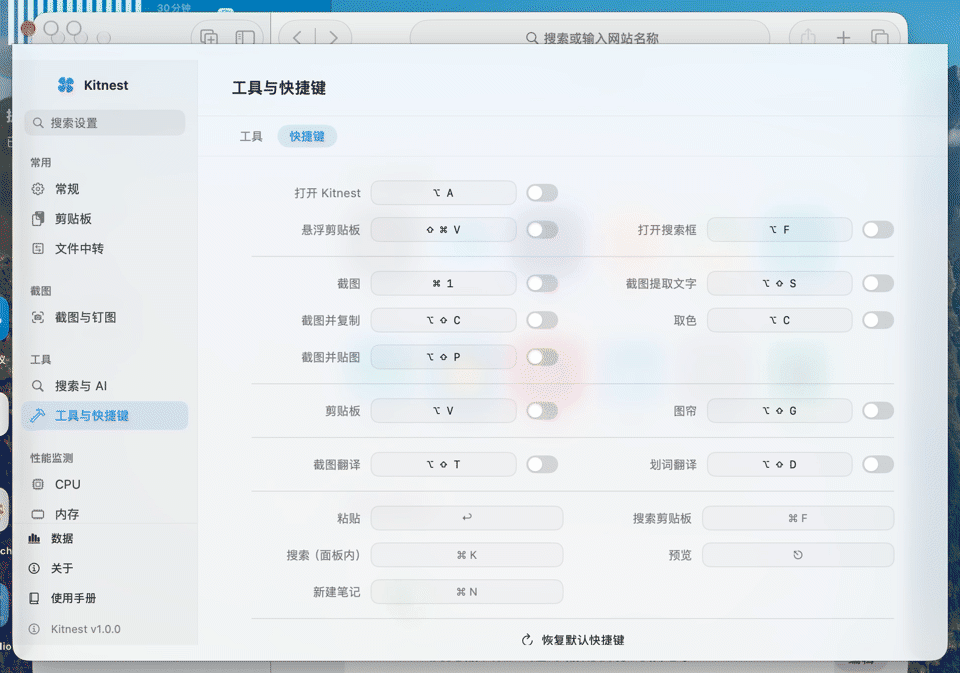

### 关键能力点

- **Carbon 全局热键**（`ShortcutManager`）
  用 `RegisterEventHotKey`，App 未激活时同样生效。不是 `NSEvent` 全局监听（那个需要辅助功能且不拦截）。

- **冲突处理**：注册失败时记下原因（`failureReason`），UI 直接显示「这个组合已被系统或其他应用占用」，不是静默失败。

- **用户绑定优先**：先注册用户自定义，再注册默认表；物理冲突时默认条目失败、用户绑定胜出。

- **双击修饰键**（`DoubleTapShortcut`）
  连按两下同一修饰键触发，适合不想占组合键的场景。首次开启有兼容性提示（某些输入法会抢）。

- **按工具绑定**（`ToolShortcutStore`）：任意工具可单独绑热键，触发时唤起面板并打开该工具。

- **录制控件**（`ShortcutRecorder`）：按下即显示组合，`Esc` 取消，`⌫` 清除；只接受带修饰键的组合（防止单键误触发）。

### 注意事项

- 系统级组合（如 `⌘Space`）会被系统先拦，注册不成功是正常的。
- 双击修饰键与「连按 `⌘` 切换输入法」可能冲突，看个人习惯。
- 恢复默认会清除所有自定义绑定**和**双击模式。

### 实现索引

| 文件:行号 | 函数 | 职责 |
|---|---|---|
| `ShortcutManager.swift:324` | `register` / `unregister` | Carbon 热键注册 |
| `ShortcutManager.swift` | `failureReason` | 冲突原因 |
| `AppBootstrap.swift:318` | `defaultHotkeys` | 19 条默认表 |
| `ShortcutRecorder.swift:85` | `start` | 录制控件 |
| `DoubleTapShortcut.swift:181` | `startMonitoringIfNeeded` | 双击修饰键 |
| `ToolShortcutStore.swift:103` | `bind` | 工具热键 |
| `ShortcutSettingsPane.swift:174` | `body` | 快捷键设置页 |

---

## 第二十八章 代码预览

### 功能是什么

把一段代码变成**能看的卡片**：语法高亮、主题切换、行号、导出图片、富文本复制。适合往聊天窗口、文档、PPT 里贴代码。

### 用户怎么用

| 入口 | 操作 |
|---|---|
| 工具箱 →「代码预览」 | 粘贴代码，选语言与主题 |
| 剪贴板条目（识别为代码）→ 预览 | 直接进代码预览 |
| 工具热键 | 可单独绑定 |

### 演示

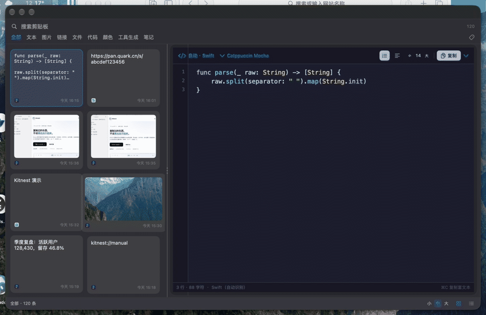

### 关键能力点

- **自研词法器**（`CodeLexer`，582 行）
  为什么不引第三方：本项目用 `swiftc` 直编、无 SPM 依赖；且预览要能在 200ms 内出结果，大库反而慢。
  支持 20+ 语言（`CodeLanguage`），语言 id 同时是高亮器的配置键。

- **主题**（`CodeTheme`，347 行）
  每个主题是一整套**显式十六进制色**，不跟随系统语义色——代码块的观感不能随深浅色模式漂移。

- **导出图片**（`CodeCardImage`）
  带内边距、圆角、可选窗口红绿灯装饰的卡片图，直接拖进聊天窗或存进剪贴板。

- **富文本复制**（`CodeRichCopy`）
  只写纯文本等于给用户一坨灰字，还得自己重排。这里同时放三种类型：纯文本、带格式富文本、HTML——粘到哪个应用都尽量保住高亮。

- **交互参照 highlightcode.com**：所有开关都在同一个框的工具条里，不来回跳页。

### 注意事项

- 语言选错会导致高亮错乱，但不会崩；不确定就选「自动」。
- 超长代码（>5000 行）会截断预览并提示，导出图片同样限制高度。
- 导出图片按 2x 输出，Retina 屏不糊。

### 实现索引

| 文件:行号 | 函数 | 职责 |
|---|---|---|
| `CodePreviewView.swift:719` | `body` | 预览界面与工具条 |
| `CodeHighlighter.swift:162` | `highlight` | 高亮入口（三处共用） |
| `CodeLexer.swift:582` | `tokenize` | 词法分析 |
| `CodeLanguage.swift:142` | `all` | 语言表 |
| `CodeTheme.swift:347` | `theme` | 主题色板 |
| `CodeCardImage.swift:82` | `render` | 卡片图导出 |
| `CodeRichCopy.swift:173` | `copy` | 三格式富文本复制 |

---

## 第二十九章 网盘链接解析

### 功能是什么

复制一条网盘分享链接，Kitnest 认出来并提示「打开解析中心」——在里面可以直接拿到直链下载，不用开浏览器走一遍验证码。

### 用户怎么用

| 操作 | 效果 |
|---|---|
| 复制网盘分享链接 | 状态栏下方弹出小提示，点开进解析中心 |
| 面板首页「网盘链接」条 | 显示剪贴板里的网盘链接，点开解析 |
| 工具箱 →「网盘解析」 | 同上 |
| `kitnest://cloudlink` | 深链直达 |

### 演示

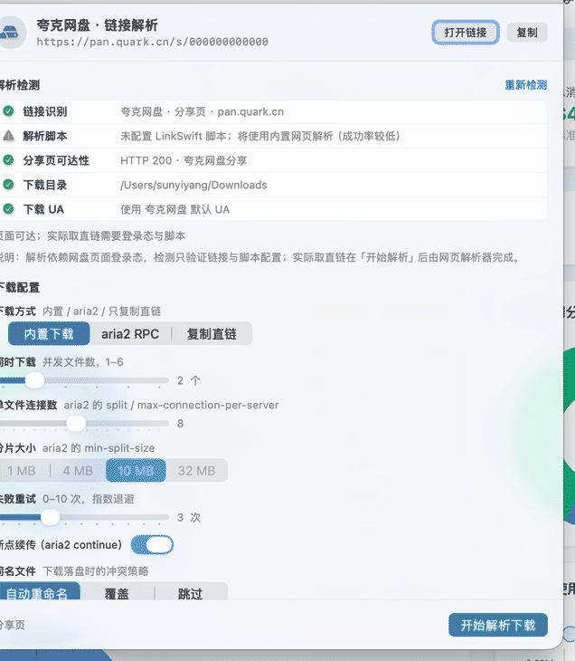

### 关键能力点

- **域名识别表**（`CloudDriveLink`）
  覆盖主流网盘（百度 / 阿里 / 夸克 / 123 / 天翼 / 移动 / 迅雷 / UC / 115 等），规则提取自 LinkSwift（AGPL-3.0 上游项目）的 `@match` 声明。

- **复制即提示**（`CloudLinkPrompt`）
  剪贴板新增文本 → 命中网盘域名 → 直接打开解析中心（不是只弹个 Toast）。

- **解析中心**（`CloudLinkCenter`，794 行）
  列出链接、标题、提取码、预计大小；支持批量、复制直链、调用下载器。

- **直链下载**（`CloudLinkDownloader`）
  内置下载器，可断点续传；也能把直链交给外部下载工具。

- **面板内嵌条**（`CloudLinkBar`）
  位置在搜索框正下方，只有检测到网盘链接时才出现，不占常驻空间。

### 注意事项

- 解析依赖各网盘当前的接口规则，网盘改版可能导致失败——失败会明确提示，不会卡住。
- 需要登录的网盘（如百度超大文件）仍需在浏览器里登录一次，应用不保存网盘账号。
- 只处理分享链接，不处理私有直链。

### 实现索引

| 文件:行号 | 函数 | 职责 |
|---|---|---|
| `CloudDriveLink.swift:201` | `match` | 域名与分享页规则 |
| `CloudLinkPrompt.swift:92` | `present` | 复制后提示 |
| `CloudLinkCenter.swift:794` | `body` | 解析中心 |
| `CloudLinkDownloader.swift:461` | `download` | 直链下载 |
| `CloudLinkBar.swift:193` | `body` | 面板内嵌条 |

---

## 第三十章 AI 助手

### 功能是什么

内置多服务商大模型接入层：配一家或多家，就能在应用内聊天、总结、翻译。密钥本地加密，支持本地 Ollama。

### 用户怎么用

| 功能 | 入口 | 说明 |
|---|---|---|
| 配置服务商 | 设置 → 搜索与 AI →「AI 服务商 → 管理」 | 选厂商、填 Base URL、存密钥、刷新模型、测试连接 |
| AI 聊天 | 工具面板 / 命令面板搜「AI」 | 多轮对话、流式输出、会话管理 |
| 总结 | 剪贴板条目 →「总结」 | 对当前文本生成摘要，结果可回写 |
| 翻译 | `⇧⌥T` / `⇧⌥D` | 截图翻译、划词翻译（第十四章） |
| 自定义工具 | 设置 → 搜索与 AI → 自定义工具 | 自己的提示词模板 |

### 四类服务商

| 类型 | 默认端点 | 鉴权 |
|---|---|---|
| **Anthropic** | `https://api.anthropic.com` | `x-api-key` |
| **Gemini** | `https://generativelanguage.googleapis.com` | Key 走 URL 参数 |
| **OpenAI 兼容** | 任意网关（DeepSeek / 月之暗面 / 智谱 / Groq…） | `Authorization: Bearer` |
| **Ollama** | `http://localhost:11434` | 无（本地） |

### 演示

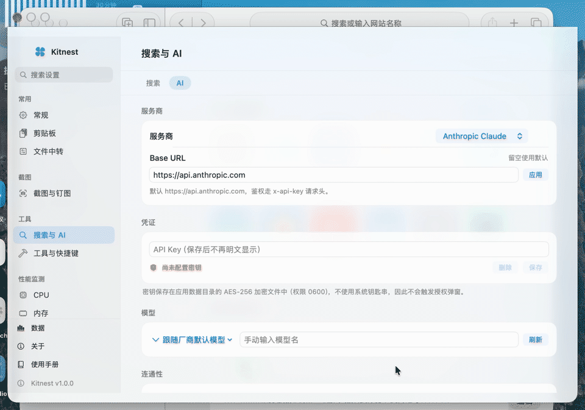

### 关键能力点

- **门面 + 适配器**（`LLMService` / `LLMResolver`）
  对外只有一个 `stream` 入口，内部按偏好路由到具体适配器。加一家新厂商只写一个 adapter。

- **流式输出**（`LLMTransport`，200 行）
  所有请求可取消——所以不用 `URLSession.shared.bytes(for:)`，自己管连接和 SSE 解析。断网/取消时立刻释放。

- **模型列表缓存**（`LLMResolver`）
  每次打开设置都拉 `/models` 会造成明显卡顿且各家有配额限制，所以缓存一次，手动「刷新模型」才重拉。

- **会话存储**（`LLMSessionStore`）
  复用 SQLite 的 `llm_sessions` / `llm_messages` 两张表，支持新建/切换/重命名/删除/关键词搜索、自动生成标题。

- **总结回写**（`AISummaryView` + `ClipboardSummaryExecutionCoordinator`）
  对剪贴板文本总结，结果可复制或写回剪贴板历史（标为「工具生成」）。

- **自定义工具**（`CustomAIToolStore`）
  名称 + 系统提示词 + `{input}` 模板，保存后与内置动作并列显示。

- **密钥安全**（`CredentialStore`，293 行）
  密钥以**加密信封**形式存本地，主密钥由系统钥匙串派生。旧版 Gemini 明文密钥会自动迁移（`LegacyGeminiMigrator`）。

### 注意事项

- API Key 只在本机；导出偏好数据时**不含密钥**。
- OpenAI 兼容端点填到域名即可（不要在末尾加 `/v1/chat/completions`）。
- 本地 Ollama 需先启动服务并 `ollama pull` 模型。
- 网络不通或密钥错误时聊天区显示可读错误，不崩溃。
- AI 请求失败不影响其他功能。

### 实现索引

| 文件:行号 | 函数 | 职责 |
|---|---|---|
| `LLMService.swift:106` | `stream` | 唯一门面 |
| `LLMResolver.swift:121` | `resolve` | 按偏好路由 + 模型缓存 |
| `LLMTransport.swift:200` | `streamBytes` | 可取消的 SSE 传输 |
| `AnthropicService.swift:127` | `stream` | Anthropic 适配 |
| `GeminiService.swift:131` | `stream` | Gemini 适配 |
| `OpenAICompatibleService.swift:138` | `stream` | OpenAI 兼容适配 |
| `OllamaService.swift:127` | `stream` | 本地 Ollama |
| `CredentialStore.swift:293` | `encryptEnvelope` / `masterSecret` | 密钥加密 |
| `LLMSessionStore.swift:152` | `createSession` / `autoTitle` / `searchSessions` | 会话管理 |
| `AISettingsPane.swift:432` | `body` | 服务商设置页 |
| `AIChatView.swift:438` | `body` | 聊天界面 |
| `AISummaryView.swift:341` | `run` / `saveToClipboard` | 总结与回写 |
| `CustomAIToolStore.swift:94` | `upsert` | 自定义工具 |
| `LLMProtocols.swift:303` | 协议定义 | 11 个自有协议 |

---

# 第六部分 · 设置与其他

## 第三十一章 设置

### 功能是什么

左侧大侧边栏的设置窗，分三个一级分类、27 个页面。左侧有搜索框（输入关键词直达某项）。

### 三个一级分类

| 分类 | 页面 |
|---|---|
| **主页** | 常规、剪贴板、搜索与 AI、工具与快捷键、数据、关于 |
| **性能监测** | CPU / 内存 / GPU / 磁盘 / 网络 / 传感器 / 电池、监测设置、部件设置 |
| **截图与钉图** | 截图、钉图、图帘 |

### 用户怎么用

| 入口 | 操作 |
|---|---|
| `⌘,` | 打开设置 |
| 菜单栏右键 →「设置…」 | 同上 |
| 面板齿轮菜单 →「设置」 | 同上 |
| `kitnest://settings?pane=general` | 直达某页 |
| 左侧搜索框 | 输入关键词，直接列出匹配项并跳转 |

### 各页要点

| 页面 | 关键项 |
|---|---|
| **常规** | 登录时启动、外观（浅色/深色/自动）、语言、个性化（面板宽度/强调色/背景图）、菜单栏图标样式 |
| **剪贴板** | 记录开关、保留策略（条数/天数/大小）、忽略应用、图片 OCR、标签管理、呼出快捷键 |
| **搜索与 AI** | 搜索引擎管理、AI 服务商、自定义 AI 工具、本地文件搜索开关 |
| **工具与快捷键** | 工具启停、19 条全局热键、工具热键、双击模式、恢复默认 |
| **数据** | 导出/导入偏好包（含统计与快捷键，不含密钥）、清除索引缓存 |
| **关于** | 版本、检查更新、导出诊断包、开源许可 |
| **截图** | 保存目录、文件名模板、格式、复制到剪贴板、导出水印、动作条形态、权限状态 |
| **钉图** | 四形态预览、边框/圆角/阴影/透明度/磁性、控制条超时 |
| **图帘** | 总开关、帘线样式、展示时长、最多张数、卡片宽度、帘线缩放、自动上架、快捷键 |
| **监测各模块** | 部件形态（12 种）、颜色、显示项 |
| **监测设置** | 采样间隔、合并模式、温度显示 |
| **部件设置** | STATS 合并条形态/间距/分隔线 |

### 演示

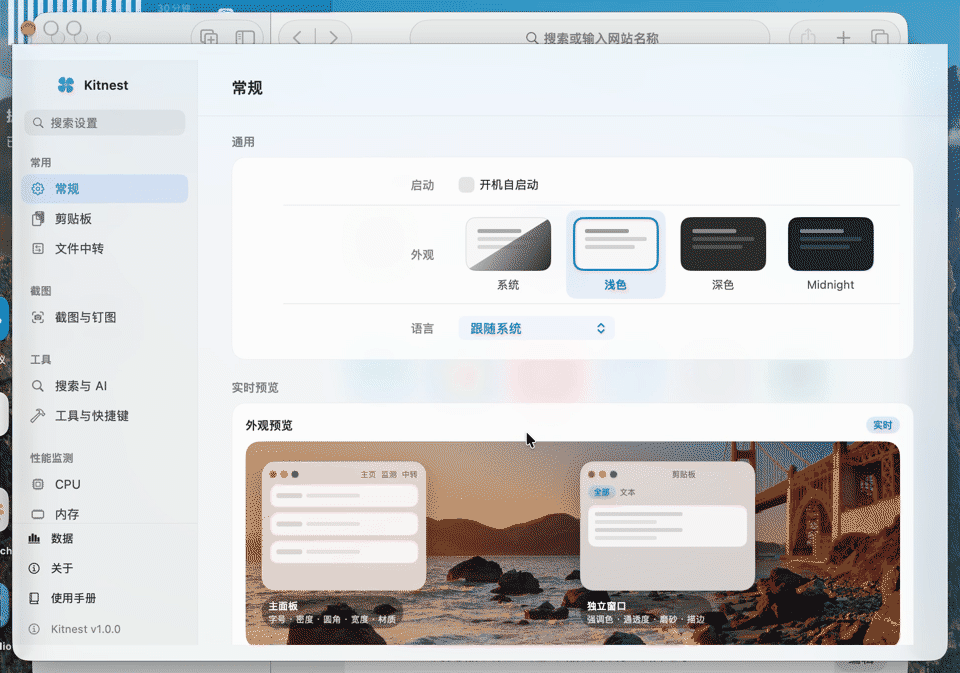

### 关键能力点

- **即改即生效**：外观、个性化、监控参数改动即时应用，不用重启（`Personalization` 单例 + `@Published` 广播）。

- **设置内搜索**（`SettingsSidebarView`）
  每个设置项注册了关键词（标题 + 别名 + 分类），输入「权限」能直接跳到截图权限那一项。

- **导入/导出**（`StatisticsSettingsPane.performExport` / `performImport`）
  导出为 plist 包，逐项应用并报告结果。**不含 AI 密钥**。

- **部件设置自检**（`WidgetSettingsSelfTest.runIfRequested`）
  设置系统内置自检例程，验证配置读写链路。

- **兼容层**（`StateCompat`）：无完整 Xcode 时工具链缺少 SwiftUI 宏插件，这里做了降级兼容。

### 注意事项

- 恢复默认快捷键会清除所有自定义绑定与双击模式。
- 语言切「自动」时跟随系统。
- 导出的数据文件不含任何密钥，换机后需重填。

### 实现索引

| 文件:行号 | 函数 | 职责 |
|---|---|---|
| `SettingsWindowController.swift:224` | `show` / `open(pane:)` | 设置窗与深链跳转 |
| `SettingsRootView.swift:214` | `body` | 根视图（940×620） |
| `SettingsSidebarView.swift:410` | `searchField` | 侧边栏搜索 |
| `SettingsPanes.swift:824` | 页面注册表 | 27 个页 |
| `PersonalizationSettingsPane.swift:888` | `body` | 个性化（即改即生效） |
| `CaptureHubPane.swift:81` | `body` | 截图/钉图/图帘三页合并 |
| `CurtainSettingsPane.swift:472` | `body` | 图帘设置 |
| `PinSettingsPane.swift:427` | `body` | 钉图设置 |
| `MonitorWidgetsPane.swift:867` | `body` | 部件设置 |
| `DiagnosticsExporter.swift:190` | `export` | 诊断包导出 |
| `AppearanceManager.swift:78` | `apply` | 外观应用 |

---

## 第三十二章 新手引导与权限

### 功能是什么

首次启动的三件套：**欢迎窗**（功能导览）、**权限引导**（四类权限实测状态 + 一键授权）、**更新说明**（版本变更）。

### 用户怎么用

| 界面 | 何时出现 | 怎么回看 |
|---|---|---|
| 欢迎窗 | 首次启动 | 菜单栏右键 →「欢迎与权限…」 |
| 权限引导 | 欢迎窗里点「权限」；或权限不足时自动弹 | 同上 |
| 更新说明 | 版本升级后首次启动 | 「关于」页 →「更新说明」 |

### 演示

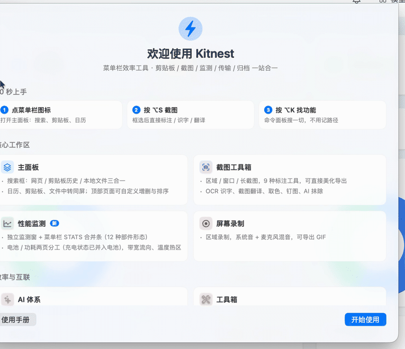

### 关键能力点

- **权限状态是实测的**（`PermissionCenter`）
  不是读某个配置标记，而是实际探测（SCK 预检、`AXIsProcessTrusted`、日历授权状态、FDA 探针）。所以系统设置里改了权限，这里会跟着变。

- **四类权限集中管理**：屏幕录制、辅助功能、麦克风、日历（+ 完全磁盘访问提示）。

- **一键授权**：点「去授权」直接跳系统设置对应页，不用自己找。

- **更新说明**（`WhatsNew`）
  按版本组织条目，分「新增 / 改进 / 修复」三类；只在版本变化时弹一次。

### 注意事项

- 权限引导不会反复骚扰：截图失败时每次启动最多提示一次，之后只 Toast。
- 从 Finder 打开应用授权比从终端 `open` 更可靠（TCC 会记录「responsible process」，终端启动可能记错）。

### 实现索引

| 文件:行号 | 函数 | 职责 |
|---|---|---|
| `WelcomeWindowController.swift:105` | `present` | 欢迎窗触发策略 |
| `WelcomeView.swift:301` | `body` | 功能导览版式 |
| `PermissionCenter.swift:293` | `status` / `request` | 四类权限实测 |
| `PermissionGuideWindowController.swift:89` | `present` | 权限引导窗 |
| `PermissionGuideView.swift:221` | `body` | 引导版式 |
| `WhatsNew.swift:324` | `presentIfNeeded` | 更新说明 |

---

## 第三十三章 内置用户手册

### 功能是什么

应用里自带这份手册：左侧目录树可展开/收起/搜索，右侧正文，图片可点击放大。

### 用户怎么用

| 入口 | 操作 |
|---|---|
| 设置 → 左侧栏底部「使用手册」 | 打开内置手册（与设置同窗） |
| `kitnest://manual` | 深链直达（自动打开设置并跳到手册页） |
| `kitnest://settings?pane=manual` | 同上 |

### 演示

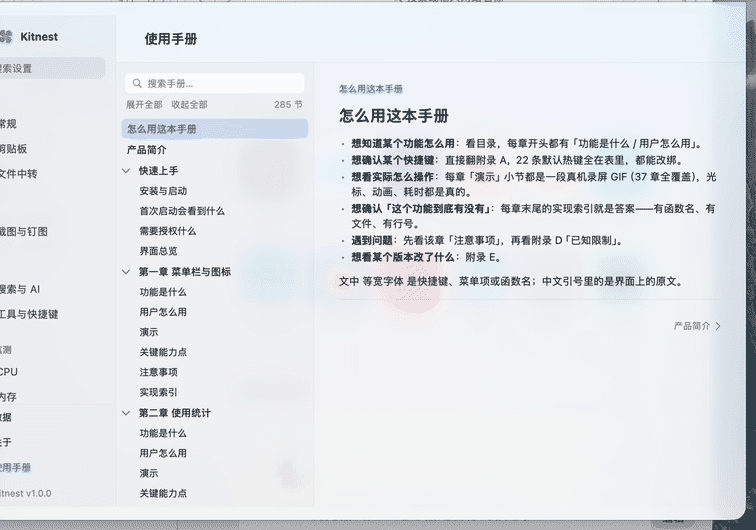

### 关键能力点

- **同源**：内置手册读的就是仓库里的 `docs/40-审计与核对/性能审计/用户手册-FrsetNext.md`，打包时复制进 `Resources/Manual/`。所以文档更新 = 应用更新，不会出现「手册和版本对不上」。

- **目录树**（`ManualView`）
  按 `##` 一级标题建树，`###` 做二级；支持关键词过滤、小节跳转。

- **图片放大**：正文里的截图点开可看原尺寸。

### 注意事项

- 内置版本是打包时的快照；要看最新内容请查仓库里的 Markdown。
- 手册里的快捷键以「设置 → 快捷键」为准（如果你改过绑定）。

### 实现索引

| 文件:行号 | 函数 | 职责 |
|---|---|---|
| `ManualDocument.swift:365` | `load` | 读取并解析 Markdown |
| `ManualView.swift:611` | `body` | 目录树 + 正文 |

---

## 第三十四章 更新与诊断

### 功能是什么

四件事：**检查更新**、**导出诊断包**、**日志归档**、**白屏探针**。

### 用户怎么用

| 功能 | 入口 |
|---|---|
| 检查更新 | 关于页「检查更新」/ 菜单栏「检查更新…」 |
| 导出诊断包 | 关于页「导出诊断」 |
| 查看日志 | `~/Library/Application Support/FrsetNext/logs/` |

### 演示

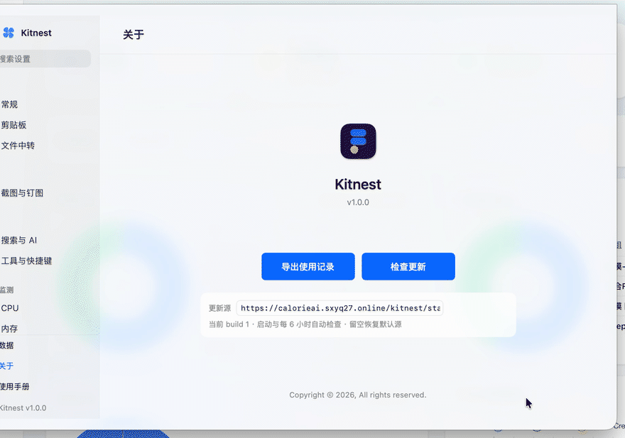

### 关键能力点

- **更新检查**（`AppUpdateChecker`）
  手动触发；更新源可配置（默认空 = 关闭）。支持 GitHub `releases/latest` 或任意返回 `tag_name` 的 JSON。
  分发通道：`calorieai.sxyq27.online/kitnest/`。

- **诊断包**（`DiagnosticsExporter`）
  包含：应用版本、系统版本、偏好快照（脱敏）、最近日志、索引统计。**不含剪贴板内容与密钥**。

- **日志归档**（`LogArchive`）
  保留最近 3 天，自动清理，控制体积。卡死/崩溃会额外留一份现场。

- **白屏探针**（`RenderProbe`）
  窗口白屏类问题的排查工具，默认关闭（`FRSET_RENDER_PROBE=1` 才开），避免日志刷屏。

- **状态兼容层**（`StateCompat`）：无完整 Xcode 时的 SwiftUI 宏降级。

### 注意事项

- 更新检查**默认关闭**，需要自己在设置里填更新源。
- 诊断包是给人看的，不自动上传。
- 日志里可能有窗口标题等片段，发出去前自己扫一眼。

### 实现索引

| 文件:行号 | 函数 | 职责 |
|---|---|---|
| `AppUpdateChecker.swift:342` | `check` | 更新源拉取与比较 |
| `DiagnosticsExporter.swift:190` | `export` | 诊断包组装 |
| `LogArchive.swift:302` | `archive` / `prune` | 日志归档与清理 |
| `RenderProbe.swift:118` | `start` | 白屏探针（默认关） |
| `StateCompat.swift:37` | 兼容声明 | 宏插件降级 |

---

# 附录

## 第三十五章 截图增强（v264）

### 功能是什么

这一版把 1Capture 的「微操」补齐了五件事，全部在 **设置 → 截图与钉图 → 截图** 里：
固定比例、文件命名模板、静默识别、仅文本马赛克，以及框选时的窗口多选。
（v267 起移除了曾在右下角自动弹出的截图预览角标，设置里也不再有对应开关。）

### 用户怎么用

**固定比例**：在「固定比例」里选一组（1:1 / 4:3 / 3:2 / 16:9 / 3:4 / 9:16 或自定义），
之后每次框选都锁死这个比例；选「自由框选」恢复手动。临时想要正方形，框选时按住 `⇧`。
自定义：填名称 + 比例（`5:4`、`1600×900` 都行，会自动约分去重）。

**文件命名**：在「文件命名」里改模板，占位符点一下追加，下面实时预览。默认模板与旧版输出一致：
`Screenshot-2026-11-08-132707-775.png`。

**截完不弹浮窗**：截图完成后右下角不会出现任何预览窗或缩略图卡片；
需要继续处理时，用屏幕下方居中的**动作工具条**（复制 / 识别 / 钉住 / 标注等 19 个动作），
点外部或按 `Esc` 即收起。想直接把图拖进别的 App，可以用图帘或截图历史。

**静默识别**：打开后识别完不再弹结果窗，只在屏幕顶部显示一条 2–12 秒的提示，
文字已经进剪贴板。需要逐字挑选时仍可用动作条里的「复制并识别」（那条路径总是开结果窗）。

**仅文本马赛克**：标注编辑器里打开后，马赛克刷子只负责**圈范围**，
实际被糊的是与笔触相交的文本行；没碰到文字时按普通马赛克处理。

**默认窗口自动识别**（v266）：截图时鼠标移到哪个窗口里，那个窗口就自动高亮，单击即截，
不用手动拉框。**直接拖拽即可拉出自定义框**（4pt 死区，拖动一次就临时转框选，松手截矩形），
不必先切模式。覆盖层顶部「窗口自动识别 / 手动框选」分段开关用于锁定纯手动（`W` 键同效），
切换只对本次生效；「设置 → 截图与钉图 → 截图 → 截图时」可改默认值。`⇧⌥W` 强制进窗口识别。

**窗口多选**：窗口识别模式下按住 `⌘` 单击勾选多个窗口（带序号），回车一次性截完，
按勾选顺序纵向拼成一张图。

### 演示

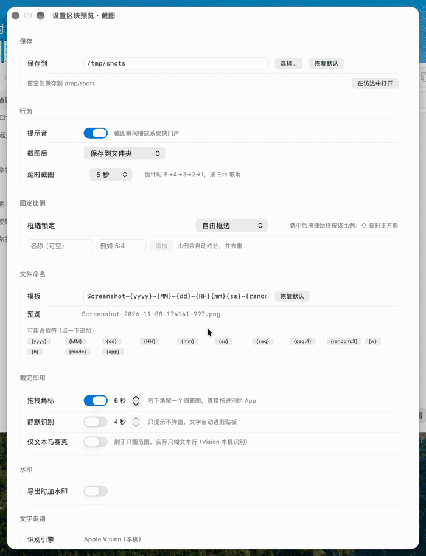

> 这段演示摄于 v264，画面里那一行「拖拽角标」已于 v267 删除；现版本的设置页只剩上面四项。

### 关键能力点

| 能力 | 说明 |
|---|---|
| 比例约束 | 起点为锚点，四个方向都正确；超出屏幕时整体收缩、不破比例 |
| 比例提示 | 尺寸气泡显示 `2560 × 1440 · 16:9` |
| 模板占位符 | `{yyyy}` `{MM}` `{dd}` `{HH}` `{mm}` `{ss}` `{date}` `{time}` `{timestamp}` `{seq}` `{seq:4}` `{random:3}` `{w}` `{h}` `{mode}` `{app}` |
| 序号 | `{seq}` 每天从 1 重置；`{seq:4}` 补零 |
| 文件名清洗 | `/ : \ ? * | " < >` 替换或删除，去掉开头的点，长度上限 180 |
| 静默提示 | 不抢焦点、不打断连续识别 |
| 文本行识别 | Vision 本机；按底图缓存，同一次编辑只算一次 |

### 注意事项

- 比例锁定时，如果拖到屏幕边缘，矩形会整体缩小以保持比例——不会为了填满屏幕破比例。
- `{w}` `{h}` 在截图、标注保存、美化、长截图、屏幕翻译、暂存测试六条链路都有真实值；
  其它模块保存图片时按 0 处理，所以模板里用了 `{w}{h}` 就尽量走这几条链路。
- 截图完成后右下角不留任何浮窗；动作工具条在屏幕下方居中，点外部或 `Esc` 收起。
- 仅文本马赛克首笔会有约 0.2 秒识别停顿；手写体、艺术字可能漏识别。
- 多选窗口若跨屏且系统窗口抓取失败，会退回快照裁剪，可能错位。

### 实现索引

| 函数 / 类型 | 文件 |
|---|---|
| `CaptureAspectRatio` / `CaptureRatioStore.constrain` | `Capture/Screenshot/CaptureAspectRatio.swift` |
| `CaptureFileName.make` / `replacePattern` / `sanitize` | `Capture/Screenshot/CaptureFileName.swift` |
| `CaptureOCRNotify.show` / `OCRNotePanel` | `Capture/Screenshot/CaptureOCRNotify.swift` |
| `CaptureRatioSettingsView` / `CaptureNamingSettingsView` / `CaptureExtraSettingsView` | `Capture/Screenshot/CaptureExtraSettings.swift` |
| `ScreenshotOverlayView.mouseDragged`（比例）/ `commitMultiWindows` | `Capture/Screenshot/ScreenshotOverlay.swift` |
| `ScreenshotManager.commitWindows` / `composeVertically` | `Capture/Screenshot/ScreenshotManager.swift` |
| `MosaicTextOnly.textLineRects` / `stroke(_:hits:radius:)` | `Capture/Annotation/MosaicTextOnly.swift` |

---

## 第三十六章 录屏

### 功能是什么

整屏或区域录制，输出 H.264 MP4。可选叠加摄像头画中画、按键显示、点击动画，
并可按 App 排除窗口；停止后自动打开裁剪窗口，剪头剪尾、静音、导出。

### 用户怎么用

- **开始**：主面板「录屏」区段点「录整屏」/「录区域…」；或按 `⌃⌥R`（整屏开始/停止）、
  `⌃⌥E`（框选区域）。
- **录制中**：屏幕顶部一条控制条（红点 + 计时 + 暂停 + 停止）。控制条**不会被录进画面**。
  暂停后画面停住、时间轴继续，继续即接着录。
- **停止**：点停止 → 自动弹出「录屏编辑」窗口：预览、拖两条滑块选保留区间、
  勾「导出时静音」、点「导出…」。
- **设置**（设置 → 截图与钉图 → 录屏）：
  - 帧率 15 / 30 / 60；
  - 声音：不录音 / 系统声音 / 麦克风（二选一）；
  - 鼠标指针开关；
  - 摄像头画中画：设备、四角位置、宽度 10–35%（4:3 竖版）；
  - 显示按键、点击动画；
  - 忽略的 App：选 `.app`，该 App 的所有窗口不进画面；
  - 保存目录（默认下载目录）。

### 演示

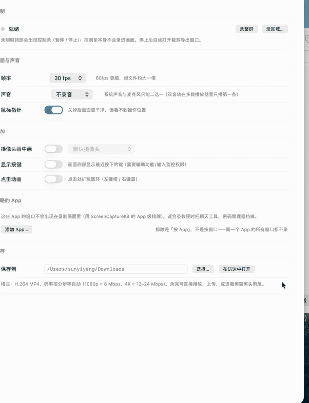

### 关键能力点

| 能力 | 说明 |
|---|---|
| 采集 | ScreenCaptureKit `SCStream` → `AVAssetWriter`，H.264 MP4 |
| 码率 | 按分辨率自动：`w×h×0.12`，钳在 4–24 Mbps |
| 区域 | `SCStreamConfiguration.sourceRect`（显示器本地坐标） |
| 忽略 App | `SCContentFilter(display:excludingApplications:)` |
| 画中画 | `AVCaptureVideoDataOutput` 取最新帧 → Core Image 合成 |
| 按键 | `CGEventTap` listenOnly，键帽条 4 个、1.6s TTL |
| 点击 | 左键橙 / 右键蓝，0.65s 双环扩散 |
| 零开销直通 | 没开任何叠加时原始帧直接 append，不做合成 |
| 编辑器 | AVPlayerLayer 预览 + 入出点 + 静音 + `AVAssetExportSession` |

### 注意事项

- 需要「屏幕录制」权限；按键显示还需要「辅助功能 / 输入监控」——没授权时**只关闭按键与点击**，
  录制本身照常，不会弹窗打断。
- 摄像头、麦克风首次使用会弹系统授权；拒绝后该项静默跳过。
- 录制分辨率跟随系统给 SCK 的源（这台机器是 1710×1112）；写 2 倍只会插值放大，所以保持 1:1。
- 系统声音与麦克风**只能二选一**：两条音轨在多数播放器里只播第一条，混音没有做。
- 忽略是「按 App」，不是按窗口。
- 暂停 = 丢帧但时间轴继续，播放时表现为画面停住。

### 实现索引

| 函数 / 类型 | 文件 |
|---|---|
| `ScreenRecorder.start(options:)` / `stop` / `pause` | `Recording/ScreenRecorder.swift` |
| `RecordingPipeline.handleVideo` / `prepareWriter` | 同上 |
| `RecordingInputMonitor.runTap` / `describe(event:)` | `Recording/RecordingInputMonitor.swift` |
| `RecordingCompositor.keyOverlay` / `clickOverlay` / `cameraRect` | `Recording/RecordingCompositor.swift` |
| `RecordingHUDController` / `RecordingRegionPicker` | `Recording/RecordingHUD.swift` |
| `RecordingEditorController.performExport` | `Recording/RecordingEditorWindow.swift` |
| `RecordingOptions` 偏好键 | `Recording/RecordingConfig.swift` |
| `RecordingSettingsPane` | `Recording/RecordingSettingsPane.swift` |

---

## 第三十七章 工作流

### 功能是什么

截图落盘之后自动执行一串动作：保存到指定目录、复制、识别文字、钉住、上传图床、
新建 GitHub / Linear issue。步骤按顺序跑，后面的步骤能用到前面的产物。

### 用户怎么用

1. 设置 → 截图与钉图 → 工作流 → 「新建工作流」。
2. 打开开关，改名字。
3. 「添加步骤」，按需选类型并填参数：
   - 保存到文件夹：目标路径；
   - 识别文字：无参数，结果进 `{text}`；
   - 上传图片：上传地址 + 文件字段名（默认 `file`），响应里的 `url` 进 `{url}`；
   - GitHub Issue：`owner/repo` + Token；
   - Linear Issue：Team ID + API Key。
4. 截图后自动执行。默认只有一条**禁用**的示例（保存 + 识别 + 复制）。

### 演示

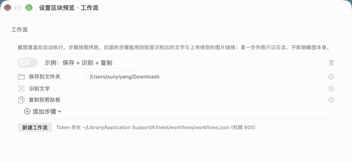

### 关键能力点

| 能力 | 说明 |
|---|---|
| 上下文 | `{name}` 文件名、`{text}` OCR 全文、`{url}` 图片链接、`{date}` 时间 |
| 容错 | 任一步失败只记日志并继续下一步 |
| 串行 | 上一轮没跑完时，新截图跳过（避免并发写同一图床） |
| 存储 | `~/Library/Application Support/Kitnest/workflows/workflows.json`，权限 0600 |
| GitHub | `POST /repos/{owner}/{repo}/issues` |
| Linear | GraphQL `issueCreate` |

### 注意事项

- Token 存在本地 JSON 里（0600），不是钥匙串；共享这台机器账号的人能读到。
- 上传端点必须返回 JSON，且含 `url` / `data.url` / `data[0].url` 之一——否则 `{url}` 为空。
- GitHub 的 issue 正文不能直接附图，需要先配图床拿到 URL，再在正文里引用。
- 工作流跑在后台队列；截图本身不等它，落盘成功即完成。

### 实现索引

| 函数 / 类型 | 文件 |
|---|---|
| `CaptureWorkflow` / `WorkflowStep` | `Capture/Workflow/CaptureWorkflow.swift` |
| `CaptureWorkflowRunner.imageCaptured` / `perform` | 同上 |
| `upload` / `createGitHubIssue` / `createLinearIssue` | 同上 |
| `WorkflowStore.load` / `save` | 同上 |
| `WorkflowSettingsPane` | `Capture/Workflow/WorkflowSettingsPane.swift` |

---

## 附录 A · 默认快捷键

> 全部可在「设置 → 工具与快捷键」改绑；「2×」列表示可切换为双击修饰键模式。

| 功能 | 默认组合 | 可双击 | 说明 |
|---|---|---|---|
| 打开 Kitnest | `⌥A` | 是 | 主面板开关 |
| 截图 | `⌥S` | 是 | 默认窗口自动识别（可切手动框选） |
| 窗口截图 | `⇧⌥W` | 是 | 强制窗口自动识别：悬停高亮、单击截取 |
| 取色 | `⌥C` | 是 | 全屏取色 + HEX |
| 打开并搜索 | `⌥F` | 是 | 面板打开且聚焦搜索框 |
| 悬浮剪贴板 | `⇧⌘V` | 是 | 鼠标旁迷你剪贴板 |
| 截图提取文字 | `⇧⌥S` | 是 | OCR |
| 截图翻译 | `⇧⌥T` | 是 | OCR + 翻译 |
| 截图并复制 | `⇧⌥C` | 是 | 不弹动作条 |
| 截图并贴图 | `⇧⌥P` | 是 | 直接钉在屏幕上 |
| 图帘 | `⇧⌥G` | 是 | 展开 / 收起 |
| 剪贴板 | `⌥V` | 是 | 打开面板并切回首页 |
| 划词翻译 | `⇧⌥D` | 是 | 翻译当前选中文本 |
| 性能监测 | `⌥P` | 是 | 独立监测窗 |
| 长截图 | `⇧⌥L` | 是 | 自动滚动拼接 |
| 文件中转 | `⌥T` | 是 | 切到中转页 |
| 暂停/恢复剪贴板记录 | `⇧⌥R` | 是 | 处理敏感内容时用 |
| 监测独立窗口 | `⌥M` | 是 | 与 ⌥P 同一窗口 |
| 命令面板 | `⌥K` | 是 | 全功能目录 |
| 开始/停止录屏 | `⌃⌥R` | 是 | 整屏录制；录制中按下即停止 |
| 录制区域 | `⌃⌥E` | 是 | 先框选，再开始 |
| 重新钉住上一张 | `⌃⌥P` | 是 | 「全部隐藏」之后一键找回 |

面板内：`⌘P` 置顶、`Esc` 关闭、`⌘,` 设置、`⌘Q` 退出。

## 附录 B · URL Scheme

Scheme 为 `kitnest://`（旧 `frsetnext://` 仍然兼容）。42 个入口：

| 分组 | URL | 效果 |
|---|---|---|
| **面板** | `kitnest://panel` | 打开主面板 |
| | `kitnest://panel?anchor=icon` | 从菜单栏图标位置展开 |
| | `kitnest://panel?monitor=sensors` | 直达性能页指定模块 |
| **设置** | `kitnest://settings?pane=general` | 打开设置并跳页（general / clipboard / search / ai / tools / shortcuts / data / about / statistics / monitor / capture / pin / curtain） |
| **统计** | `kitnest://statistics` | 使用统计窗 |
| **监测** | `kitnest://monitor` / `?module=cpu` | 监测独立窗 |
| | `kitnest://performance` | 同上 |
| **存储** | `kitnest://storage` / `?scan=1` / `?drill=Users` | 存储管理（可自动扫描/下钻） |
| **截图** | `kitnest://capture` / `?action=history` | 截图区段 / 历史 |
| | `kitnest://capture?action=region` / `?action=window` | 直接打开覆盖层（读默认拾取方式 / 强制窗口自动识别） |
| | `kitnest://capturebar?expand=pinGroup` | 弹出动作条（排障用） |
| | `kitnest://copyocr` | 截图并复制文字 |
| **长截图** | `kitnest://longshot` | 进入长截图 |
| | `?demo=1` / `?check=1` / `?preview=1` | 排障入口 |
| **钉图** | `kitnest://pin` | 钉图演示 |
| **图帘** | `kitnest://curtainprobe?count=3&shot=1` | 合成 N 张挂图帘（排障） |
| | `kitnest://shelfprobe` | 旧名，兼容 |
| **OCR** | `kitnest://ocr` / `kitnest://ocrwin` | 识别链路自检 / 结果窗 |
| **翻译** | `kitnest://translate` | 翻译链路自检 |
| **归档** | `kitnest://archive?path=…` / `?action=mini` / `?action=compress` | 打开/小窗/压缩 |
| | `kitnest://compress` / `kitnest://extract` | 压缩 / 解压 |
| **中转** | `kitnest://transfer` | 文件中转页 |
| | `kitnest://tasks` | 任务队列 |
| **投屏** | `kitnest://cast` / `kitnest://castpair` / `kitnest://castapps` | 投屏 / 扫码配对 / 应用库 |
| **搜索** | `kitnest://fileindex?q=…` | 查询全盘索引（排障） |
| **网盘** | `kitnest://cloudlink` | 解析中心 |
| **剪贴板** | `kitnest://clipdesk` / `?action=toggle` | 悬浮剪贴板 |
| **内存** | `kitnest://memcheck` / `kitnest://memthaw` | 深度释放 / 全部解冻 |
| **手册** | `kitnest://manual` | 内置用户手册 |
| **设置区块** | `kitnest://settingsprobe?block=recording` | 单独打开某块设置（recording / workflow / capture，排障用） |
| **诊断** | `kitnest://annotest` / `kitnest://stagetest` / `kitnest://toast` | 各类自检 |

## 附录 C · 函数索引怎么查

本手册每章末尾的「实现索引」是**精选**（每章 6-16 条关键函数）。要查全部函数：

| 资源 | 路径 | 内容 |
|---|---|---|
| 函数清单 | `docs/40-审计与核对/数据表/FrsetNext-函数清单.csv` | 8,693 条声明（module/file/owner/kind/name/line/lines/complexity） |
| 函数审阅台账 | `docs/40-审计与核对/数据表/函数审阅台账.csv` | 3,410 条函数 + 证据链 |
| 符号索引 | `docs/00-总览/符号索引.md` | 8,693 条，按文件组织，可全文搜 |
| 模块依赖图 | `docs/00-总览/模块依赖图.md` | 106 条模块引用边 |

查法示例：

```bash
# 找某个功能的所有函数
grep -i "curtain" docs/40-审计与核对/数据表/FrsetNext-函数清单.csv

# 找某文件里最复杂的函数
awk -F, '$2=="Features/Capture/Curtain/CurtainWindow.swift"' \
  docs/40-审计与核对/数据表/FrsetNext-函数清单.csv | sort -t, -k8 -rn | head
```

## 附录 D · 已知限制

| 限制 | 影响 | 说明 |
|---|---|---|
| 截图/录屏需「屏幕录制」权限 | 无权限时全黑 | 系统限制，无法绕过 |
| 全局快捷键需「辅助功能」 | 无权限时无响应 | 系统限制 |
| 存储索引不含 TCC 目录 | 少约 33GB（沙盒容器） | 授予「完全磁盘访问」后补全 |
| 存储索引不含 APFS 快照/交换文件 | 索引量 < 磁盘已用 | 这些不在任何目录里 |
| RAR 只能解不能压 | — | 7zz 的 RAR 编码器授权限制 |
| PP-OCR 首次识别多约 300ms | 仅首次 | 子进程冷启动 |
| 图帘/钉图不参与截图 | 设计如此 | `sharingType = .none` |
| 隔空投送只通苹果设备 | 安卓用扫码/ADB | AWDL 是苹果私有协议 |
| 手写体 OCR 识别率低 | — | 模型能力边界 |
| 中文输入法组词未上屏不搜索 | 250ms 防抖 | 避免打一个字搜一次 |
| 录屏分辨率跟随系统 1x 源 | 本机 1710×1112 | 写 2 倍只是插值放大，宁小勿糊 |
| 录屏音频二选一 | 系统声音或麦克风 | 双音轨在多数播放器只播第一条 |
| 录屏按键需输入监控权限 | 无权限只关闭按键/点击 | 录制本身不受影响 |
| 工作流 Token 存本地 JSON | 同机用户可读 | 未接钥匙串 |
| 钉图窗不参与屏幕录制 | 手册第 11 章演示拍的是设置页 | `sharingType = .none`，录制/截图都拍不到，设计如此 |
| 归档窗打开普通目录显示「共 0 项」 | 无法逐层浏览文件夹 | v264 实测：直接打开 zip 正常，目录枚举返回空并给⚠️；原因待查（不影响解压/压缩本身） |

## 附录 E · 版本演进（关键节点）

| 版本 | 变更 |
|---|---|
| v211 | 存储管理：全盘索引雏形、气泡堆块、移到废纸篓 |
| v213 | 存储「可清理」名单收紧：排除 Downloads / tmp / 工具链 |
| v233 | 钉图统一叫法（原「贴图」） |
| v259 | 内存「清缓存 + 冻结闲置」合并为「深度释放」 |
| v261 | 图帘落地（原名悬挂架），默认关闭、可开关 |
| v262 | 图帘按 1Capture 反汇编重做几何；截图/钉图/图帘三页合并 |
| v263 | 「悬挂架」改名**图帘**；⌘ 拖动缩放；图帘/剪贴板独立快捷键；钉住四形态 |
| v264 | 存储索引真正扫全盘（248 万条目 / 185GB）；自建全盘文件名索引；搜索覆盖 `~/Library` / 隐藏目录 |
| v264（B/C 档） | 固定比例 / 文件命名模板 / 拖拽角标 / 静默识别 / 仅文本马赛克 / 窗口多选 / 图帘悬停唤出；录屏（画中画·按键·点击·忽略 App·裁剪导出）；自定义工作流 + GitHub/Linear |
| v266 | 截图默认窗口自动识别 + 同一次截图可直接拖拽拉自定义框；模式开关避开刘海 |
| v267 | **移除截图后右下角预览角标**（组件、4 条弹出路径、设置开关与偏好键全部删除）；截完只剩动作工具条 |

---

> 本手册由源码逐文件核对生成，覆盖 32 个功能域、280 个源文件、3,410 个函数。
> 发现描述与实现不一致时，**以代码为准**，并请反馈以便修正。

---

## 附录 F · 演示 GIF 怎么来的

不是示意图，也不是拼的帧，全部是本机真机录屏，**37 章一章一段**，每段都带自动镜头。

### 两遍处理（抄 Screenize / OpenScreen 的路子）

| 遍 | 做什么 |
|---|---|
| 第一遍 | `screencapture -v -C` 录屏（带光标），同时把每一次 `move / click / drag / scroll / type` 连同时间戳写成 `*.json` |
| 第二遍 | 按事件生成镜头段落，逐帧裁切放大，再叠点击涟漪与光标环，最后量化成 GIF |

参考的三个开源项目：**Screenize**（syi0808，Apache-2.0，连续/分段两种相机 + 多轨时间线）、
**OpenScreen**（siddharthvaddem，MIT，点击驱动自动缩放 + 光标高亮）、
**Recordly**（跨平台，自动缩放 + 平滑光标 + 点击效果）。

我们与它们的差别：这里的鼠标是**程序合成**的，坐标与时刻完全已知，不需要 Vision 去猜 UI 元素，
所以不会出现「镜头跟丢光标」。

### 镜头规则（`tools/gifdoc/camera.py`）

| 事件 | 推近 | 说明 |
|---|---|---|
| 点击 | 1.95× | 镜头停在点击处，直到下一个动作 |
| 打字 | 1.75× | 覆盖整段输入 |
| 拖拽 | 1.50× | 起点、终点各一个镜头 |
| 滚动 | 1.45× | 跟住滚轮位置 |
| 停顿 ≥0.75s | 1.50× | 先按「时间近 + 距离近」聚簇，一簇一个镜头，避免表单页每悬停一行就推拉一次 |
| 空闲 >2.8s | 回 1.0× | 全景 |

细节：推近上限按窗口尺寸算 `min(w,h)/200` 夹在 1.45–2.0×（窄面板推狠了只会糊）；
进出用 smoothstep（0.20s / 0.28s），再叠一层 0.10–0.12s 的双向 EMA；
镜头几乎不动时**钉住**（比例 0.002、中心 0.35pt 死区），否则静止段帧帧不同，GIF 会翻十倍。

叠加层：点击涟漪 0.52s 两圈扩散；放大状态下给真光标套一圈细白环（光标本身仍来自录屏）。

### 演示数据：录的时候就不碰真实数据

第一版录完后做了逐帧审查，发现剪贴板历史里有一条 VPN 订阅链接（带 token）、
若干服务器地址与工作待办，跟着浮层预览一起进了画面——37 段里有 8 段能看到。

靠马赛克逐一遮不现实，改成**录制时就用隔离的数据目录**：

```bash
python3 tools/make_demo_data.py                 # 生成纯虚构的演示数据到 /tmp/kitnest-demo
defaults write com.sxyq.frsetnext KitnestDataDir /tmp/kitnest-demo
python3 tools/gifdoc/run.py ch01 --record       # 录
defaults delete com.sxyq.frsetnext KitnestDataDir
```

`AppDirectories` 支持 `KITNEST_DATA_DIR` 环境变量与 `KitnestDataDir` 偏好项覆盖，
剪贴板库、截图历史、统计、暂存目录全部跟着走。演示数据里域名一律 `example.com`、
路径一律 `/Users/demo`、设备地址用文档保留网段 `192.0.2.0/24`。

**换不掉的再打码**。有三类内容来自运行环境而不是数据目录，换不了：

| 内容 | 出现位置 | 处理 |
|---|---|---|
| `~/Movies`、`~/Downloads` 等绝对路径 | 录屏设置、网盘解析、工作流设置 | 打码 |
| 磁盘索引里的真实文件名 | 文件中转 | 打码 |
| 本机进程名 | 性能监测的「占用流量」 | 打码 |

打码用**马赛克**而不是高斯模糊：模糊会留下低频轮廓，缩到 1/12 再放大才真的读不出。
实现是 `h.redact(frames, boxes, pixel=12)`，每章在 `scenes.py` 里配一个区域。

> 录完自查：`tools/gifdoc/` 里有一套 OCR 探针（`ocrbox`），把每段 GIF 抽 5 帧跑一遍，
> 搜 `sunyiyang` / `/Users/` / `192.168.` / `sxyq27` / 邮箱与手机号，命中就重录。

### 演示数据的完整性（第 13 / 18 / 22 章）

隔离目录最初只有剪贴板、截图历史和统计，三个窗口因此是空态：存储管理提示
「需要先建立索引」、归档浏览是空列表、截图历史只有一串 UUID。`make_demo_data.py`
现已补齐三份 App 能直接读取的数据：

| 数据 | 位置 | 演示效果 |
|---|---|---|
| 截图历史 6 条 | `capture-history.sqlite` + 样张 / 缩略图 | 按 `Screenshot-yyyy-MM-dd-HHmmss-….png` 真实命名，带模式、尺寸、OCR 摘要；敲 `2026-11` 能看到列表从 6 张过滤到 4 张 |
| 磁盘索引 | `disk-index/index-fullDisk.json`（schema 4） | 虚构目录树 `/Users/demo/...`，存储窗出 45.3 G 可清理、气泡图与候选清单，可勾选 |
| 素材包 | `downloads/素材包.zip`（6 个 UTF-8 条目） | 归档窗能列文件、点选预览、看详情 |

这三段重录后画面里全是虚构内容，**没有新增任何遮罩或打码**——空态是靠把数据造完整解决的，
不是靠糊住画面。

### 录制画质的四项修正

| 问题 | 原因 | 处理 |
|---|---|---|
| 玻璃面板透出别的 App 文字、桌面小组件 | 窗口是半透明材质 | 录制时铺一块纯色渐变背景板（`backdrop.swift`），录完关掉 |
| 首帧就放大、窗口边缘被切 | 镜头双向平滑把后面的推近值「回传」到了开头 | `camera.render(intro=0.35)`：开场锁全景，再用 3 帧软接回 |
| 缩略图上出现白色方块残影 | 增量帧只贴差异像素，列表重排后旧像素擦不掉 | 关键帧间隔 12 → 6 帧，并关掉抖动 |
| 搜索框打字全丢 | 键盘事件是全局 `CGEvent`，深链打开窗口并不保证 App 在前台 | 开镜前显式 `activate` Kitnest |

另外把镜头目标减掉裁切原点再换算（`camera.py`），修掉了小窗口推近时焦点整体偏右下的问题；
并给三个小窗口单独压了放大上限（`zmax`），避免推到只剩三列卡片。

### 体积控制

| 手段 | 效果 |
|---|---|
| 静止帧合并（`--merge-th 4`） | 镜头停住时把连续同帧并成一帧、时长累加，帧数常砍一半 |
| 增量帧（透明索引） | 只贴变化像素 |
| 调色板阶梯 | 176 → 160 → 128 → 96 → 64，按单条上限自动降 |
| 输出宽度自适应 | `crop宽 × 2 ÷ 缩放上限`，保证放大后不插值 |
| 少数场景关镜头 | 长截图（滚动本身在动）、框选覆盖层（镜头一推选区就看不清） |

实测：37 段合计 **44.3 MB**（平均 1.20 MB/段，最小 0.16 MB、最大 2.3 MB）。三段演示数据补齐后
重录、关键帧加密使总量比上一版多约 2.5 MB。**App 包不受影响**——GIF 只在文档目录与官网，
DMG 里打包的仍是 45 MB 左右（手册正文以文字形式内嵌，不含位图）。

### 复现

```bash
python3 tools/gifdoc/run.py ch16 --probe     # 只出构图截图到 /tmp/gifprobe
python3 tools/gifdoc/run.py ch16 --record    # 录 + 加镜头 → /tmp/gifs_out/ch16.gif
GIF_CAMERA=0 python3 tools/gifdoc/run.py ch16 --record   # 关镜头出平铺版
```

> **三处没上镜头**：① 第 1 章（菜单栏图标位置每次重启会漂，改用探测定位，镜头坐标换算不稳定）；
> ② 第 7 章框选覆盖层（镜头推近会和选区打架）；③ 第 25 章命令面板
> （`⌥K` 在本机被前台 App 抢走，无法确定性重录，沿用旧片）。其余 34 章全部带推拉。
>
> **拍不到的一处**：钉图窗 `sharingType = .none`（第 11 章拍设置页代替）。
> 归档窗打开普通目录原本是空列表，改用演示素材包后（第 22 章）已能完整演示文件列表、预览与详情。
