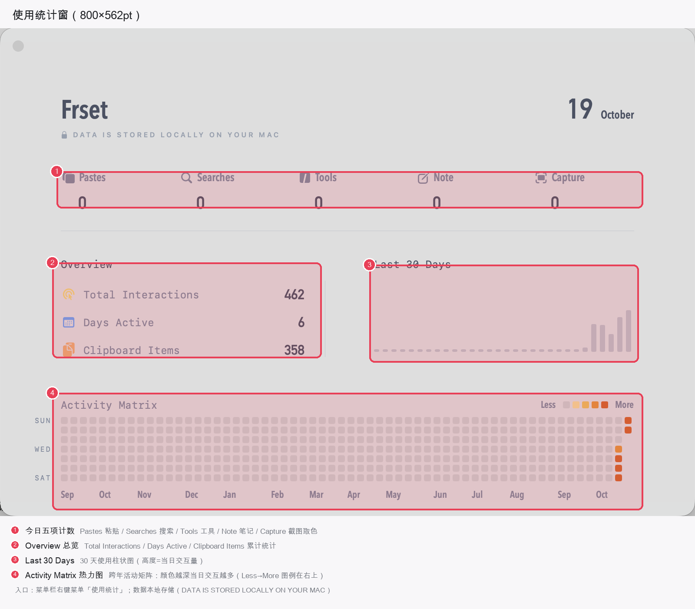
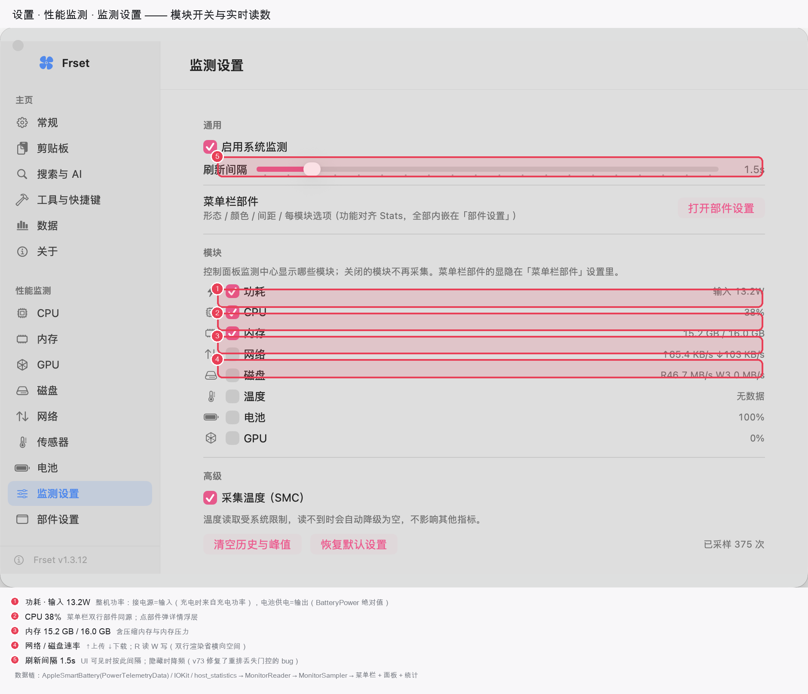
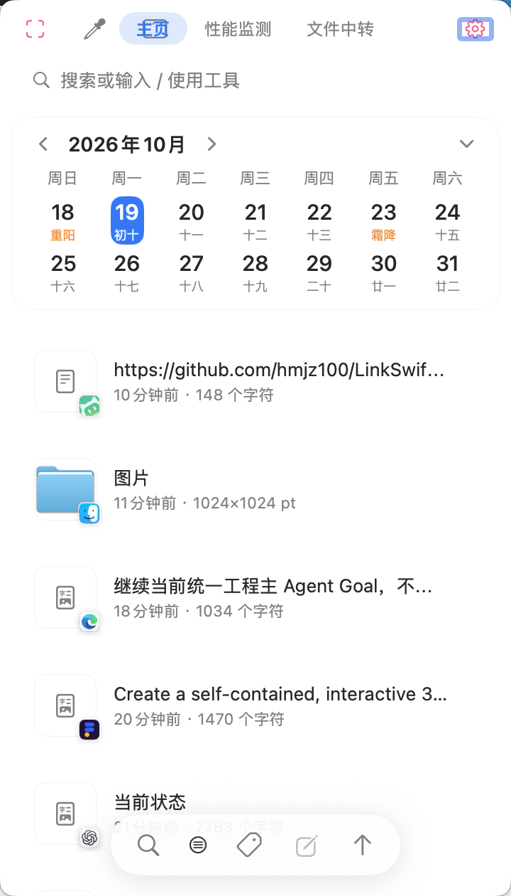
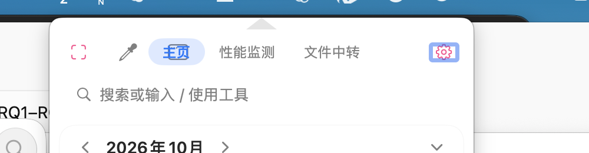
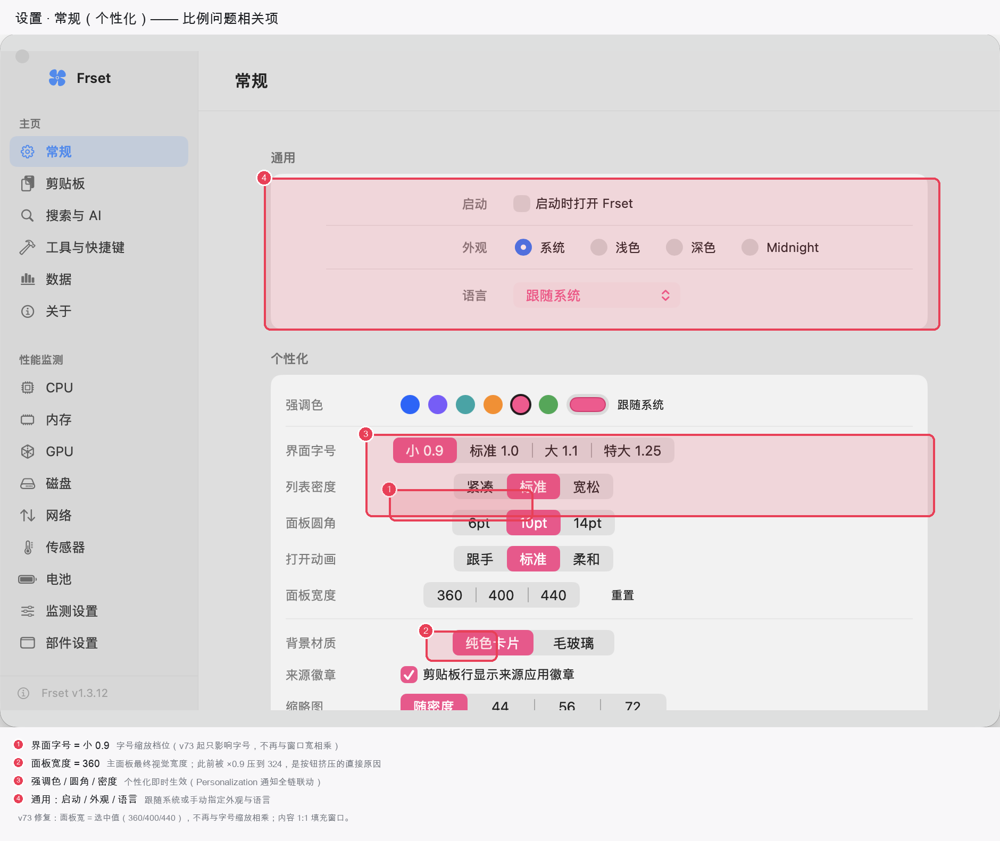
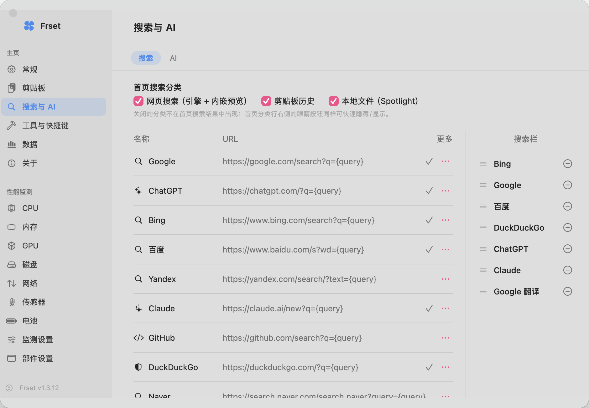
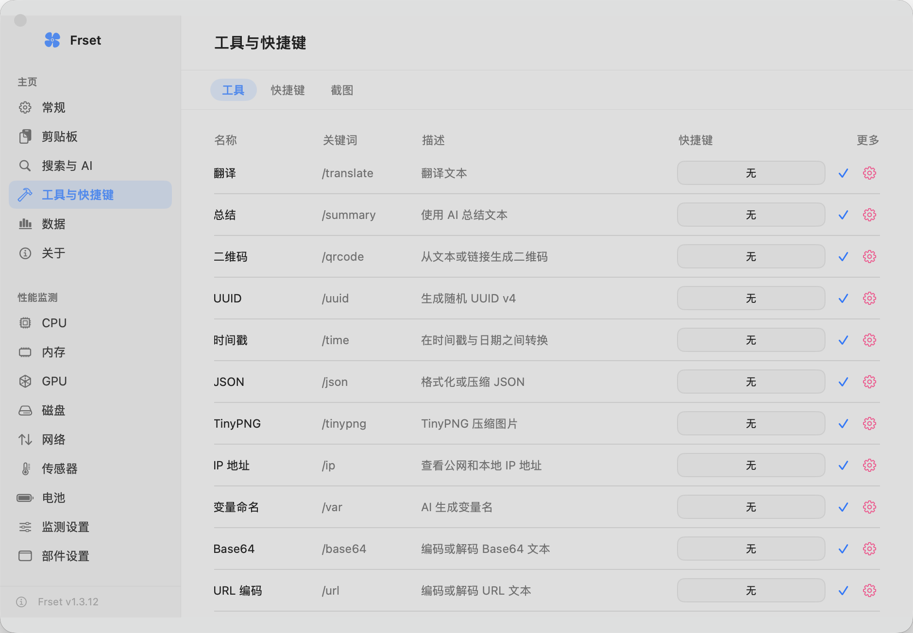
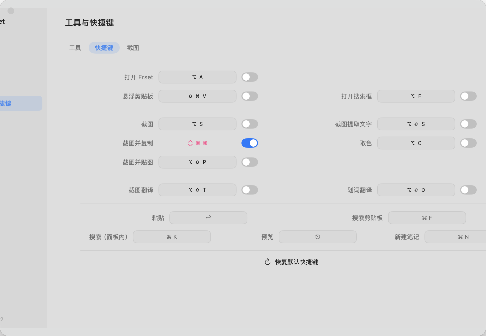
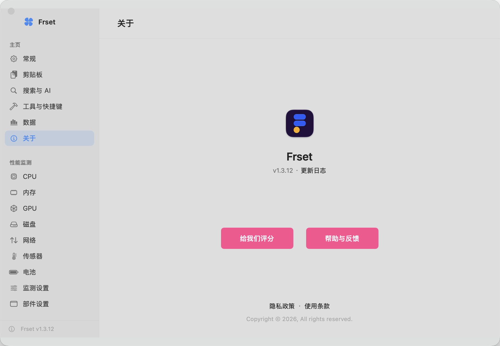

# FrsetNext 用户手册（草稿）

> 版本：基于 FrsetNext 源码（apps/FrsetNext）整理 | 状态：草稿 v1，待截图补齐与校对
> 说明：本手册面向最终用户撰写；文中括号内的英文为源码中的函数名，作为功能实现佐证，普通读者可忽略。

## 产品简介

FrsetNext 是一款常驻 macOS 菜单栏的效率工具集。启动后它住在屏幕右上角的菜单栏里，不占 Dock 位，随叫随到。一个应用汇集了日常高频操作：

- **剪贴板历史**：自动记录复制过的文本、图片、文件、链接，随时检索回贴；
- **截图与图像**：区域截图、长截图、标注编辑、OCR 取字、屏幕翻译、贴图（钉图）、取色、截图美化、物体擦除；
- **录屏**：整屏或选区录制，可选帧率、分辨率、声音来源，导出 MOV / MP4 / GIF；
- **系统监控**：CPU、内存、网络、磁盘、温度、电池、功耗实时数据，菜单栏一眼可见，独立窗口看细节；
- **AI 能力**：接入多家大模型服务商，提供聊天、文本总结与翻译；
- **工具箱**：IP 查询、日历/农历/节假日、媒体转换、哈希、二维码、模糊搜索、命令面板等一整套小工具；
- **传输与投屏**：隔空投送收发（iPhone 零安装）、无线配对与 scrcpy 投屏（Android 零安装）、ADB 文件互传、扫码直传（任意设备浏览器）、本地暂存。

---

## 快速上手

### 安装与启动

1. 将 FrsetNext 拖入「应用程序」文件夹，首次双击打开。
2. 它是菜单栏应用：启动后**不会出现主窗口，也不会在 Dock 显示图标**，只在屏幕顶部菜单栏（或刘海右侧）出现一个应用图标（`MenuBarIconStyle` 提供「应用图标 / 动态风扇 / 日期 / 自定义图标」四种样式，见第一章）。
3. 若杀毒软件提示，请在「系统设置 → 隐私与安全性」中允许运行。
4. 如需退出：点菜单栏图标 →「退出 Frset」（⌘Q）。

### 首次使用建议授予的权限

首次启动会自动弹出**欢迎窗**（功能导览 + 快捷键速查），内含**权限引导窗**入口——四类权限的状态、用途与一键授权集中在那里（`PermissionCenter` / `PermissionGuideWindowController`，状态以 SCK 实探为准）。菜单栏图标右键 →「欢迎与权限…」可随时回看。

| 权限 | 用途 | 不授予的后果 |
|---|---|---|
| 屏幕录制 | 截图、录屏、长截图、OCR、取色 | 截图画面为黑色或直接失败（`ensureScreenRecordingPermission` 会弹统一权限引导） |
| 辅助功能 | 全局快捷键、双击修饰键、划词工具条、复制后自动粘贴 | 快捷键无响应；自动粘贴首次触发会弹模态引导（`presentAccessibilityGuide`，每启动一次） |
| 麦克风 | 录屏时收麦克风声音（可选） | 录屏自动降级为只录系统音（`frset_recorder.m`） |
| 日历 | 主面板日历卡显示系统日程与节假日 | 日历卡仅显示日期（`CalendarService`，UI 有「去授权」入口） |
| 完全磁盘访问 | 工具箱文件搜索（mdfind 增强） | 文件搜索结果可能不全（待确认） |

> 权限均可在「系统设置 → 隐私与安全性」中随时开关；欢迎窗/权限引导窗可从状态栏菜单「欢迎与权限…」随时回看。

### 菜单栏图标说明

启动后菜单栏至少有一个 FrsetNext 主图标。左键点击打开主面板，右键点击弹出功能菜单（打开面板 / 设置 / 性能监测 / 使用统计 / 显示项开关 / 退出）。如果开启了监控部件，主图标右侧还会出现 CPU、内存、网络等实时数据条（详见第二章）。

---

## 第一章 菜单栏与主图标

### 功能是什么

菜单栏是 FrsetNext 的「总指挥部」：主图标负责呼出主面板与功能菜单；旁边的监控部件实时显示系统数据；图标本身还有四种样式和一个小彩蛋。

### 用户怎么用

| 操作 | 入口 | 效果 |
|---|---|---|
| 打开主面板 | 左键点主图标，或 ⌥A，或 `frsetnext://panel` | 从图标下方弹出主面板（再按一次收起） |
| 打开功能菜单 | 右键点主图标 | 见下方菜单项清单 |
| 打开设置 | 菜单「设置…」或 ⌘, | 打开设置窗口 |
| 打开使用统计 | 菜单「使用统计」 | 打开统计窗 |
| 切换监控部件显隐 | 菜单「显示状态项」/「显示项」子菜单 | 逐模块开关（`toggleMonitorModuleAction`） |
| 退出 | 菜单「退出 Frset」⌘Q | 结束应用 |

主图标右键菜单包含：打开面板（⌥空格标注）、设置…（⌘,）、性能监测…、使用统计、显示状态项（总开关）、显示项（CPU/内存/网络/磁盘/温度/功耗等逐项开关）、退出 Frset（⌘Q）（`StatusBarMenuBuilder.mainMenu`）。

### 关键能力点

- **四种菜单栏图标样式**（`MenuBarIconStyle.selectIconStyle`）：
  - 应用图标：默认 Logo；
  - 动态风扇：一个旋转小风扇，转速随 CPU 使用率实时变化（`updateFanSpeed`）；
  - 日期：在菜单栏直接显示当前日期（`startDateTimer`）；
  - 自定义图标：可指定任意 SF Symbol 名称（`setSymbol`）。
- **自定义图标选项需解锁**：连续点击主图标一定次数可触发彩蛋，解锁后才显示「自定义菜单栏图标」子菜单，还有庆祝动效（`MenuBarIconEasterEggManager.unlock` / `presentUnlockCelebration`）。解锁后还可以把该选项「藏起来」或「放回来」（`hideIconOption` / `restoreIconOption`）。
- **图标位置记忆**：监控部件在菜单栏中的位置会被保存，重启后还原（`saveStatusItemPosition` / `restoreStatusItemPosition`）。
- **状态项自愈**：偏好变化或系统菜单栏重建时，部件自动重建（`rebuild` / `syncStatusItems`）。
- **唯一实例保护**：重复启动会自动退出旧实例，避免菜单栏出现两套监控（`enforceSingleMenubarOwner`）；若检测到官方原版 Frset 同时在跑，会弹提示建议退出原版。
- **使用统计窗**：顶部为今日各项计数（粘贴、搜索、工具、笔记、截图/取色），中段为总览卡片与 30 天柱状图，底部是跨年活动热力图（`StatisticsRootView.loadData` / `heatCellView`）。

### 注意事项

- 菜单栏图标被系统折叠时，可到「系统设置 → 控制中心 → 菜单栏」调整，或用 ⌥ 键点击菜单栏展开。
- 「打开面板」在菜单中显示为 ⌥空格，但实际注册的全局热键为 ⌥A（`defaultHotkeys` 中 openFrset 键码为 kVK_ANSI_A）；两者显示不一致，**以 ⌥A 为准（待确认）**，也可在「设置 → 工具与快捷键」中改绑。
- 动态风扇图标持续旋转会增加少量菜单栏重绘开销，介意的话可换回应用图标样式。

---

## 第二章 系统监控

### 功能是什么

实时监测 Mac 的运行状态：CPU、内存（含交换空间与内存压力）、网络（上下行速率）、磁盘（读写速率）、温度（各传感器）、电池（电量与健康）、功耗（整机瓦数），并可查看开机时长与系统负载。数据有三个展示层级：菜单栏部件、监测独立窗口、主面板「性能监测」页。

### 用户怎么用

| 入口 | 操作 | 效果 |
|---|---|---|
| ⌥P 或 ⌥M | 打开/关闭监测独立窗口 | 弹出可常驻的监测窗（`MonitorPopoutWindowController.toggle`） |
| 主面板「性能监测」段 | 点击分段切换 | 面板内嵌同一套监测内容 |
| 菜单栏监控部件 | 点击部件 | 弹出该模块数据浮层（`showPopover`） |
| 菜单「显示项」 | 逐项勾选 | 控制各模块菜单栏部件显隐 |
| 设置 → 性能监测 | 选模块 / 监测设置 / 部件设置 | 配置采样间隔、模块开关、部件形态 |
| `frsetnext://settings?pane=monitor` | URL 直达 | 打开监测设置页 |

监测窗顶部是模块切换条（CPU / 内存 / GPU / 磁盘 / 网络 / 传感器 / 电池），选中哪个模块就展示哪个模块的详情（`MonitorDetailView.availableModules`）。

### 关键能力点

- **采样引擎**：按设定间隔（0.5–10 秒，默认 2 秒）周期性采样（`MonitorSampler.scheduleNext` / `sampleOnce`），面板/设置不可见时自动降频，省电省 CPU。
- **数据来源分层**：Swift 侧读取主机层指标（`MonitorReader.readCPU` / `readMemory` / `readNetworkRate` / `readDiskRate` / `readPower` / `readBatteryLevel`），温度走 SMC 直读（`readSMCTemperature`），底层 C 采样见 `frset_stats_data.c`（`frset_cpu_sample` / `frset_mem_sample` / `frset_net_sample` / `frset_disk_sample` / `frset_smc_scan`）。
- **菜单栏双排文案**：CPU 显示百分比与趋势箭头，内存显示压力百分比，网络显示 ↑上行 / ↓下行速率，磁盘显示 R 读 / W 写，功耗区分「输入（⚡充电中）」与「输出」（`MonitorStatusItems.cpuTwoLine` / `networkTwoLine` / `powerTwoLine`）。
- **温度按传感器分组**：CPU、GPU、硬盘、电池、主板等传感器分类展示，含平均温度（`sensorCategorySection` / `primaryTemperature`）。
- **历史曲线**：各模块保留一段历史数据，绘制趋势图（`MonitorHistory.append`）。
- **网络诊断**（网络模块详情内）：探测公网 IP 与归属地、多目标延迟、DNS 解析、检测系统代理与本地代理端口（`probePublicIP` / `probeLatencies` / `probeDNS` / `detectProxyProcess`）。
- **内存优化**：一键释放可回收内存，并列出内存占用 Top 进程（`MemoryOptimizer.optimize` / `ProcessMemoryInspector.topConsumers`）；优化效果以「释放量 + 前后对比」呈现（`MemoryOptimizeCard.reportView`）。辅助组件需在设置内安装（`installHelper`）。
- **STATS 合并条**：菜单栏监控的官方实现是一条可自定义形态、颜色、间距的合并条，配置在「设置 → 性能监测 → 部件设置」（`StatsBarEngine.openSettings` / `MonitorWidgetsPane.moduleCard`）。

### 注意事项

- 温度读取依赖 SMC，Intel 与 Apple Silicon 的传感器列表不同；个别机型某些传感器无读数属正常现象。
- 内存「优化」释放的是可回收部分，不会真的杀掉进程；频繁优化无额外收益。
- 功耗数据需要电池或电源适配器在位，部分台式机可能无数据（显示「无数据」）。
- 同时运行官方原版 Frset 会画两套菜单栏组件，建议二选一。

---

## 第三章 主面板

### 功能是什么

主面板是 FrsetNext 的核心窗口，宽约 400pt，从菜单栏图标「长出来」。面板分四页（顶部胶囊左右切换）：**主页**（搜索 + 日历 + 剪贴板）、**性能监测**、**文件中转**（仅文件传输）、**投屏**（Android 设备中心）；后两页受设置开关控制显隐。

### 用户怎么用

| 入口 | 操作 | 效果 |
|---|---|---|
| ⌥A / 左键点图标 | 呼出/收起面板 | 弹出/收起 |
| ⌥F | 打开并搜索 | 面板打开并自动聚焦顶部搜索框 |
| ⌘P | 置顶窗口 | 面板常驻不失焦 |
| Esc | 关闭面板 | 面板收起 |
| 顶部工具条 | 截图 / 取色 / 悬浮剪贴板图标，中部三段切换，右侧齿轮菜单 | 快速发起截图类动作、切页、进入设置 |
| 齿轮菜单 | 置顶窗口、悬浮剪贴板、暂停记录剪贴板、设置、使用统计、功能建议、退出 | 面板内快捷操作 |
| 底部悬浮工具条 | 搜索 / 筛选 / 标签 / 编辑 / 上传 | 操作剪贴板列表 |

*锚点展开形态（v73）：面板停到菜单栏图标正下方，顶部中央三角指示器指向图标；`frsetnext://panel?anchor=icon` 可复现。*

### 关键能力点

- **顶部截图菜单**（`PanelRootView.runCapture`）：截图、截图并复制、截图并贴图、截图提取文字、截图翻译、划词翻译、长截图、录屏——直接调用对应模块能力，改了全局热键也不影响菜单可用。
- **搜索区段**（Toolbox 注入）：输入关键词 → 显示搜索引擎栏，点击或回车打开网页搜索；输入 `/` → 切换为工具列表（详见第八章）。
  - **文件搜索覆盖全盘**（v264）：Spotlight 只索引可见目录，**不索引** `~/Library`、以 `.` 开头的隐藏目录（`.workbuddy` / `.cursor` / `.npm`…）、`.app` 包内部与 `/usr/local`，所以此前搜 `~/.workbuddy/skills/image-html-deck` 一条都搜不到（`mdfind` 连 `-onlyin` 都返回空）。v264 起自建一份**全盘文件名索引**：本机 124 万条 / 164MB，mmap 加载（不占堆内存），首次搜索时后台建立（实测 14 秒），之后每次查询 30–220ms。
  - 索引状态就显示在「文件」分组下方：多少条、什么时候建的、重建按钮。搜不到时可先看是不是索引还没建完。
  - 排序按「路径越浅越前」，空格能匹配连字符（`image html deck` → `image-html-deck`）、也能跨目录名匹配（`workbuddy skill` → `~/.workbuddy/skills`）。
  - 系统垃圾文件（`.DS_Store` / `.localized` 等）不参与结果。
- **日历卡**：显示当月月历、今天高亮，并叠加系统日程与节假日/农历信息（Toolbox 的 `CalendarSectionView` / `CalendarService`）。
- **剪贴板列表**：一条条陈列历史记录，图标按来源应用与内容类型区分（`ClipboardAppIconCache`）。
- **悬停预览气泡**：鼠标悬停条目即弹出内容预览——文本自动判别 Markdown / 代码 / JSON 并高亮渲染，图片显示缩略图并识别二维码（`MainPanelPreviewPopoverCoordinator.present` / `PreviewPopoverContentModel.classify` / `PreviewImageLoader.detectQRCode`）。
- **Mermaid 图表渲染**：Markdown 代码块中的 Mermaid 流程图可直接渲染成图（`MermaidRenderer.parse` / `PreviewMarkdownRenderer.renderDiagram`）；Markdown 表格、目录、代码高亮同样支持（`renderTable` / `renderTOC`）。
- **JSON 检查器**：把 `.json` / `.txt` 文件拖进面板任意位置，即打开独立检视器，支持节点折叠、格式化复制（`handleFileDrop` → `JSONInspectorWindow.open` / `parse` / `copyFormatted`）。
- **个性化**：面板宽度、字号缩放、强调色、打开动画、背景图均可在「设置 → 常规 → 个性化」调整，即改即生效（`PanelController.syncPanelFrameToPersonalization` / `persistSize`）。
- **面板位置**：默认贴在菜单栏下方右对齐（`settleTopEdge`），失焦自动收起（⌘P 置顶后除外）。

### 注意事项

- 面板是「临时窗口」：失焦即自动收起，⌘P 置顶可改变这一行为。
- 「文件中转」段可在「设置 → 常规 → 功能」里关掉，关闭后面板只剩两页。
- 底部「上传」按钮需要图床配置，当前版本点击会提示未配置（待确认后续版本接入）。
- 预览气泡内可直接编辑图片（`PreviewPopoverContentView.editImage`）。

---

## 第四章 截图与图像

### 功能是什么

完整的截图工作流：选区/全屏截图 → 标注编辑 → OCR 取字 → 翻译 → 复制/保存/贴图。另有长截图、取色器、截图美化、物体擦除等专项能力。

### 用户怎么用

| 功能 | 快捷键 | 说明 |
|---|---|---|
| 区域截图 | ⌥S | 框选区域后进入默认动作（复制/保存等）；纯手动拖拽（不做窗口吸附） |
| 窗口截图 | ⇧⌥W | 原版固有模式（v113 对齐）：覆盖层窗口选择——悬停识别高亮 + 单击截取，SCK 窗口级抓取排除遮挡 |
| 截图并复制 | ⇧⌥C | 框选后图片直接进剪贴板 |
| 截图并贴图 | ⇧⌥P | 框选后图片钉在桌面上 |
| 截图提取文字 | ⇧⌥S | 框选后 OCR，结果窗可复制、重新识别 |
| 截图翻译 | ⇧⌥T | 框选后 OCR 并翻译，译文回写剪贴板 |
| 划词翻译 | ⇧⌥D | 翻译剪贴板当前文本（译文写入剪贴板历史） |
| 长截图 | ⇧⌥L | 框选区域后自动滚屏采集并拼接（动作条里独立一组） |
| 图帘 | ⇧⌥G | 展开 / 收起图帘（截图后的临时暂存条，设置页可改键） |
| 剪贴板 | ⌥V | 打开主面板剪贴板页（设置页可改键） |
| 取色 | ⌥C | 屏幕任意位置取 HEX，右键/Esc 取消 |

截图类动作也可以从主面板顶部「截图」菜单、菜单栏菜单或命令面板发起。框选后的动作工具条含**空投**（⌘D）——截图落盘文件直接调系统隔空投送。

### 关键能力点

- **选区覆盖层**：半透明遮罩 + 白色虚线选框 + 黄色手柄 + 实时尺寸标签 + 十字准线，Esc 取消、回车确认（`ScreenshotOverlay.drawHandles` / `drawSizeLabel` / `drawCrosshair`）。
- **窗口模式（v113 对齐原版）**：原版 CaptureMode 含 `.window`（docs/10-规格/06 反汇编），二进制反射字段 windows/windowOrder/selectedWindowId/keyDownMonitor 表明窗口选择交互。实现：`pickMode = .window` 覆盖层——悬停识别高亮 + 窗口名标签 + 单击截取 + 顶部提示 + Esc 取消；提交优先 SCK `desktopIndependentWindow`（排除遮挡），回退快照裁剪（`ScreenshotOverlay.snapshotWindowHits` / `ScreenshotManager.commitWindow`）。
- **区域模式不做窗口吸附**（v112 曾在区域模式混入悬停吸附，属自研发明，v113 已移除；原版无此行为证据）。
- **截图后动作链**：截图、复制、贴图、OCR、翻译由同一条动作链分发（`ScreenshotManager.captureAndOCR` / `captureAndPin` / `captureAndCopy` / `captureAndScreenTranslate`），完成后播放快门音（`playShutterSound`）并自动写入剪贴板历史。
- **标注编辑器**（截图后点「标注」，或对贴图/最近截图点「标注」）：九种工具——矩形、椭圆、箭头、画笔、文字、荧光笔、马赛克、橡皮、物体擦除（`AnnotationTool` 定义于 `AnnotationCompositor.swift:9`）；支持撤销、清空、复制、保存，标注坐标与图像像素对齐（`AnnotationEditorWindow.undoTapped` / `composite`）。
- **OCR**：系统级文字识别，支持中英等多语言（`OCRService.recognizeText`），结果窗可一键复制、重新识别（`ScreenshotOCRWindow.copyTapped` / `reRecognize`）；截图 OCR 文本会自动存入剪贴板历史，图片条目也会被异步 OCR 建立索引。
- **屏幕翻译**：截取屏幕区域 → OCR 分块 → 批量翻译 → 按原背景色重绘译文贴图，尽量保持原版式（`ScreenTranslator.translateBlocks` / `render` / `sampleBackground`）。
- **长截图**：框选目标区域后向任意方向（横/竖/斜）滚动页面，自动逐帧采集、去抖拼接，完成后进预览窗，可继续标注或保存（`LongScreenshotSession.onScroll` / `captureFrame` → `LongScreenshotPreviewWindow.show`；Esc 随时取消）。
  - **采集期 UI（v74 补齐）**：框选确认后保留**橙色选区边框**（四角标记、点击穿透不挡滚动），鼠标旁浮出**采集 HUD**——红点 + 实时已采高度（px）+「完成 / 取消」按钮（毛玻璃 `.popover` 材质）；滚动时高度实时跳动，完成/取消均可点（`LongScreenshotHUDController` / `LongScreenshotSelectionBorderWindow`）。
  - 排障/深链入口：`frsetnext://longshot` 直接进入长截图选区（等价 ⇧⌥L 与面板菜单「长截图」）。
- **贴图（钉图）**：图片钉在桌面最顶层，可拖动、滚轮/双指缩放、右键菜单（标注/OCR/翻译/保存/关闭），悬停显示控制条，小尺寸时有操作提示（`PinWindow.showControls` / `showActionsMenu` / `magnify`）。
  - v263 起截图动作条把「钉住」从「更多」里提出来单独成组：点图标按当前外观钉住，悬停展开**经典 / 无边框 / 卡片 / 强调**四种形态（一个形态一个选项）以及「挂到图帘」。形态只作用于这一张，不改全局默认（`PinAppearance`）。
- **图帘（原「悬挂架」，v263 改名）**：截图后不直接消失，而是挂到屏幕顶边的帘线上临时暂存；可拖出、复制、保存、钉图。默认关闭，开关在「设置 → 截图与钉图 → 图帘」。
  - 帘线四种样式（原版 / 拐杖糖 / 圣诞彩灯 / 积雪）；到点只收起不删内容（`ImageCurtainController`）。
  - **缩放**：在图帘上按住 ⌘ 左右拖，或 ⌘ + 滚轮，整条图帘等比放大（72–420 pt）；右键菜单也有「放大 / 缩小图帘」。设置里可单独关闭「帘线跟随缩放」——关掉后只放大图片，帘线/夹子保持原粗细（`CurtainPref.railScalesWithCards`）。
  - **不常驻**：开关关着时不建窗口、不占内存；屏幕放不下时自动收窄，不会溢出屏幕。
- **取色器**：放大镜式取色，实时显示 HEX 与 RGB，点击复制 HEX 到剪贴板并计入历史（`Eyedropper.pickColor` / `copyHexToPasteboard`）。
- **截图美化**：为截图添加纯色/渐变背景、圆角与投影，可复制/保存/贴图，也可设为「框选后默认动作」（`BeautifyPanel.render` / `rerender`）。
- **物体擦除**：在标注编辑器里涂抹掉画面中的物体，自动用周围像素修复（`ObjectRemovalEngine.inpaint` / `AnnotationEditorWindow.applyRemoval`）。
- **保存位置**：截图默认保存目录可在「设置 → 截图」中更改（`CaptureSettingsPane.chooseDirectory`）。

### 注意事项

- 首次截图/录屏需授予「屏幕录制」权限，否则画面全黑；授权后需重启应用生效。
- 长截图依赖页面正常滚动，遇到「不响应滚动的页面」可能采集不完整。
- 划词翻译当前版本是「翻译剪贴板文本」的降级实现，尚不能直接抓取其他应用里的选中文本（源码注释明确说明，待后续版本补齐）。
- 贴图数量过多时注意内存占用，可用贴图右键菜单逐个关闭。

---

## 第五章 录屏

### 功能是什么

基于 ScreenCaptureKit 的屏幕录制：可录整屏或自选区域，支持选择帧率、分辨率（缩放）、声音来源（系统音/麦克风），导出 MOV / MP4 / GIF。录制过程有毛玻璃计时窗实时显示时长，随时停止。

### 用户怎么用

| 入口 | 操作 |
|---|---|
| 主面板截图菜单 →「录屏」 | 打开录屏设置小窗 |
| 菜单栏 STATS 部件 → 录屏入口 | 打开录屏设置小窗（`StatsBarEngine.openRecorder`） |
| `frsetnext://panel` → 截图菜单 → 录屏 | 同上 |

设置小窗里选好参数 → 点「开始录制」→（如选了「选择区域」）拖出录制区域、回车确认 → 开始录制。停止：点计时窗上的「停止」。

### 录屏设置项

| 设置 | 可选值 | 说明 |
|---|---|---|
| 帧率 | 15 / 24 / 30 / 60 | 越高越流畅，文件越大 |
| 分辨率 | 原始 / 75% / 50% | 缩放录制，减小文件体积 |
| 区域 | 整个屏幕 / 选择区域 | 选「选择区域」后进入框选（Esc 取消 / 回车确认） |
| 声音来源 | 无 / 系统音 / 麦克风 / 系统+麦克 | 内录与麦克风混音 |
| 格式 | MOV / MP4 / GIF | GIF 由录制结果转换生成（`FSRecConvertMovieToGIF`） |
| 保存到 | 任意目录 | 「更改…」按钮选择，设置自动保存 |

### 关键能力点

- **计时窗**：毛玻璃药丸，红点 + `M:SS` 计时 + 停止按钮，可拖动让位（`FSRecBarShow` / `FSRecBarHide`）。
- **区域选择覆盖层**：evenOdd 挖洞遮罩 + 白虚线选区 + 黄手柄 + 尺寸标签（`FSRegionOverlayShow` / `FSRegionOverlayClose`）。
- **编码管线**：SCStream 采集 → AVAssetWriter 输出 H.264 视频 + AAC 音频双轨（`FSScreenRecStart` / `FSScreenRecStop`）。
- **完成面板**：停止后弹出完成面板，可查看/打开产物（`FSRecShowDonePanel`）。
- **毛玻璃界面**：macOS 26 使用 Liquid Glass，旧系统回退毛玻璃材质（`FSRecMakeGlass` / `FSRecInstallGlass`）。
- **参数持久化**：所有设置写入 widgets.plist（`Recorder_*` 键），下次打开保持。

### 注意事项

- 录制系统音/麦克风同样需要「屏幕录制」与相应麦克风权限。
- GIF 适合短片段（几秒到十几秒），长录制建议选 MP4。
- 高帧率 + 原始分辨率 + 系统音录制时文件增长很快，注意磁盘空间。
- 录屏进行中切换用户或锁屏可能中断录制（待确认）。

---

## 第六章 剪贴板管理

### 功能是什么

自动记录复制历史（文本、图片、文件、富文本、链接），提供主面板列表、悬浮窗、全局搜索、类型筛选、标签、编辑备注、图片 OCR 等管理能力，并可随时暂停记录保护隐私。

### 用户怎么用

| 入口 | 操作 | 效果 |
|---|---|---|
| ⇧⌘V | 悬浮剪贴板 | 鼠标附近弹出迷你列表（再按收起） |
| ⌥F | 打开面板并搜索 | 搜索历史记录 |
| 主面板底部工具条 | 筛选 / 标签 / 编辑 | 按类型过滤、管理标签、编辑选中条目 |
| ⇧⌥R | 暂停/恢复记录 | 暂停期间不再记录新复制内容 |
| 面板齿轮菜单 | 暂停记录剪贴板 | 同上（菜单形式） |

### 关键能力点

- **自动记录与去重**：周期性轮询剪贴板，按内容指纹去重，重复复制只更新位置与计数（`ClipboardManager.pollTick` / `ingest` / `ClipboardPasteboardReader.fingerprint`）。
- **多类型识别**：纯文本、富文本（RTF）、图片（含尺寸信息）、文件、URL 分别入库（`readText` / `readRichText` / `readImage` / `readFiles` / `readURL`）。
- **记录来源应用**：每条记录显示来源应用图标，隐私名单中的应用可不记录（`frontmostAppIdentifier`）。
- **回贴**：选中条目回车或点「复制」即写回系统剪贴板，也可直接粘贴到当前前台应用（`pasteToFrontmostApplication`）。
- **类型筛选**：全部 / 文本 / 图片 / 链接 / 文件 / 代码 / 颜色 / 工具生成 / 笔记九种过滤（`ClipboardFilterKind`）。
- **标签系统**：可创建、重命名、设颜色的标签，并给条目打标签（`TagStore.create` / `assign` / `toggle`）。
- **条目编辑**：可编辑文本内容、设置别名标题与备注（`ClipboardItemEditWindowController.setContent` / `setAliasTitle` / `setNote`）。
- **图片 OCR**：图片入库后自动调度 OCR，文本可被全局搜索命中（`scheduleOCR`）。
- **悬浮窗**：240×290 迷你窗，可钉住、拖动、记忆位置，鼠标处唤出（`FloatingClipboardWindow.toggle` / `setPinned` / `showNearMouse`）。
- **清理策略**：按条数/天数/体积自动清理历史，可在设置中调整（`ClipboardPruneSchedulers.prune`）。
- **工具产出回流**：截图 OCR、AI 结果、工具输出会以「工具生成」类型进入历史（`ingestToolOutput`），与手动复制区分。

### 注意事项

- 密码管理器（1Password 等）的复制通常有「几秒后清除剪贴板」行为，可能记录不到或被快速清理，属预期。
- 暂停记录期间复制的内容不会进历史，恢复后从新内容开始记录。
- 大体积图片历史会占用磁盘，可在「设置 → 剪贴板」调小保留策略。
- 富文本以 RTF 形式保真存储，粘贴时保留格式。

---

## 第七章 AI 功能

### 功能是什么

内置多服务商大模型接入层：配置一家或多家服务商后，即可在应用内使用 AI 聊天、文本总结与翻译。密钥本地加密存储，支持本地 Ollama。

### 用户怎么用

| 功能 | 入口 | 说明 |
|---|---|---|
| 配置服务商 | 设置 → 搜索与 AI →「AI 服务商 → 管理」 | 选厂商、填 Base URL、保存密钥、刷新模型、测试连接 |
| AI 聊天 | 主面板搜索区输入 `/` 后选 AI 工具，或工具面板 | 多轮对话、流式输出、会话管理 |
| 总结 | 剪贴板条目 →「总结」，或 AI 面板 | 对剪贴板当前文本生成摘要 |
| 翻译 | ⇧⌥T / ⇧⌥D，或 AI 面板 | 截图翻译、划词翻译 |
| 自定义工具 | 设置 → 搜索与 AI → 自定义工具 | 定义自己的提示词模板工具 |

### 关键能力点

- **四类服务商**（`AISettingsPane.selectProvider`）：
  - Anthropic（默认 `https://api.anthropic.com`，x-api-key 鉴权）；
  - Gemini（默认 `https://generativelanguage.googleapis.com`，Key 走 URL 参数）；
  - OpenAI 兼容（DeepSeek / 月之暗面 / 智谱 / Groq 等任意网关，填到域名即可）；
  - Ollama（默认 `http://localhost:11434`，本地运行免密钥，模型需先 `ollama pull`）。
- **模型列表拉取**：保存密钥后点「刷新模型」自动拉取可用模型并选择（`AIChatView.refreshModels` / `loadModelsAsync`）。
- **连接测试**：一键验证配置是否正确（`testConnection`）。
- **流式输出**：聊天回复逐字流出，可随时停止（`LLMService.stream` / `AIChatView.perStream`；传输层 `LLMTransport.streamBytes` 解析 SSE）。
- **会话管理**：多会话新建/切换/重命名/删除，自动生成标题，可按关键词搜索历史会话（`LLMSessionStore.createSession` / `autoTitle` / `searchSessions`）。
- **总结与回写**：对剪贴板文本总结，结果可复制或写回剪贴板历史（`AISummaryView.run` / `saveToClipboard` / `ClipboardSummaryExecutionCoordinator.summarizeAndWriteBack`）。
- **翻译链路**：截图翻译 = OCR → `TranslationToolSession` 翻译 → 译文回流剪贴板并弹提示（`TranslationToolSession.translate` / `systemPrompt`）。
- **自定义 AI 工具**：名称 + 系统提示词 + `{input}` 模板，保存后在文本工具面板与内置动作并列显示（`CustomAIToolStore.upsert` / `addCustomTool`）。
- **密钥安全**：密钥以加密信封形式存本地，主密钥由系统密钥链派生（`CredentialStore.encryptEnvelope` / `masterSecret`）；旧版 Gemini 明文密钥会自动迁移（`LegacyGeminiMigrator.migrateIfNeeded`）。

### 注意事项

- API Key 只保存在本机，不会随截图/日志外发；但导出偏好数据时**不包含密钥**。
- OpenAI 兼容端点只需填到域名（不要带 `/v1` 后缀之外的路径），程序会自动拼接。
- 本地 Ollama 需自行先启动服务并下载模型，应用侧只负责调用。
- 网络不通或密钥错误时，聊天区会显示可读错误信息（`readableError`），不会崩溃。
- AI 请求失败不影响其他功能；未配置密钥时聊天入口会提示先配置。

---

## 第八章 工具箱

### 功能是什么

一整套即开即用的小工具，加上统一入口：命令面板（⌥K）、主面板搜索区（输入 `/`）和工具面板。工具结果一键复制，并自动回流剪贴板历史。

### 用户怎么用

| 入口 | 操作 | 效果 |
|---|---|---|
| ⌥K | 命令面板 | 弹出全功能目录，输入即模糊过滤，回车执行 |
| ⌥F 后输入 `/` | 工具列表 | 主面板内切换为工具模式 |
| 主面板 → 工具 | 工具面板 | 分类网格 + 输入区 + 输出区 |

### 内置工具一览

| 分类 | 工具 | 说明 |
|---|---|---|
| 转换 | 时间戳转换 | 时间戳 ↔ 日期互转（`timestampToDate` / `dateToTimestamp`） |
| 转换 | 变量命名 | 多种命名风格互转（`registerVarNameTool`） |
| 编解码 | Base64 | 编码 / 解码 |
| 编解码 | URL Encode | 编码 / 解码 |
| 编解码 | 哈希生成 | MD5 / SHA1 / SHA256（`sha256` / `md5`） |
| 格式化 | JSON | 格式化 / 压缩 / 校验 |
| 格式化 | 代码预览 | 代码高亮预览 |
| 网络 | IP 地址 | 本机 IP + 公网 IP 及归属地（`localIPAddress` / `queryPublicIP`） |
| 网络 | 二维码 | 文本/链接生成二维码（`registerQRCodeTool`） |
| 图片 | TinyPNG 图片压缩 | 压缩图片体积（`MediaTools.compress`） |
| 图片 | 取色器 | 屏幕取色 HEX（跨模块注册于总控） |
| AI | Translate / Summary | 调用已配置的 AI 服务商 |
| 其他 | UUID | 生成 UUID |

### 关键能力点

- **模糊搜索**：命令面板与工具列表共用模糊匹配引擎，支持乱序字符匹配与评分排序（`FuzzyMatcher.match` / `rate`）。
- **日历与农历**：公农历互转、二十四节气、农历节日（`LunarCalendar.lunarDate` / `solarTerm` / `lunarFestival`）；主面板日历卡叠加显示。
- **节假日**：内置节假日数据，标注当天是否休息/上班（`HolidayManager.holiday` / `isOnLeave`）。
- **系统日程**：授权后读取日历事件，月历格点提示有安排的日期（`CalendarService.events`）。
- **文件搜索**：搜索区可检索本机文件（mdfind）与剪贴板历史，结果按分类分组、命中高亮（`SearchSectionView.runMdfind` / `clipboardCategory` / `filesCategory`）。
- **网页搜索**：输入关键词显示搜索引擎栏，点击/回车跳转浏览器；搜索引擎可增删排序（`performWebSearch` / `searchURL`）。
- **快捷键录制**：可为工具单独录制全局快捷键，冲突时给出提示（`ShortcutRecorder.start` / `ShortcutManager.register`）。
- **双击快捷键**：任意动作可切换为「双击修饰键」模式（⌘⌘ / ⌥⌥ / ⌃⌃ / ⇧⇧），首次开启有兼容性提示（`DoubleTapShortcut.startMonitoringIfNeeded`）。
- **工具启停管理**：每个工具可在设置里单独停用，停用后不出现在面板与命令面板（`ToolRegistry.setEnabled`）。
- **窗口管理**：工具窗口统一登记，可一键全部关闭（`WindowManager.closeAll`）。

### 注意事项

- 命令面板默认 ⌥K（⌘K 易被浏览器等占用，可改绑）。
- 部分工具（AI 总结/翻译）依赖第七章的服务商配置，未配置时会引导去设置。
- 图片压缩类工具处理大图时略慢，属正常。
- 文件搜索依赖系统索引，刚保存的文件可能有延迟。

---

## 第九章 设置

### 功能是什么

设置窗口采用左侧大侧边栏：一级「主页」含六个分类（常规 / 剪贴板 / 搜索与 AI / 工具与快捷键 / 数据 / 关于），一级「性能监测」含七个模块设置 + 监测设置 + 部件设置。⌘, 随时打开。

### 用户怎么用

- 菜单栏图标右键 →「设置…」；或主面板齿轮菜单 →「设置」；或 ⌘,。
- URL 直达：`frsetnext://settings?pane=general`（pane 可选 general / search / tools / shortcuts / about / clipboard / statistics）。

### 各页内容

**常规（settings-general）**

| 分区 | 内容 |
|---|---|
| 通用 | 登录时启动、外观（浅色/深色/自动）、语言（自动 + 多语言） |
| 个性化 | 面板宽度、字号缩放、强调色、打开动画、背景图（`PersonalizationSettingsPane.pickBackgroundImage`） |
| 菜单栏 | 功能开关（系统状态/日历/截图自动 OCR/文件中转入口）、AI 服务商管理入口、菜单栏图标样式（四种单选）、菜单栏部件设置入口、标签管理 |
| 关于入口 | 检查更新与项目链接 |

**剪贴板**：记录开关与保留策略（条数/天数/大小）、忽略应用（隐私名单）、图片 OCR 开关、标签管理。

**搜索与 AI（settings-search）**：搜索引擎栏管理（增删、拖拽排序、自定义引擎：名称 + URL 模板）、AI 服务商管理（密钥/模型/连接测试）、自定义 AI 工具管理。

**工具与快捷键（settings-tools / settings-shortcuts）**：工具启停管理、全局快捷键表（每条可重新录制、可切换为双击模式、可恢复默认）、默认快捷键一键还原。

**数据**：导出/导入偏好数据（含快捷键绑定、搜索引擎、工具配置等，**不含 AI 密钥**）（`StatisticsSettingsPane.performExport` / `performImport`）。

**关于（settings-about）**：版本信息、导出使用记录（诊断包）、**检查更新**（v112：手动检查按钮 + 更新源配置——默认空=关闭，指向 GitHub `releases/latest` 或任意含 tag_name 的 JSON；状态栏菜单「检查更新…」共用 `AppUpdateChecker`）。

**性能监测（settings-monitor）**：左侧选 CPU / 内存 / GPU / 磁盘 / 网络 / 传感器 / 电池进入各模块配置（状态栏形态、颜色、显示项），或进「监测设置」（总开关、采样间隔、合并模式、温度显示）与「部件设置」（STATS 合并条形态/间距/分隔线）。

### 关键能力点

- **即改即生效**：外观、个性化、监控参数改动即时应用，无需重启（`AppearanceManager.apply` / `applyPanelWidth`）。
- **自定义搜索引擎**：名称 + `{query}` 占位的 URL 模板，表单校验后保存（`SearchSettingsPane.saveCustomEngine` / `validateEngineForm`）；支持恢复默认。
- **快捷键改绑**：点按录制新组合，冲突时拒绝并提示原因（`ShortcutManager.failureReason`）；「恢复默认快捷键」一键还原全部。
- **部件设置自检**：设置系统内置自检例程，启动时可按需运行验证配置读写（`WidgetSettingsSelfTest.runIfRequested`）。
- **导入校验**：导入时逐项应用偏好并报告（`applyPreferences`）。

### 注意事项

- 导出的数据文件不含任何 AI 密钥，换机导入后需重新填写密钥。
- 恢复默认快捷键会同时清除所有自定义绑定与双击模式，操作前请三思。
- 语言切换为「自动」时跟随系统语言。

---

## 第十章 文件中转与投屏

### 功能是什么

v114（2026-10-25 用户需求）拆成两页：**文件中转**（第三页，只做文件传输：隔空投送 / 扫码直传 / ADB 文件互传 / 本地暂存）与**投屏**（第四页，Android 设备中心：设备检测 / 无线配对 / scrcpy 镜像）。全部对端零安装。背后是系统空投（`AirDropSendEngine` / `AirDropReceiveWatcher`）、ADB 无线配对与文件桥（`ADBWirelessEngine` / `ADBFileBridge`）、局域网 HTTP 直传（`LanTransferServer`）与 scrcpy 投屏（`ScreenCastEngine`）。

### 用户怎么用

| 通道 | 对方设备 | 怎么用 |
|---|---|---|
| 隔空投送 | iPhone / iPad / Mac | 发送：面板按钮或剪贴板条目右键「隔空投送」；接收：对方空投到本机 → 自动进本地暂存（监听 ~/Downloads） |
| 无线投屏 | Android 11+ | USB 或无线（扫描/配对码）连上后「开始投屏」；镜像期间剪贴板双向同步（`--clipboard-autosync`） |
| 文件互传 · Android | Android | 推送暂存项 → 手机 `Download/FrsetNext/`；拉取该目录全部文件 → 本地暂存（`adb push/pull`） |
| 扫码直传 | 任何有浏览器的设备 | 勾选暂存文件 → 扫码直传 → 相机扫码在浏览器上传/下载（一次性 token 门控） |

### 关键能力点

- **隔空投送联动**（v112）：截图动作链「空投」（⌘D）与剪贴板两套右键菜单「隔空投送」经 `.frsetAirDropFiles` 通知接线到发送引擎（App 层统一分发）。
- **无线配对**（v112）：`adb mdns services` 发现 pairing/connecting 服务，配对码 `adb pair` + `adb connect`；手动 IP:端口输入框。
- **ADB 文件桥**（v112）：逐文件推送精确报数；拉取前清空暂存目录、走 `LocalTransferStore.add` 正式入索引。
- **接收落盘**：AirDrop 接收监听 ~/Downloads（DispatchSource，跳过 `.download` 未完成文件）。

### 注意事项

- 隔空投送只通苹果设备；安卓/Windows 用扫码直传或 ADB 文件互传补齐。
- 无线投屏与文件互传需要手机开启 USB/无线调试（Android 11+ 支持配对码无线配对）；scrcpy 未安装时按引导 `brew install scrcpy`。
- 首次配对需在手机「无线调试」页确认；之后 `adb connect` 随连随用。
- 云端 OPPO 中转与旧扫码上传链路已下线，代码暂留待清理。

---

## 第十一章 性能审计与 v73 修复记录（2026-10-19）

### 11.1 主面板三项回归修复

| 问题 | 根因 | 修复 |
|---|---|---|
| 面板比例怪、按钮全挤一堆 | 三重缩放叠加：设置「面板宽度 360」× 字号缩放 0.9 = 324，内容又叠加 `scaleEffect(0.9)`；同时 `NSHostingView` 默认 sizingOptions 会按内容 fitting 反向压窗口，`windowDidResize` 把 167pt 脏值持久化到 `panel.width`，此后每次启动都读窄值 | ① 窗口宽 = 选中值（360/400/440），不再乘字号缩放；② 内容 1:1 填充（删除内容层 `scaleEffect`）；③ `NSHostingView.sizingOptions = []` 禁止内容改窗口；④ `persistSize` 增加下限保护（<320 丢弃） |
| 展开位置不在菜单栏图标正下方 | 主图标点击与菜单「打开面板」都走 `show()`，恒用 `rightEdgeOrigin`（屏幕右上角右对齐）；`show(atAnchor:)` 存在但无人调用 | `PanelControlling` 协议新增 `toggle(atAnchor:)` / `show(atAnchor:)`；主图标左键、状态项回落、菜单「打开面板」三处改传 `NSStatusBarButton.window.frame` 锚点；快捷键等无锚点路径保持右缘 |
| 没有「三角形从图标指下来」的过渡 | 只有 alpha 淡入；`anchored` 状态与指示器缺失 | `PanelPresentationState.anchored` 驱动根视图顶部 9pt 让位 + 居中三角指示器（尖端朝上指向图标）；配合原 `scaleEffect(anchor:.top) 0.93→1 + offset -10 + spring`，形成从图标下方「长出来」的整体动效 |

> 排障入口：`frsetnext://panel?anchor=icon` 可直接以主图标 frame 锚点展开（等价左键点击），用于截图与回归验证。

### 11.1g 第七轮：小猫只有一只、宽度不再裁切（2026-10-19 22:15）

| 问题 | 根因 | 修复 |
|---|---|---|
| 菜单栏像有两只猫、动作不同步 | 主图标样式为 custom（猫符号），`button.image` 由 NSButton 自己绘制，覆盖层只隐藏子视图挡不住 → 静态猫从透明区透出 | 小猫接管期间清空 `button.image`/`title`；关闭时发通知让 Swift 重应用原样式 |
| 其中一只猫被截断 | 猫图固定 56:36（约 31pt 宽），custom 样式是 variableLength（约 20-24pt） | 主项宽度按猫比例固定（约 33pt）；绘制时宽度不足则等比缩小，绝不超出 bounds |
| 小猫速度与 CPU 数值「两套时间」 | 速度每 20Hz tick 更新，CPU 部件每 3s 刷新 | 速度档只在 `FSBarModuleInterval(@"CPU")` 时刻更新；动画帧仍 20Hz 平滑 |

### 11.1f 第六轮：屏幕录制权限「重复请求」根因与修复（2026-10-19 21:35）

全盘 177 个源文件检索了所有录屏 TCC API（42 处命中），确认这是**持续 API 调用**导致的弹窗循环，不是签名漂移：

| 触发链 | 频率 | 修复 |
|---|---|---|
| `FSBarSystemTick` → `FSBarProbeMenuBarDarkAsync` → `CGDisplayCreateImageForRect`（dlsym） | **每 2 秒**（最严重） | 删除截屏判色，改为视图 `effectiveAppearance`（Stats 同源），C 侧不再有任何截屏调用 |
| `ScreenshotManager.init` → `probePermission` → `SCShareableContent` | 每次启动 | 启动只做 `CGPreflightScreenCaptureAccess()`；权威探测推迟到用户真正截图 |
| `ensureScreenRecordingPermission` → `CGRequestScreenCaptureAccess()` + NSAlert | 每次截图失败 | 每次启动最多请求一次、最多弹一次说明；后续只 Toast 提示 |
| `refreshPermission`（打开设置截图页）→ `SCShareableContent` | 每次打开设置页 | 改为只做 preflight |

保留：截图/长截图/取色/录屏开始时的 `SCShareableContent`、`SCStream`、`SCScreenshotManager`——都是用户主动操作，不属于重复请求。

签名核对：`Authority=FrsetDev`，designated requirement 为 `identifier + certificate leaf`（跨构建稳定）；TCC 已有 `ScreenCapture auth_value=2`、csreq 76 字节。因此主因是高频调用，不是签名。若仍被弹窗，请从 **Finder/程序坞**打开 `/Applications/FrsetNext.app` 授权一次（避免由终端 `open` 启动导致 responsible process 记错）。

完整调用链见 `屏幕录制权限-全盘调用链.md`。

### 11.1e 第五轮：全盘入口核对 + 数据源同源（2026-10-19 21:20）

**全盘扫描**：`apps/FrsetNext` 共 177 个源文件（Swift 164 / ObjC 4 / C 3 / 头文件 6），含 `Sources/FrsetStatsBar/` 全部 `.m/.c/.h`。完整清单见 `性能监测-全盘入口清单.md`。

结论（避免重复实现）：

1. **全盘只有 1 个性能监测窗口实现**：`MonitorPopoutWindowController` → `MonitorPerformanceContent` → `MonitorDetailView`。主面板性能页与状态栏独立窗共用它。
2. 状态栏的“多个小口”是 C 引擎的**独立模式**（`CombinedModules=false`）：每个启用模块各建一个 `NSStatusItem`（当前 CPU run_cat / Network label / Sensors mini）。它们的点击全部走 `openItem:` → `FSBarOpenMonitor` → `StatsBarEngine.openMonitor` → 同一个窗口。不是多套窗口。
3. C 引擎其余窗口只有 `FSEnsureWindow`（720×480，标题 Settings，是**部件设置**窗，不是性能监测）。
4. 仍存在的重复渲染（已登记、未删）：`MonitorCenterView.swift`（全盘 0 调用，死代码）、`StatsModulePanels.swift` 的 `StatsModulePage`（仅设置窗「性能监测 → 模块」使用）。

**数据源同源（v76）**：`MonitorSampler.sampleOnce` 的核心指标（CPU/内存/磁盘/网络/电池）不再用 `MonitorReader` 另采，改为直接读 C 引擎 `g_snap`（0.5s tick，菜单栏部件的同一份快照）。温度/功耗/内存压力/交换仍走原采样。从此菜单栏部件、主面板性能页、状态栏独立窗显示同一时刻的同一组数值。

### 11.1d 第四轮：两个性能入口真正收敛成「一套」（2026-10-19 20:50）

这一轮不是改样式，而是把两条入口的**状态与节奏**合并。逐函数核对结果（函数级台账见 `函数性能审计台账.csv`）：

| 函数 | 之前的问题 | 现在 |
|---|---|---|
| `StatsBarEngine.openMonitor` | `isVisible → showModule`：面板已开时点同一部件**永远不关**；不同部件也只是切模块 | 同模块=收起（toggle）、异模块=切换；监视器抢先收起后 0.6s 内去抖，避免「关了又弹回来」 |
| `MonitorPopoutWindowController.open` | 独立窗用**自己的** `lastModule/selection`；重开不回顶部 | 改用共享选中态 `MonitorCenterPresenter.shared.monitorSelection`；每次打开 `scrollState.resetToken += 1` 强制滚回顶部（顶部模块切换条必然可见） |
| `PopoutRootView` | 自己写一份 `ScrollView + padding + MonitorDetailView`，与主页各自维护 | 与主页共用 `MonitorPerformanceContent`（唯一实现），仅顶部 22pt 让出关闭钮 |
| 模块选中态 | 主面板 `monitorSelection` 与独立窗 `selection` 各自独立（源码注释原文「各自独立记忆」） | **共用一份**：在任一入口切模块，另一入口同步 |
| `MonitorSampler.setPanelActive` | 只有独立窗调用；主面板性能页从未置 active → 主面板 **≥5s 一帧**、独立窗 **1.5s** ——「两套时间」的根因 | 新增 `setHomePanelActive` 独立门控，`uiActive = panelActive ∥ homePanelActive ∥ settingsActive`；任一入口可见都按用户间隔（1.5s） |
| `MonitorPopoutWindowController.dismissPopout` | 只在 `CATransaction` completion 里 `orderOut`；窗口被遮挡/动画被跳过时 completion 不执行 → 窗口永留屏上（日志有 `dismiss` 无 `已收起`） | 0.2s **硬兜底** `finishDismiss`（幂等）+ CA completion 双通道 |
| `windowDidResignKey` | 点自家状态项也会先触发 → 先关后开 | app 仍活跃时交由点击目标处理；真正点外由 `didResignActive` + 监视器 + 轮询负责 |
| 点外监听 | 只有全局 `NSEvent` 监视器（**收不到本 app 事件**，且本 app Accessibility=TCC 拒绝、无输入监控授权，可能静默失效） | 四路冗余：全局监视器 + 本 app 内监视器 + 50ms `pressedMouseButtons` 轮询（不需授权）+ app 失活通知 |

实测（未使用鼠标）：`frsetnext://panel?monitor=sensors` 打开主面板性能页 → `frsetnext://monitor` 打开独立窗，独立窗**同样停在温度**，两图模块切换条、计算项数值（78/82/71/71）、27 项温度条、底栏「刷新间隔 1.5s」完全一致（`shots/v75-panel-performance.png` / `shots/v75-popout-performance.png`）。把 Finder 激活使本 app 失焦后独立窗 `onscreen true→false`，日志 `resignKey → dismiss → app失活 → 已收起`。

### 11.1c 第三轮：监测面板统一 + 玻璃态统一 + 温度可视化（2026-10-19 晚）

| 项 | 之前 | 现在 |
|---|---|---|
| 状态栏部件点击面板 | 292×260 小弹窗，独立构造，**打开时未提升采样频率**（隐藏态 5s 一帧，数值看着"不走"）→ 与主页性能页像两套 | 340×620；与主页/独立窗同一构造（`MonitorDetailView(selection:pageMode:false,fixedWidth:nil)`，带模块切换条）；打开期间 `setSettingsActive(true)` 把采样提到用户间隔（实测页脚显示「刷新间隔 1.5s」），关闭恢复降频 |
| 加载节奏 | 主页/独立窗用 `setPanelActive`，popover 无门控 | 三条路径统一：面板/独立窗 → `setPanelActive`；popover → `setSettingsActive`；两者任一为真即 1.5s |
| 主页玻璃态 | `solid` = windowBackground 纯色（与监测面板观感割裂） | 统一为 `NSVisualEffectMaterial.popover`（系统 popover 原生玻璃），实测面板透出桌面模糊（`shots/panel-glass-v74.png`） |
| 性能监测独立窗 | 普通不透明窗口 | 透明窗 + `.popover` 玻璃铺满 + 12pt 连续圆角（与状态栏 popover 同源） |
| 独立窗 ≠ 主页性能页（2026-10-19 二次修正） | 上一轮只改了**死代码**：`MonitorStatusItems.registerAll()` 早已被注释（v42），实际生效链是 `StatsBarEngine` → `MonitorPopoutWindow` → `PopoutRootView`；且独立窗仍是 `.titled`（系统标题栏悬浮在 fullSizeContentView 上），**顶部模块切换条被标题栏压住**，看起来只有单模块内容 | ① 独立窗改 `MonitorPopoutPanel`（borderless，canBecomeKey=true，无标题栏/红绿灯），玻璃 `.popover` + 12pt 圆角 + 自绘关闭钮 + 可拖动；② `PopoutRootView` 容器与主页**完全同参**（`MonitorDetailView(selection:pageMode:false,fixedWidth:nil)` + `.padding(.horizontal,14)` + `.padding(.vertical,10)`，额外顶部 22pt 让出关闭钮）；③ 实测两图结构/数据/刷新间隔一致（`popout-unified-cpu.png` / `panel-unified-sensors.png`） |
| 独立窗「点外即消」 | 只依赖 `windowDidResignKey`，但 `open()` 从未激活 app → LSUIElement 下窗口成不了 key → resignKey 永不触发，点外部收不起来 | ① `open()` 先 `NSApp.activate` 再上屏；② 兜底全局鼠标监视器：点击点落在窗口外即收起（不依赖 key 状态，dismiss 时移除）。实测 `onscreen=true → false` |
| 温度可视化 | 纯数字行 | 按逆向注入版 v42 规格：**20–110°C 固定标尺橙色条形**（sRGB 0.95/0.60/0.30），计算项（Average/Hottest CPU/GPU）与温度 27 项全部带条；风扇保留原有 RPM 条（`shots/monitor-temp-bars.png`） |

> 新增深链：`frsetnext://panel?monitor=sensors` 面板直达性能页指定模块（sensors/cpu/memory/network/disk/battery/power/gpu）。

### 11.1b 第二轮修复（存储 / 常驻开销，同日实测）

| 问题 | 实测证据 | 修复与效果 |
|---|---|---|
| RenderProbe 常驻探针 | `app.log` 被 `reason=periodic` 每 5s 刷屏（110 KB/天级），隐藏窗口也快照 | 默认关闭（`FRSET_RENDER_PROBE=1` 才开）；重启后 15s 内日志仅 5 条真实启动记录 |
| SQLite WAL 无上限 | `statistics.sqlite` 主库 4 KB 而 `-wal` 2.1 MB；`clipboard.sqlite-wal` 1.6 MB | `journal_size_limit=1MB` + 启动 `wal_checkpoint(TRUNCATE)`；重启后两个 WAL 均归零，主库合并为 32 KB |
| 存储占用 | 数据目录 460 MB，其中剪贴板图片 440 MB（89 个文件，均值 5 MB） | 在 2 GB 上限内属设计内积累；建议图片入库前压缩（预计 −60~80%）或调低上限 |

### 11.2 函数级性能审计摘要（1815 个函数全量台账）

审计方法：tree-sitter AST 抽取 161 个 Swift 文件 + 13 个 C/ObjC 文件的全部函数（1594 + 221），静态调用点统计（修正点调用/短名口径后），入口链 BFS（175 入口 / 1691 条边），热点 API 检测（IOKit/sysctl/ScreenCaptureKit/OCR/DB/网络等 24 类），逐函数标记。完整台账见同目录 `函数性能审计台账.csv`。

| 判定 | 数量 | 含义 |
|---|---|---|
| hotspot | 3 | 常驻/高频路径上的重函数（见下表） |
| optimize | 5 | 有明确优化空间（见下表） |
| review | 62 | 大函数/高风险 API，建议复看（台账 notes 有指引） |
| dead_suspect | 25 | 零调用疑似死代码（C 静态函数为主，建议删除或接回） |
| dead | 6 | 调试/自检专用，生产不调用（保留排障） |
| normal | 1714 | 已读确认合理或静态低风险 |

**hotspot / optimize 明细**：

| 函数 | 判定 | 说明与建议 |
|---|---|---|
| `MonitorSampler.scheduleNext` | hotspot（已修） | 重排时用 `refreshInterval` 丢失 UI 隐藏门控，隐藏时仍按 1s 全量采样。v73 已改为重排复用 `applyPreferences` 间隔（隐藏 ≥5s） |
| `FSRecEngine.start`（录屏） | hotspot | 全屏 ×2×resScale = 5120×3328 BGRA + H.264 40Mbps；仅录制时运行。降负载：resScale 50–75% / 区域录制 / 显式硬件编码 |
| `FSScreenRecBeginFromSettings/Start` | hotspot | 同上入口 |
| `StatsDataProvider.refresh` | optimize | 每帧全量 C 采集；随 sampler 门控修复自动降频 |
| `MonitorSampler.sampleOnce` | optimize | 每轮 2 次 `MonitorExtra.update` 可合并；7 个历史数组每轮拷贝 |
| `FSBarSystemTick` | optimize | 0.5s Reconcile/RefreshValues，需确认幂等快路径 |
| `FSBarKeepAdjacentTick` | optimize | 每 0.5s 无条件派发主队列，可前置 `g_posCalibrating` 判断 |
| `StatusBarController.refreshTitles` | optimize | 双层项每次重建 bitmap；文本未变应跳过 |

**死代码候选（25 个，节选）**：`MidnightTheme.h`、`SpringyIconButtonStyle.makeBody`、`hoverLift`、`FSEnsureWindow`、`FSBarSettingsCreateEmbeddedView`、`FSBarColorName`、`frset_uptime`、`frset_fmt_rate` 等 —— 完整清单与行号见台账 `dead_suspect` 行。

### 11.3 已知问题（v73 时点）

1. 「界面字号」档位（小 0.9 / 标准 / 大 1.1 / 特大 1.25）目前只影响窗口宽度计算的历史逻辑已移除，字号缩放待接入全局字体缩放（当前视觉仅由面板宽度档决定）。
2. 菜单栏监控数据项（CPU/内存/网速/功耗双行部件）在当前安装包未渲染，已列入复看清单（可能与 C 引擎模块配置未同步有关）。
3. 录屏设置小窗与悬浮剪贴板的高清截图待补（见第五章、第六章占位）。

## 附录 A：默认快捷键速查表

> 全部快捷键均可在「设置 → 工具与快捷键」改绑；「2×」列表示可切换为双击修饰键模式。

| 功能 | 组合键 | 可改绑 | 备注 |
|---|---|---|---|
| 打开 Frset 主面板 | ⌥A | 否 | 菜单中该行显示为 ⌥空格（显示问题，待确认） |
| 截图（区域） | ⌥S | 否 | 悬停自动吸附窗口，单击截整个窗口 |
| 窗口截图 | ⇧⌥W | 否 | v112 新增：抓最前台应用主窗口 |
| 取色 | ⌥C | 是（工具域） | |
| 打开并搜索 | ⌥F | 否 | 打开面板并聚焦搜索框 |
| 悬浮剪贴板 | ⇧⌘V | 否 | |
| 截图提取文字（OCR） | ⇧⌥S | 否 | |
| 截图翻译 | ⇧⌥T | 否 | |
| 截图并复制 | ⇧⌥C | 否 | |
| 截图并贴图 | ⇧⌥P | 否 | |
| 划词翻译 | ⇧⌥D | 否 | 当前为翻译剪贴板文本 |
| 性能监测窗 | ⌥P | 否 | |
| 长截图 | ⇧⌥L | 否 | |
| 文件中转 | ⌥T | 否 | |
| 暂停/恢复剪贴板记录 | ⇧⌥R | 否 | |
| 监测独立窗口 | ⌥M | 否 | |
| 命令面板 | ⌥K | 否 | |
| 置顶主面板 | ⌘P | 面板内 | |
| 设置 | ⌘, | 全局 | |
| 退出 | ⌘Q | 全局 | |

## 附录 B：URL Scheme

| URL | 效果 |
|---|---|
| `frsetnext://panel` | 呼出主面板 |
| `frsetnext://settings?pane=general` | 打开设置并跳转指定页（general/search/tools/shortcuts/about/clipboard/statistics） |
| `frsetnext://statistics` | 打开使用统计窗 |

用法示例：`open "frsetnext://settings?pane=tools"`（可在「快捷指令」/ Alfred 等中调用）。

---

## 附录 C：功能-函数索引表

> 每章挑选最关键的函数，格式为 `文件:起始行号`。行号对应源码当前版本，仅作定位佐证。

### C.1 菜单栏与主图标（Features/StatusBar/）

| 函数 | 职责 |
|---|---|
| `StatusBarController.swift:139` installMainItem | 创建并安装主图标状态项 |
| `StatusBarController.swift:424` mainItemClicked | 主图标点击分发（左键面板 / 右键菜单） |
| `StatusBarController.swift:468` showPopover | 点击监控部件弹出数据浮层 |
| `StatusBarController.swift:483` presentStatsPopover | 呈现 STATS 合并条浮层 |
| `StatusBarController.swift:508` openPanelAction | 菜单「打开面板」 |
| `StatusBarController.swift:510` openSettingsAction | 菜单「设置…」 |
| `StatusBarController.swift:529` showStatisticsAction | 菜单「使用统计」 |
| `StatusBarController.swift:533` toggleIconsAction | 「显示状态项」总开关 |
| `StatusBarController.swift:540` quitAction | 「退出 Frset」 |
| `StatusBarController.swift:270` rebuild | 偏好变化后重建全部状态项 |
| `StatusBarController.swift:256` saveStatusItemPosition | 保存状态项在菜单栏的位置 |
| `StatusBarController.swift:262` restoreStatusItemPosition | 重启后还原状态项位置 |
| `StatusBarMenuBuilder.swift:11` mainMenu | 组装主图标右键菜单 |
| `StatusBarMenuBuilder.swift:83` customIconSubmenu | 组装自定义图标子菜单 |
| `MenuBarIconStyle.swift:257` selectIconStyle | 切换图标样式（logo/fan/date/custom） |
| `MenuBarIconStyle.swift:476` startFan | 启动风扇动画 |
| `MenuBarIconStyle.swift:513` updateFanSpeed | 按 CPU 使用率调整风扇转速 |
| `MenuBarIconStyle.swift:465` startDateTimer | 日期样式定时刷新 |
| `MenuBarIconStyle.swift:157` setSymbol | 设置自定义 SF Symbol 名称 |
| `MenuBarIconEasterEggManager.swift:82` registerMainIconClick | 监听主图标连击解锁彩蛋 |
| `MenuBarIconEasterEggManager.swift:123` unlock | 解锁自定义图标选项 |
| `MenuBarIconEasterEggManager.swift:141` presentUnlockCelebration | 播放解锁庆祝动效 |
| `StatisticsRootView.swift:207` loadData | 装载统计数据 |
| `StatisticsRootView.swift:374` heatCellView | 渲染活动热力图格子 |
| `StatisticsSettingsPane.swift:291` performExport | 导出偏好数据 |
| `StatisticsSettingsPane.swift:345` performImport | 导入偏好数据 |

### C.2 系统监控（Features/Monitor/、FrsetStatsBar/）

| 函数 | 职责 |
|---|---|
| `MonitorReader.swift:176` readCPU | 读取 CPU 使用率 |
| `MonitorReader.swift:239` readMemory | 读取内存与内存压力 |
| `MonitorReader.swift:319` readNetworkRate | 计算网络上下行速率 |
| `MonitorReader.swift:333` readDiskRate | 计算磁盘读写速率 |
| `MonitorReader.swift:372` readTemperatures | 读取传感器温度 |
| `MonitorReader.swift:426` readSMCTemperature | 经 SMC 直读温度 |
| `MonitorReader.swift:480` readBatteryLevel | 读取电池电量 |
| `MonitorReader.swift:502` readPower | 读取整机功耗 |
| `MonitorReader.swift:170` loadAverages | 读取系统负载 |
| `MonitorSampler.swift:138` scheduleNext | 调度下一次采样 |
| `MonitorSampler.swift:157` sampleOnce | 单轮全量采样 |
| `MonitorStatusItems.swift:31` cpuTwoLine | CPU 双排菜单栏文案 |
| `MonitorStatusItems.swift:47` networkTwoLine | 网络双排菜单栏文案 |
| `MonitorStatusItems.swift:59` powerTwoLine | 功耗双排菜单栏文案 |
| `MonitorStatusItems.swift:111` combinedTwoLine | 合并条文案 |
| `MonitorStatusItems.swift:138` registerAll | 注册全部菜单栏部件 |
| `MonitorPreferences.swift:105` isModuleEnabled | 模块启用查询 |
| `MonitorPreferences.swift:115` visibleStatusItemIDs | 可见状态项集合 |
| `MonitorDetailView.swift:94` availableModules | 监测窗可用模块列表 |
| `MonitorDetailView.swift:644` sensorCategorySection | 传感器分类展示 |
| `MonitorDetailView.swift:755` batteryStatusText | 电池状态文案 |
| `NetworkDiagnostics.swift:313` probePublicIP | 探测公网 IP 与归属地 |
| `NetworkDiagnostics.swift:387` probeLatencies | 探测多目标延迟 |
| `NetworkDiagnostics.swift:414` probeDNS | DNS 解析探测 |
| `NetworkDiagnostics.swift:199` detectProxyProcess | 检测代理进程 |
| `Memory/ProcessMemoryInspector.swift:30` topConsumers | 内存占用 Top 进程 |
| `Memory/MemoryOptimizer.swift:84` optimize | 执行内存优化 |
| `StatsBarEngine.swift:183` openMonitor | 打开监测窗 |
| `StatsBarEngine.swift:207` openRecorder | 打开录屏设置 |
| `../frset_stats_data.c:166` frset_cpu_sample | C 层 CPU 采样 |
| `../frset_stats_data.c:133` frset_smc_scan | C 层 SMC 传感器扫描 |

### C.3 主面板（Features/Panel/）

| 函数 | 职责 |
|---|---|
| `PanelController.swift:121` toggle | 呼出/收起主面板 |
| `PanelController.swift:125` show | 显示主面板 |
| `PanelController.swift:186` settleTopEdge | 贴菜单栏定位 |
| `PanelController.swift:221` handleGlobalShortcut | 处理面板全局快捷键 |
| `PanelController.swift:249` persistSize | 持久化面板尺寸 |
| `PanelRootView.swift:297` runCapture | 面板内发起截图类动作 |
| `PanelRootView.swift:480` handleFileDrop | 文件拖入打开 JSON 检视器 |
| `FloatingPanel.swift:74` applyPersonalizedMaterial | 应用个性化材质/背景 |
| `JSONInspectorWindow.swift:29` open | 打开 JSON 检视器 |
| `JSONInspectorWindow.swift:210` parse | 解析 JSON 内容 |
| `JSONInspectorWindow.swift:232` copyFormatted | 复制格式化 JSON |
| `JSONInspectorView.swift:87` toggle | 展开/折叠 JSON 节点 |
| `MermaidRenderer.swift:64` parse | 解析 Mermaid 图 |
| `MermaidRenderer.swift:146` parseStatement | 解析 Mermaid 语句 |
| `PreviewMarkdownRenderer.swift:411` renderDiagram | 预览内渲染 Mermaid 图 |
| `PreviewMarkdownRenderer.swift:542` renderTable | 预览内渲染 Markdown 表格 |
| `PreviewPopoverContentModel.swift:78` classify | 预览内容类型判别 |
| `PreviewPopoverContentModel.swift:119` looksLikeMarkdown | Markdown 判定 |
| `PreviewPopoverContentModel.swift:140` looksLikeCode | 代码判定 |
| `MainPanelPreviewPopoverCoordinator.swift:162` present | 呈现悬停预览气泡 |
| `PreviewImageLoader.swift:88` detectQRCode | 识别图片中的二维码 |
| `PreviewPopoverContentView.swift:346` loadFullText | 加载条目全文 |
| `PreviewPopoverContentView.swift:639` editImage | 预览内编辑图片 |

### C.4 截图与图像（Features/Capture/）

| 函数 | 职责 |
|---|---|
| `ScreenshotManager.swift:258` captureRegion | 区域截图入口 |
| `ScreenshotManager.swift:272` startRegionCapture | 启动选区覆盖层 |
| `ScreenshotManager.swift:261` captureAndOCR | 截图并识别文字 |
| `ScreenshotManager.swift:264` captureAndPin | 截图并贴图 |
| `ScreenshotManager.swift:267` captureAndCopy | 截图并复制 |
| `ScreenshotManager.swift:270` captureAndScreenTranslate | 截图并翻译 |
| `ScreenshotManager.swift:350` captureFullScreen | 全屏截图 |
| `ScreenshotManager.swift:228` ensureScreenRecordingPermission | 检查录屏权限 |
| `ScreenshotManager.swift:475` playShutterSound | 播放快门音效 |
| `ScreenshotManager.swift:544` copyOCRText | 复制 OCR 结果 |
| `ScreenshotManager.swift:607` captureLongScreenshot | 长截图入口 |
| `ScreenshotManager.swift:566` stitchAndSave | 拼接并保存长图 |
| `ScreenshotOverlay.swift:228` drawHandles | 绘制选区手柄 |
| `ScreenshotOverlay.swift:238` drawSizeLabel | 绘制选区尺寸标签 |
| `ScreenshotOverlay.swift:261` drawCrosshair | 绘制十字准线 |
| `AnnotationEditorWindow.swift:436` undoTapped | 撤销标注 |
| `AnnotationEditorWindow.swift:452` saveTapped | 保存标注结果 |
| `AnnotationEditorWindow.swift:440` longScreenshotTapped | 编辑器内发起长截图 |
| `AnnotationEditorWindow.swift:252` applyRemoval | 应用物体擦除结果 |
| `AnnotationEditorWindow.swift:354` composite | 合成标注与底图 |
| `OCRService.swift:45` recognizeText | 文字识别 |
| `ScreenshotOCRWindow.swift:196` show | 显示 OCR 结果窗 |
| `ScreenTranslator.swift:99` translateBlocks | 分块翻译屏幕文本 |
| `ScreenTranslator.swift:156` render | 重绘译文贴图 |
| `PinWindow.swift:400` showControls | 贴图悬停显示控制条 |
| `PinWindow.swift:620` showActionsMenu | 贴图右键动作菜单 |
| `Eyedropper.swift:200` start | 启动取色器 |
| `Eyedropper.swift:292` copyHexToPasteboard | 复制 HEX 到剪贴板 |
| `BeautifyPanel.swift:35` render | 渲染截图美化效果 |
| `BeautifyPanel.swift:239` pinTapped | 美化后贴图 |
| `ObjectRemovalEngine.swift:35` inpaint | 图像修复（物体擦除核心） |
| `LongScreenshotCoordinator.swift:168` commitSelection | 确认长截图选区 |
| `LongScreenshotSession.swift:211` captureFrame | 长截图逐帧采集 |

### C.5 录屏（FrsetStatsBar/frset_recorder.m、Features/Monitor/）

| 函数 | 职责 |
|---|---|
| `frset_recorder.m:1201` FSScreenRecStart | 开始录制 |
| `frset_recorder.m:1202` FSScreenRecStop | 停止录制 |
| `frset_recorder.m:1208` FSScreenRecIsRunning | 查询录制状态 |
| `frset_recorder.m:656` FSScreenRecOpenSettings | 打开录屏设置小窗 |
| `frset_recorder.m:1158` FSScreenRecBeginFromSettings | 从设置开始录制 |
| `frset_recorder.m:402` FSRecBarShow | 显示计时窗（红点 + M:SS） |
| `frset_recorder.m:426` FSRecBarHide | 隐藏计时窗 |
| `frset_recorder.m:329` FSRegionOverlayShow | 显示区域选择覆盖层 |
| `frset_recorder.m:352` FSRegionOverlayClose | 关闭区域选择 |
| `frset_recorder.m:162` FSRecConvertMovieToGIF | 录制结果转 GIF |
| `frset_recorder.m:1130` FSRecShowDonePanel | 显示录制完成面板 |
| `frset_recorder.m:1124` FSScreenRecCloseDone | 关闭完成面板 |
| `frset_recorder.m:26` FSRecMakeGlass | 构建毛玻璃层 |
| `frset_recorder.m:46` FSRecInstallGlass | 为窗口安装玻璃效果 |
| `frset_recorder.m:141` FSRecCreateScaledImage | 按缩放比处理帧 |
| `../StatsBarEngine.swift:207` openRecorder | 菜单栏打开录屏设置 |

### C.6 剪贴板管理（Features/Clipboard/）

| 函数 | 职责 |
|---|---|
| `ClipboardManager.swift:195` pollTick | 定时轮询系统剪贴板 |
| `ClipboardManager.swift:251` ingest | 摄入新剪贴板内容 |
| `ClipboardManager.swift:613` insertImage | 插入图片条目 |
| `ClipboardManager.swift:619` insertText | 插入文本条目 |
| `ClipboardManager.swift:567` ingestToolOutput | 工具产出回流历史 |
| `ClipboardManager.swift:625` searchGlobal | 全局搜索历史 |
| `ClipboardManager.swift:559` setNote | 设置条目备注 |
| `ClipboardManager.swift:519` rename | 重命名条目 |
| `ClipboardManager.swift:649` scheduleOCR | 调度图片 OCR |
| `ClipboardManager.swift:671` pasteToFrontmostApplication | 回贴到前台应用 |
| `ClipboardPasteboardReader.swift:84` readImage | 读取剪贴板图片 |
| `ClipboardPasteboardReader.swift:112` readFiles | 读取剪贴板文件 |
| `ClipboardPasteboardReader.swift:141` readRichText | 读取富文本 |
| `ClipboardPasteboardReader.swift:162` readText | 读取纯文本 |
| `ClipboardPasteboardReader.swift:175` readURL | 读取链接 |
| `ClipboardPasteboardReader.swift:215` fingerprint | 内容指纹去重 |
| `ClipboardPruneSchedulers.swift:41` prune | 按策略清理历史 |
| `FloatingClipboardWindow.swift:197` toggle | 呼出/收起悬浮窗 |
| `FloatingClipboardWindow.swift:202` showNearMouse | 在鼠标处显示悬浮窗 |
| `FloatingClipboardWindow.swift:155` setPinned | 钉住/取消钉住 |
| `FloatingClipboardWindow.swift:144` refresh | 刷新悬浮窗列表 |
| `ClipboardPreviewWindow.swift:381` copyContent | 预览窗复制内容 |
| `ClipboardItemEditWindowController.swift:25` setContent | 编辑窗载入内容 |
| `ClipboardItemEditWindowController.swift:202` saveTapped | 保存编辑 |
| `TagStore.swift:68` create | 创建标签 |
| `TagStore.swift:123` toggle | 切换条目标签 |

### C.7 AI 功能（Features/AI/）

| 函数 | 职责 |
|---|---|
| `LLMService.swift:45` send | 统一发送请求入口 |
| `LLMService.swift:84` stream | 流式请求 |
| `LLMProtocols.swift:228` complete | 非流式补全协议 |
| `LLMTransport.swift:70` streamBytes | SSE 流字节读取 |
| `AIChatView.swift:127` send | 聊天发送 |
| `AIChatView.swift:177` performStream | 流式渲染回复 |
| `AIChatView.swift:111` refreshModels | 刷新模型列表 |
| `AISettingsPane.swift:49` selectProvider | 切换服务商 |
| `AISettingsPane.swift:66` saveKey | 保存 API Key |
| `AISettingsPane.swift:146` testConnection | 测试连接 |
| `AISettingsPane.swift:89` addCustomTool | 添加自定义 AI 工具 |
| `LLMSessionStore.swift:18` createSession | 新建会话 |
| `LLMSessionStore.swift:150` autoTitle | 自动生成会话标题 |
| `LLMSessionStore.swift:164` searchSessions | 搜索历史会话 |
| `TranslationToolSession.swift:47` translate | 执行翻译 |
| `TranslationToolSession.swift:78` systemPrompt | 翻译系统提示词 |
| `CredentialStore.swift:127` masterSecret | 派生主密钥 |
| `CredentialStore.swift:170` encryptEnvelope | 加密密钥信封 |
| `LegacyGeminiMigrator.swift:80` migrateIfNeeded | 迁移旧版明文密钥 |
| `AnthropicService.swift` makeRequest | Anthropic 协议请求 |
| `OpenAICompatibleService.swift` makeRequest | OpenAI 兼容协议请求 |
| `OllamaService.swift` makeRequest | Ollama 本地请求 |
| `GeminiService.swift` makeRequest | Gemini 协议请求 |

### C.8 工具箱（Features/Toolbox/）

| 函数 | 职责 |
|---|---|
| `CommandPalette.swift:196` toggle | 呼出命令面板 |
| `CommandPalette.swift:278` refilter | 输入变化重新过滤 |
| `CommandPalette.swift:309` executeSelected | 执行选中命令 |
| `FuzzyMatcher.swift:37` match | 模糊匹配核心 |
| `FuzzyMatcher.swift:82` rate | 匹配评分排序 |
| `BuiltinTools.swift:28` registerAll | 注册全部内置工具 |
| `BuiltinTools.swift:105` registerIPTool | 注册 IP 查询工具 |
| `BuiltinTools.swift:311` registerHashTool | 注册哈希工具 |
| `BuiltinTools.swift:336` registerQRCodeTool | 注册二维码工具 |
| `BuiltinTools.swift:265` registerImageCompressTool | 注册图片压缩工具 |
| `IPAddressService.swift:28` localIPAddress | 查询本机 IP |
| `IPAddressService.swift:56` queryPublicIP | 查询公网 IP |
| `LunarCalendar.swift:126` lunarDate | 公历转农历 |
| `LunarCalendar.swift:183` solarTerm | 二十四节气 |
| `LunarCalendar.swift:204` lunarFestival | 农历节日 |
| `HolidayManager.swift:48` holiday | 节假日数据 |
| `HolidayManager.swift:62` isOnLeave | 是否休息日判定 |
| `CalendarService.swift:26` requestAccessIfNeeded | 日历授权引导 |
| `CalendarService.swift:77` events | 读取系统日程 |
| `MediaTools.swift:33` compress | 图片压缩执行 |
| `ToolConverters.swift:29` timestampToDate | 时间戳转日期 |
| `ToolConverters.swift:268` sha256 | SHA-256 计算 |
| `ToolConverters.swift:313` md5 | MD5 计算 |
| `SearchSectionView.swift:226` runMdfind | 本机文件搜索 |
| `SearchSectionView.swift:1342` performWebSearch | 网页搜索 |
| `SearchSectionView.swift:289` searchURL | 构造搜索 URL |
| `SearchSectionView.swift:1044` clipboardCategory | 搜索结果-剪贴板分类 |
| `ShortcutManager.swift:47` installEventHandler | 安装快捷键事件处理 |
| `ShortcutManager.swift:84` register | 注册全局快捷键 |
| `ShortcutRecorder.swift:21` start | 开始录制快捷键 |
| `DoubleTapShortcut.swift:128` startMonitoringIfNeeded | 双击修饰键监听 |
| `ToolRegistry.swift:137` register | 工具注册 |
| `ToolboxSectionView.swift:247` run | 工具面板执行工具 |
| `WindowManager.swift` closeAll | 一键关闭工具窗口 |

### C.9 设置（Features/Settings/）

| 函数 | 职责 |
|---|---|
| `SettingsWindowController.swift:88` open | 打开设置窗口 |
| `SettingsWindowController.swift:30` selectPane | 选择页签 |
| `SettingsWindowController.swift:37` applyPaneMapping | 应用页签映射 |
| `SettingsSidebarView.swift:141` navRow | 侧边栏导航行 |
| `SettingsPanes.swift:328` openDetail | 常规页跳转子设置 |
| `SettingsPanes.swift:548` aboutButton | 关于页按钮 |
| `SettingsPanes.swift:640` createTag | 标签管理入口 |
| `SettingsPanes.swift:663` persist | 持久化设置项 |
| `AppearanceManager.swift:39` apply | 应用外观设置 |
| `PersonalizationSettingsPane.swift:155` applyPanelWidth | 应用面板宽度 |
| `PersonalizationSettingsPane.swift:310` pickBackgroundImage | 选择背景图片 |
| `SearchSettingsPane.swift:276` addToSearchBar | 添加搜索引擎到栏 |
| `SearchSettingsPane.swift:380` saveCustomEngine | 保存自定义引擎 |
| `SearchSettingsPane.swift:359` validateEngineForm | 校验引擎表单 |
| `SearchSettingsPane.swift:441` performReset | 恢复默认搜索引擎 |
| `MonitorWidgetsPane.swift:108` moduleCard | 部件设置模块卡片 |
| `MonitorWidgetsPane.swift:642` write | 写入部件配置 |
| `StatisticsSettingsPane.swift:291` performExport | 导出偏好数据 |
| `StatisticsSettingsPane.swift:345` performImport | 导入偏好数据 |
| `WidgetSettingsSelfTest.swift:46` runIfRequested | 设置自检 |

### C.10 传输坞（Features/TransferDock/）

| 函数 | 职责 |
|---|---|
| `TransferDockService.swift:158` upload | 上传文件到中转站 |
| `TransferDockService.swift:182` download | 下载文件到本地 |
| `TransferDockService.swift:204` delete | 删除中转文件 |
| `TransferDockService.swift:101` refresh | 刷新文件列表 |
| `TransferDockService.swift:225` saveCookies | 保存登录态 |
| `TransferDockService.swift:263` runBridge | 调用本地 Python 桥 |
| `TransferDockService.swift:77` startKeepAlive | 会话保活 |
| `TransferDockLoginView.swift:112` checkCookies | 检查登录 Cookie |
| `TransferDockLoginView.swift:97` startPolling | 登录态轮询 |
| `TransferDockView.swift:143` row | 文件列表行 |
| `TransferDockView.swift:191` iconName | 文件类型图标 |
| `TransferDockView.swift:291` handleDrop | 拖放上传处理 |
| `TransferDockView.swift:306` pickAndUpload | 选择文件并上传 |

---

## 附录 D：已知问题与待确认项

| # | 事项 | 状态 |
|---|---|---|
| 1 | 菜单「打开面板」显示 ⌥空格，实际注册为 ⌥A | 显示不一致，待确认 |
| 2 | 主面板底部「上传」按钮未接图床 | 待确认后续版本 |
| 3 | 划词翻译为剪贴板文本降级实现 | 源码注释明确，待后续版本 |
| 4 | 文件搜索依赖 mdfind 与完全磁盘访问 | 表现待实测确认 |
| 5 | 传输坞依赖本地 Python 桥 | 运行时是否内置待确认 |
| 6 | 部分机型传感器/功耗读数缺失 | 硬件差异，待确认 |

---

*（草稿结束。截图占位共 11 处，待 shot-collector 提供实际截图后替换 ``。）*
