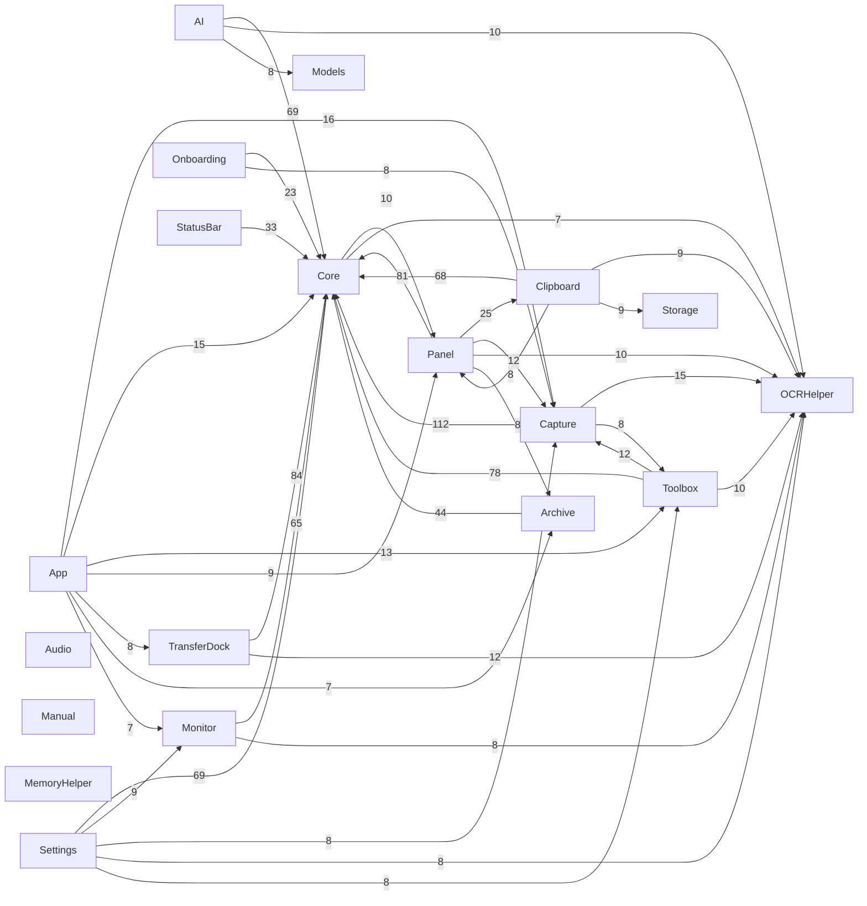

# FrsetNext 模块依赖与规模

> 自动生成，重算：`python3 tools/swift_catalog.py`　共 19 个模块 / 241 文件 / 75,652 行 / 11,719 个成员

## 模块规模

| 模块 | 文件 | 行数 | 成员 |
|---|---:|---:|---:|
| Capture | 39 | 13,328 | 2397 |
| TransferDock | 26 | 9,876 | 1369 |
| Panel | 20 | 7,970 | 1185 |
| Monitor | 23 | 7,666 | 1277 |
| Toolbox | 23 | 6,010 | 860 |
| Clipboard | 16 | 5,989 | 972 |
| Archive | 14 | 5,663 | 744 |
| AI | 25 | 4,500 | 807 |
| Settings | 13 | 4,367 | 397 |
| Core | 18 | 2,950 | 565 |
| StatusBar | 7 | 2,432 | 436 |
| Onboarding | 6 | 1,236 | 114 |
| Manual | 2 | 990 | 142 |
| App | 2 | 886 | 78 |
| Storage | 1 | 622 | 93 |
| Models | 2 | 522 | 141 |
| Audio | 1 | 330 | 74 |
| MemoryHelper | 1 | 185 | 40 |
| OCRHelper | 2 | 130 | 28 |

## 模块依赖（顶层类型被跨模块引用，边权=引用到的类型数）

## 高复杂度成员 Top 30

| 复杂度 | 行数 | 成员 | 位置 |
|---:|---:|---|---|
| 59 | 61 | ShortcutManager.keyText | `Features/Toolbox/ShortcutManager.swift:223` |
| 55 | 12 | PreviewMarkdownRenderer.keywords | `Features/Panel/PreviewMarkdownRenderer.swift:542` |
| 24 | 28 | ColorKeyControl.swatch | `Features/Settings/MonitorWidgetsPane.swift:786` |
| 23 | 23 | CodeLanguage.keywords | `Features/Toolbox/ToolConverters.swift:410` |
| 22 | 49 | SearchSectionView.listContent | `Features/Toolbox/SearchSectionView.swift:646` |
| 19 | 20 | FilePreviewBuilder.kindLabel | `Features/TransferDock/FileHoverPreview.swift:128` |
| 18 | 225 | AISettingsPane.body | `Features/AI/AISettingsPane.swift:181` |
| 16 | 125 | MonitorWidgetsPane.optionGroups | `Features/Settings/MonitorWidgetsPane.swift:579` |
| 16 | 17 | SettingsUIState.applyPaneMapping | `Features/Settings/SettingsWindowController.swift:38` |
| 15 | 17 | AnnotationEditorWindow.root | `Features/Capture/AnnotationEditorWindow.swift:1198` |
| 14 | 32 | LongScreenshotCaptureStream.start | `Features/Capture/LongScreenshotCoordinator.swift:25` |
| 14 | 220 | TransferDockSettingsPane.body | `Features/TransferDock/TransferDockSettingsPane.swift:30` |
| 14 | 16 | PermissionCenter.quickStatus | `Features/Onboarding/PermissionCenter.swift:172` |
| 13 | 110 | NetworkStatsPanel.diagnosticsSection | `Features/Monitor/StatsModulePanels.swift:1054` |
| 13 | 76 | AdbPairingView.body | `Features/TransferDock/AdbPairingView.swift:33` |
| 13 | 14 | Phase.text | `Features/TransferDock/AdbQrPairing.swift:69` |
| 13 | 73 | TransferDockView.lanCard | `Features/TransferDock/TransferDockView.swift:545` |
| 13 | 16 | SearchEngine.logoAssetName | `Models/SearchEngine.swift:27` |
| 12 | 13 | CaptureModule.capture | `Features/Capture/CaptureModule.swift:126` |
| 12 | 11 | ManualBlock.id | `Features/Manual/ManualDocument.swift:64` |
| 12 | 52 | CastView.body | `Features/TransferDock/CastView.swift:88` |
| 12 | 58 | TransferDockView.cloudSection | `Features/TransferDock/TransferDockView.swift:825` |
| 12 | 11 | SearchServiceManager.builtInEngines | `Models/SearchEngine.swift:60` |
| 11 | 12 | AnnotationTool.title | `Features/Capture/AnnotationCompositor.swift:13` |
| 11 | 12 | AnnotationTool.shortcut | `Features/Capture/AnnotationCompositor.swift:28` |
| 11 | 13 | AnnotationTool.systemImage | `Features/Capture/AnnotationCompositor.swift:42` |
| 11 | 17 | AnnotationCanvasView.apply | `Features/Capture/AnnotationEditorWindow.swift:1029` |
| 11 | 12 | CaptureMode.title | `Features/Capture/CaptureEventBus.swift:40` |
| 11 | 13 | CaptureMode.systemImage | `Features/Capture/CaptureEventBus.swift:55` |
| 11 | 8 | MonitorPopoutWindowController.cancelDismiss | `Features/Monitor/MonitorPopoutWindow.swift:240` |
